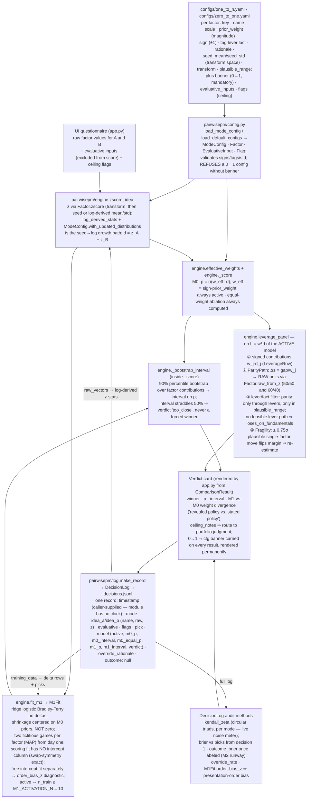

# PairwisePM — Architecture Leaf

leaf: architecture
derives_from: spine/SPINE.md (spine wins every conflict) · docs/technical-spec.md (locked contract)
status: finished halfway-draft for expert refinement

---

## 0. Reading guide

Three claims organize everything below:

1. **The runtime is mechanical.** Weights and a bias term; the engine's third-party
   surface is numpy + PyYAML and nothing else (~~"numpy only"~~ — struck round 20,
   §4.3.2: it was this leaf's own sentence, it was wrong in the same way in the §1
   diagram label and the §3 Adopt table, and `pairwisepm/config.py:218` imports `yaml`).
   No LLM, no API key, no network call ever leaves the process at decision time. The
   LLM's entire contribution was at build time — research, factor identification, this
   repository.
2. **The boundary between Space and local is a deployment boundary, not a code
   boundary.** The same `pairwisepm/` package runs in both; the Gradio Space adds only
   a UI shell and download/upload plumbing. Nothing user-generated persists server-side.
3. **The Build-vs-Adopt split is a product decision.** We adopt everything that is
   commodity plumbing and build exactly the four things that encode *how the PM
   thinks*: the GenAI factor schemas, the regression ladder with prior-centered
   shrinkage, the leverage/path-to-parity math, and the honesty rules. That is the
   moat (Section 3).

---

## 1. System diagram — subsystems and boundaries

Config feeds the engine; the engine feeds the UI; the UI appends to the log; the log
feeds back into the engine (z-scoring, M1 training, ζ/Brier audit). The log lives
**only** in the user's hands: in the Space it exists in browser-session memory until
downloaded; locally it is a plain file on disk.

```mermaid
flowchart LR
    subgraph CONFIG["CONFIG (editable YAML, ships with repo)"]
        direction TB
        C1["configs/one_to_n.yaml<br/>(1→N allocation schema)"]
        C2["configs/zero_to_one.yaml<br/>(0→1 search schema + banner + ceiling flag)"]
        C3["seed distributions live inside each factor<br/>(seed_mean/seed_std, transform space, until log grows)"]
    end

    subgraph ENGINE["ENGINE (pairwisepm/ — numpy + PyYAML, no LLM, no network;<br/>import purity instrumented §4.3.2)"]
        direction TB
        E1["z-scoring & delta<br/>d = z_A − z_B"]
        E2["Regression ladder<br/>M0 always · M1 ≥ ~10 decisions"]
        E3["Uncertainty & honesty<br/>bootstrap interval · too-close-to-call"]
        E4["Leverage panel math<br/>path to parity · lever/fact · fragility"]
        E5["Audit<br/>ζ (circular triads) · Brier · free-intercept diagnostic"]
    end

    subgraph UI["UI (app.py — Gradio, one screen, one sitting)"]
        direction TB
        U1["Questionnaire A + B<br/>+ mode toggle + 0→1 banner"]
        U2["Verdict card<br/>winner · p · interval · overrides shown"]
        U3["Leverage panel"]
        U4["Audit view"]
    end

    subgraph LOG["DECISION LOG (user-owned, JSONL)"]
        direction TB
        L1["decisions.jsonl<br/>append-only records"]
        L2["download / upload<br/>(Space) · plain file (local)"]
    end

    CONFIG --> ENGINE
    ENGINE --> UI
    UI -- "confirmed pick → append record" --> LOG
    LOG -- "history: z-stats · M1 training · ζ/Brier" --> ENGINE

    subgraph DEPLOY["Deployment boundary — same package both sides"]
        direction TB
        D1["HF Gradio Space<br/>stateless server: stores NOTHING;<br/>log lives in session, user downloads it"]
        D2["Local install (pip)<br/>log is a file on the user's disk"]
    end

    UI -.-> D1
    UI -.-> D2
```



**Boundary rules (normative):**

- CONFIG → ENGINE is one-way: the engine never writes config. User edits to priors are
  edits to YAML, versioned by the user. Config fingerprinting of log records (§4.1)
  is IMPLEMENTED (integration 2026-08-30) as the additive v1.1 key
  `config_fingerprint`.
- ENGINE ↔ LOG: the engine *reads* the whole log (z-stats, M1 training, audit) and
  *emits* one record per confirmed decision; the UI layer performs the actual append.
  The engine never mutates or rewrites past records — the log is append-only.
- UI holds zero math. Every number on screen is computed in `pairwisepm/` and is
  therefore reachable by `pytest` without Gradio.
- The Space process holds the log only in per-session memory (Gradio State). No
  server-side write, no analytics, no telemetry. Refusing server-side storage is a
  Spine commitment, not an implementation detail.

---

## 2. Component diagram — module flow through one decision



Notes the diagram compresses:

- **Which weights drive the leverage panel:** the active model's. Before M1 activates,
  `w = w_prior`; after, `w = w_M1`. The panel labels which regime produced it, because
  "path to parity" is advice and advice must name its source.
- **Evaluative inputs** (strategic fit, brand fit) flow Q → J directly. They are a
  separate `EvaluativeInput` type the engine never sees as factors — excluded from the
  score by type, not convention. They render on the verdict card as labeled override
  inputs only.
- **The Ceiling flag** (0→1 only) bypasses scoring entirely: `compare(..., ceiling_a,
  ceiling_b)` carries it to `ceiling_notes` and re-routes the verdict text. The `Flag`
  dataclass has no weight field — unweighted by construction.
- **M2/M3** exist only as the `outcome: null` slot in the log schema plus
  `DecisionLog.outcome_brier()` (returns None until outcomes are labeled). No
  speculative code ships.

---

## 3. Build vs. Adopt — where the moat lives

The split is a product decision. Everything adopted is commodity: replaceable
tomorrow with no loss of identity. Everything built encodes **how the PM thinks** —
judgment turned into config and math — and is the reason this tool is not a RICE
spreadsheet with better fonts.

### Adopt / reuse (commodity — zero differentiation, zero maintenance ambition)

| Component | What we adopt | Why adopt, not build |
|---|---|---|
| Numerics | **numpy** (one of the engine's TWO third-party runtime deps; `pyproject.toml` `dependencies = ["numpy>=1.24", "PyYAML>=6.0"]`) | σ, ridge solves, bootstrap resampling are solved problems; also enforces the no-LLM/no-network Spine rule by making heavy deps conspicuous |
| UI framework | **Gradio** (Blocks) | One-screen questionnaire + cards is exactly Gradio's sweet spot; buys HF Space deployment for free |
| Hosting | **Hugging Face Spaces** | Free, discoverable by the target PM audience, and *stateless by our choice* — its persistence features are deliberately unused |
| Testing | **pytest** | Standard; the engine is pure functions, so plain asserts suffice |
| Config format | **YAML**, parsed by **PyYAML>=6.0** — a hard, pinned, non-optional engine dependency, not an "e.g." | Human-editable priors are a Spine commitment; PMs can read and edit YAML without us building a config UI |
| Packaging | **pip / pyproject.toml** | Standard install path is the whole point of "clones/installs locally" |
| Serialization | **JSONL** (stdlib `json`) | Append-only, greppable, uploadable, schema-evolvable via the null outcome slot |

**Round-20 correction to the two rows above, kept legible rather than reworded away.**
The Numerics row read *"numpy (sole runtime dependency of the engine)"* and the Config
row read *"YAML (stdlib-adjacent parser, e.g. pyyaml)"*. Both are false against this
project's own packaging contract — `pyproject.toml` declares
`dependencies = ["numpy>=1.24", "PyYAML>=6.0"]` — and against **eight** later
statements in this very file that say numpy + PyYAML correctly (§4.2 purity invariant,
§4.3 layout tree ×3, §4.3 packaging contract, §5.15, §5.16, §5.17). So the ADOPT
table, which is the half of the moat argument a reader quotes, was the only place in
this leaf that misnamed what we adopt, and it misnamed it in the direction that makes
the moat look cleaner than it is. Measured, not reasoned (own run, fresh interpreter,
nothing mutated): importing `pairwisepm` loads **218 modules**, third-party
top-levels = `numpy`, `yaml` (plus `cython_runtime`, a numpy artifact). The full
dependency-boundary census is §4.3.2. *A Build-vs-Adopt table whose Adopt column is
one dependency short is not a moat argument, it is an advertisement.*

### Build (the moat — this IS the product)

| Component | What we build | Why it cannot be adopted |
|---|---|---|
| **GenAI factor schemas** | The two mode-specific factor sets — scales anchored in GenAI reality (capability-trajectory exposure, GenAI-necessity, unit economics vs. inference cost, data flywheel), prior weights, signs, written rationales, lever\|fact tags, seed distributions | No generic prioritization framework knows that "will the next frontier model absorb this?" is a factor, or that inference cost belongs inside unit economics. The schema *is* the researched judgment; it is why the questionnaire asks the right questions |
| **Regression ladder w/ prior-centered shrinkage** | M0 prior scorer; M1 ridge logistic Bradley-Terry whose L2 shrinkage centers on M0's priors rather than zero; MAP regularization from day one; zero-intercept scoring constraint with the free-intercept order-bias diagnostic; equal-weight ablation; activation gates | Off-the-shelf logistic regression shrinks toward zero — i.e., toward "nothing matters." Centering shrinkage on the stated policy makes small-n learning *deviation from your own declared priors*, which is the product's epistemics. No library ships that stance |
| **Leverage / path-to-parity math** | Signed-contribution decomposition; smallest single-factor raw-unit change to 50/50 and 60/40; the lever/fact filter ("no working-harder path flips this"); the fragility flag | This converts a probability into a PM's next action. The raw-unit conversion (z-shift × factor std, in interviews or person-weeks) and the refusal to propose parity through facts are product judgment, not math routine |
| **Honesty rules** | Bootstrap intervals shown always; "too close to call" when the interval straddles 50%; the permanent 0→1 no-accuracy banner; evaluative factors excluded from the score but displayed; Ceiling-flag routing to human judgment; ζ and Brier from decision 1 | These are the Spine's refusals made executable. A judge that overstates confidence is worse than no judge; every one of these rules exists to keep the tool ignorable-for-the-right-reasons. No dependency can carry a refusal for you |

**Litmus test used for every future component:** *if a competitor copied it verbatim,
would the product lose identity?* Copying our Gradio layout loses nothing; copying
the factor YAML, the prior-centered shrinkage, the parity math, or the honesty rules
copies the product. Build those; adopt the rest.

---

## 4. Data-flow contract (what other Leaves build against)

### 4.1 File formats

**Factor config — `configs/one_to_n.yaml`, `configs/zero_to_one.yaml`** (one file per
mode; contents per the locked tables in technical-spec §2; prior magnitudes pending
Decisions D1/D2 — they are config, not code; this is the AS-BUILT shape,
`pairwisepm/config.py` is the loader):

```yaml
mode: one_to_n                  # "one_to_n" | "zero_to_one"
label: "1→N (allocation)"
banner: null                    # MANDATORY non-empty string in zero_to_one.yaml —
                                # the loader raises ValueError without it
factors:
  - key: impact_primary_metric  # unique snake_case
    name: "Impact on primary metric"
    scale: "vs. a named past feature, −2..+2"   # human-readable anchor text
    prior_weight: 0.25          # MAGNITUDE; effective weight = sign * prior_weight
    sign: 1                     # +1 | -1 (effort / cost-to-test are -1)
    tag: lever                  # lever | fact
    rationale: "…written rationale, rendered in UI help…"
    seed_mean: 0.0              # seed z-distribution, in TRANSFORM space,
    seed_std: 1.0               #   used until the log grows (std must be > 0)
    transform: identity         # identity | log10p (log10(1+x); Reach uses this)
    plausible_range: [-2, 2]    # raw-unit bounds for path-to-parity feasibility
  # … remaining factors per spec §2 …
evaluative_inputs:              # captured & displayed, NEVER scored (separate type)
  - {key: strategic_fit, name: "Strategic fit", scale: "0–4", note: "not scored — labeled override input"}
  - {key: brand_fit,     name: "Brand fit",     scale: "0–4", note: "not scored — labeled override input"}
flags:                          # zero_to_one.yaml only; Flag has NO weight field
  - {key: ceiling, name: "Ceiling", description: "Top-box flag … unweighted; routes to human portfolio judgment"}
```

`config.py` validates (sign ∈ {+1, −1}; tag ∈ {lever, fact}; seed_std > 0; keys
unique; 0→1 banner present) and loads into frozen dataclasses (`ModeConfig`,
`Factor`, `EvaluativeInput`, `Flag`). **Config fingerprinting** is IMPLEMENTED
(integration 2026-08-30): `config.config_fingerprint(data)` computes the FULL
sha256 hex digest over the canonical form of the parsed YAML (JSON, sorted keys —
reformatting never changes it, any semantic edit always does; the full digest was
chosen over the earlier `[:12]` sketch since record size is immaterial and
truncation only buys collisions). `ModeConfig.fingerprint` carries it,
`make_record(..., config_fingerprint=)` stamps it into every record (null for
pre-v1.1 callers), and `app.py` passes it on every logged decision. Additive key,
safe under the ignore-unknown-keys rule; pinned by T-FPR in `tests/test_engine.py`.

**Decision log — `decisions.jsonl`**, one JSON object per line, append-only
(as built by `pairwisepm/log.make_record`, `schema_version: 1`):

```json
{
  "schema_version": 1,
  "timestamp": "2026-08-30T14:12:03Z",
  "mode": "one_to_n",
  "config_fingerprint": "a7eab7c9039cf261…(64 hex — sha256 of the canonical config; null in pre-v1.1 records)",
  "idea_a": {"name": "…", "raw": {"impact_primary_metric": 1.0}, "z": {"impact_primary_metric": 1.0}},
  "idea_b": {"name": "…", "raw": {"impact_primary_metric": 0.0}, "z": {"impact_primary_metric": 0.0}},
  "evaluative": {"a": {"strategic_fit": 3}, "b": {"strategic_fit": 1}},
  "flags": {"a": {"ceiling": false}, "b": {"ceiling": false}},
  "pick": "A",
  "model": {
    "active": "M0",
    "m0_p": 0.64, "m0_interval": [0.55, 0.72],
    "m0_equal_p": 0.61,
    "m1_p": null, "m1_interval": null,
    "verdict": "A"
  },
  "override_rationale": null,
  "outcome": null
}
```

Rules: `timestamp` is caller-supplied (the log module has no clock and no network —
nothing can invent provenance). `pick` ∈ {"A", "B"} is what the user chose; it may
differ from `model.verdict`, in which case the UI requires a rationale before append
(`override_rationale` non-null ⇔ override). `m1_p`/`m1_interval` are `null` until an
M1 fit exists. `outcome` stays `null` until a future labeling flow (M2) — the slot
ships now so no migration is ever needed. Unknown keys must be ignored by all
readers (forward compatibility) — this is what makes `config_fingerprint` a safe
v1.1 addition.

### 4.2 Module boundaries (`pairwisepm/` public surface)

The package is four modules — same responsibilities, few seams
(as built by Engineering; this table is the surface other leaves rely on):

| Module | Public surface (signatures other leaves rely on) |
|---|---|
| `pairwisepm.config` | `load_mode_config(path) -> ModeConfig` · `load_default_configs(config_dir=None) -> {"one_to_n": ModeConfig, "zero_to_one": ModeConfig}` · `default_config_dir()` (resolves `Path(__file__).parent.parent / "configs"`) · types `Factor` (`.effective_weight`, `.zscore`, `.raw_from_z`, `.in_plausible_range`), `EvaluativeInput`, `Flag`, `ModeConfig` (`.factor_keys`, `.factor(key)`, `.with_updated_distributions(stats)`) |
| `pairwisepm.engine` | `compare(cfg, raw_a, raw_b, m1_fit=None, ceiling_a=False, ceiling_b=False, n_boot=2000, seed=7) -> ComparisonResult` (fields: `m0`, `m0_equal`, `m1`, `active_model`, `active`, `leverage`, `parity_paths`, `loses_on_fundamentals`, `fragility`, `ceiling_notes`, `banner`) · `fit_m1(delta_rows, picks, cfg, lam=1.0) -> M1Fit` (`.weights`, `.n_train`, `.free_intercept`, `.free_intercept_se`, `.order_bias_z`, `.order_bias_flagged` (\|z\|>2), `.active` ⇔ n ≥ `M1_ACTIVATION_N` = 10) · `zscore_idea`, `log_derived_stats`, `effective_weights(cfg, equal=False)`, `leverage_panel`, `sigmoid` · constants `M1_ACTIVATION_N = 10`, `FRAGILITY_Z = 0.75` |
| `pairwisepm.strings` | **Vendored copy of `leaves/design/strings.py` (design is the single source of truth; the package copy must stay byte-identical).** Byte-identity of the two SOURCE files re-verified (`cmp`, own run round 13) and guarded by `tests/test_vendoring.py` (T-VEND-01, matrix row F-25, pre-push gate P-9), which fails the suite on drift in either direction, skipping only in a stripped deployment where the design leaf is absent. **Scope correction, round 13 (§5.14), CLOSED round 15 (§5.16) — retained in full because the correction is the durable part.** T-VEND-01 was never self-enforcing as this section originally claimed: it compares two paths derived from its own `__file__` and never imports `pairwisepm.strings`, so it certifies the file on disk, not the module the interpreter binds. With the venv's stale non-editable install present, a session started outside the repo root imported the drifted site-packages copy AND T-VEND-01 still reported green — rule applied, rule not effective. **What closes it is not the install fix but the instrument set:** the boundary is now enforced by three guards with three distinct scopes — T-VEND-01 (bytes on disk), T-VEND-02 (the identity and bytes of the module actually bound), T-VEND-04 (the count of importable copies across `sys.path`) — plus T-VEND-05 (the VALUES the bound module serves, the only clause that speaks in a stripped install), and by T-VEND-03 (resolution) and T-VEND-06 (freshness) for the config authority. **This section no longer states the copy count in prose; §4.3.1 is the census, and every row of it names the test that reds when the row goes false — and, as of round 16, the trees in which that test actually runs.** T-VEND-01 is retained unchanged: it honestly claims what it measures and was never the thing that was wrong. Pure data + two pure helpers, zero dependencies. Exports the five compliance-pinned constants (`PINNED_TOO_CLOSE`, `PINNED_FUNDAMENTALS`, `PINNED_CEILING`, `PINNED_FRAGILITY_TMPL`, `PINNED_BANNER_01`), the `STRINGS` id→template map, and `prob_token()` (MP-1: no API renders p without its interval). Imported by `engine.py` (ceiling/fragility note text) and `app.py` (all copy keyed off `STRINGS` ids). **Singular-variant selection (as built, round 9):** count-bearing IDs have `*_one` companions that DROP count slots rather than rename placeholders; `app.py` routes every such call site through one selector `_S_n(base_id, n)` (`app.py:56`) which appends `_one` when the count is exactly 1 and passes the full kwarg set (`str.format` ignores unused kwargs) — one call site serves both variants, zero desynchronization surface. Catalogued-but-unwired IDs (e.g. `str.log.loaded_one`) are design inventory, not a boundary concern |
| `pairwisepm.log` | `make_record(timestamp, mode, name_a, name_b, raw_a, raw_b, result, pick, evaluative_a/b, flags_a/b, override_rationale) -> dict` · `DecisionLog` (`.append`, `.to_jsonl`, `.from_jsonl`, `.for_mode`, `.n(mode)`, `.training_data(cfg) -> (delta_rows, picks)`, `.raw_vectors(mode)`, `.kendall_zeta(mode) -> float\|None`, `.brier(mode)`, `.outcome_brier(mode)`, `.override_rate(mode)`) — every audit statistic is per-mode-partitionable, as the Design leaf requires |

Every `ModelScore` carries `interval` — there is no path that produces a probability
without one, satisfying Design's "no naked probabilities" contract. The free-intercept
diagnostic exposes both a value (`free_intercept`) and a significance gate
(`order_bias_flagged`), satisfying the S7 audit row.

Invariants every module preserves (tests enforce them — `tests/test_engine.py`):

- **Swap symmetry:** scoring (B, A) yields exactly `1 − p` (logits negate) for M0,
  M0-equal, and M1, and a mirrored leverage panel. Guaranteed by the zero-intercept
  constraint (the scoring design matrix has no intercept column) and by the
  order-symmetric fictitious-games pair.
- **Purity:** engine functions are deterministic given (inputs, seed); the engine does
  no I/O; `config.py` reads YAML, `log.py` (de)serializes JSONL and has no clock; no
  imports beyond numpy + stdlib (+ pyyaml in the loader, + the dependency-free
  `pairwisepm.strings` data module for engine-attached copy). Gradio exists only in
  `app.py`.
- **Copy vendoring is one-way:** `leaves/design/strings.py` is the single source of
  truth for user-facing copy; `pairwisepm/strings.py` is its byte-identical vendored
  mirror (design cannot write inside the package). Any copy change lands in design's
  file first, then is mirrored verbatim — editing the package copy directly is
  boundary smuggling. STATUS (round 3): CLOSED and SELF-ENFORCING. Engineering
  re-vendored the mirror (byte-identity re-verified by `cmp` this round) and landed
  `tests/test_vendoring.py` (T-VEND-01) in the same change, exactly as demanded:
  the test fails the suite on drift in *either* direction — a stale mirror and a
  smuggled package-edit are now equally undetectable-proof. The round-2 drift
  episode (authority ahead 22:08, re-vendored 22:11) stands in the spec as the
  observed failure mode this guard addresses. The boundary has graduated from
  discipline-enforced to test-enforced; no standing ask remains.
- **Honesty gates run last:** the verdict string is derived from the interval
  (`too_close`), ceiling flags, and mode banner *after* all scoring — the UI cannot
  render a winner the honesty layer suppressed. The straddle test is inclusive
  as-built (`lo <= 0.5 <= hi or p == 0.5` ⇒ `too_close`, `engine.py` verdict
  derivation — verified 2026-08-30): an endpoint exactly at 0.5 breaks toward
  `too_close`, never toward a winner (see §5.2).

### 4.3 Repository layout (deployment contract)

```
pairwisepm/            # engine package: config.py, engine.py, log.py (numpy+pyyaml)
                       #   + strings.py (vendored byte-identical from leaves/design/)
configs/               # one_to_n.yaml, zero_to_one.yaml — weights are config, not code
app.py                 # Gradio UI shell (no math); exposes module-level `demo` for Spaces
tests/                 # test_engine.py (architecture's invariant suite, engine-only,
                       #   no Gradio) + test_vendoring.py (T-VEND-01 byte-identity
                       #   on disk, T-VEND-02 bound-module identity+bytes, T-VEND-03
                       #   loaded config dir, T-VEND-04 importable-copy COUNT,
                       #   T-VEND-05 the R-10 VALUES the bound module serves,
                       #   T-VEND-06 freshness of a permitted configs duplicate,
                       #   T-VEND-07 the file's own floor: it cannot return an
                       #   all-skipped green (compliance, round 17 — the clause that
                       #   makes a green here readable at all) — the
                       #   copy census of §4.3.1 is enforced by these seven and not by
                       #   the prose that used to state it; §4.3.1 also records which
                       #   of them RUN in which tree, since through round 15 all of
                       #   them gated on the design leaf's presence and the sdist
                       #   include list below ships tests/ without leaves/)
                       #   + test_packaging.py (incl. T-SER-01
                       #   serialization guard, T-THEME-01/01b theme guards,
                       #   T-BANNER-01 — Gradio imported by tests only via
                       #   importorskip, never by pairwisepm/)
                       #   + test_copy_surfaces.py (compliance's copy guards on the
                       #   two populations OUTSIDE the string catalogue: T-COPY-01/01b
                       #   stub + key-echo, T-COPY-02/02b the diff against design's
                       #   ratified fixture, T-COPY-02c the checked exemption citation,
                       #   T-COPY-02d the dataclass-derived field census, T-COPY-02e the
                       #   AST guard on app.py:73's import-time banner assert — the
                       #   guard on the guard, landed round 19 — the round-20 AST clause
                       #   on app.py's pick question (design §6.19(iii)), T-COPY-03 the
                       #   file's own floor — 12 passed / 0 skipped here, and 10 passed /
                       #   2 skipped in a tree without leaves/, the two skips being the
                       #   fixture-dependent pair on their own subject: §4.3.1 B1)
                       #   + test_audit_honesty.py (compliance round 19, 2 clauses:
                       #   T-NEG-09 the 0→1 no-prediction caption's ARRIVAL on the audit
                       #   surface, T-NEG-09b the census of that view's pooled
                       #   statistics — the file that made the offline guard's
                       #   order-dependence observable, §4.3.2)
                       #   + conftest.py;
                       #   full suite 83/83 FROM THE REPO ROOT **AND** 83/83 from /tmp
                       #   (own runs round 20, project venv, 1.46s / 1.46s — and it read
                       #   81/81 twenty minutes earlier in the SAME round, see §5.20;
                       #   the pin read
                       #   72/72 at round 16, 73/73 at round 18 and 78/78 at round 19 —
                       #   the INTEGER moves whenever another seat lands a clause and is
                       #   not the thing certified here; it was also 79-passed-1-FAILED
                       #   for part of round 19, which is the strongest argument on this
                       #   board against quoting a pin you did not just run);
                       #   through round 14 those were two different numbers against
                       #   two different modules and every packet quoted them as one,
                       #   see §5.16 — what this leaf certifies is the EQUALITY and
                       #   the module behind it, not the integer)
                       #   + test_engine_spec.md (Compliance leaf's full test spec)
decisions.sample.jsonl # worked example log, generated by the REAL engine; record 1 is
                       #   the canonical GTM demo pair (leaves/gtm/seed-comparison.json:
                       #   L = 0.345, p = 58.5%, 90% CI [52%, 64%] — reproduced exactly);
                       #   records 1–3 form a transitive triad (ζ = 1.0); record 4 is a
                       #   0→1 override example with a logged rationale
README.md              # HF Space YAML header (sdk: gradio, app_file: app.py) + the three
                       #   spec §7 epistemics statements + design's pinned 0→1 banner text
requirements.txt       # numpy, PyYAML, gradio — nothing else at runtime
pyproject.toml         # hatchling; deps numpy+PyYAML, gradio under [app] extra, pytest
                       #   under [dev]; configs/ force-included in the wheel
leaves/, spine/, docs/ # build methodology artifacts (not shipped in the wheel)
```

All files above exist as of the exchange round — tests/, README.md,
pyproject.toml, and decisions.sample.jsonl were provided by this leaf at
Engineering's request (they sit outside Engineering's paths).

Packaging contract: the wheel ships `pairwisepm/` plus `configs/` force-included at
site-packages root, so `config.default_config_dir()`'s
`Path(__file__).parent.parent / "configs"` resolution works identically from a git
clone and a pip install. `gradio` is an optional extra (`pip install pairwisepm[app]`);
the engine's runtime dependencies are numpy + PyYAML only.

#### 4.3.1 COPY CENSUS — both authorities, every site, each with its instrument

This census replaces the prose count ("exactly two copies") that stood here through
round 14. A count stated in a sentence is an honor system: it is what allowed a third
copy to exist undeclared for eleven rounds while six seats certified the boundary
green. **Every row below names the instrument that would fail if the row became
false.** A row with no instrument is written as having none.

**Round 16 adds a second column to every instrument, and it is not cosmetic.** An
instrument has a SCOPE (what it measures) and an ACTIVATION (the trees in which it
runs at all). Round 15's census named scope only, which is the same half-measure it
was written to end: through round 15 every guard here gated on
`_in_repo_checkout()` — the presence of `leaves/design/strings.py` — so T-VEND-03/04/06
were inert in exactly the tree where their hazard is created, and a green suite could
not be told apart from four skips. That is engineering's finding, not mine; it is the
mirror of A-13-01 (there, a guard whose SCOPE was narrower than its claim; here, a
guard whose ACTIVATION was narrower than its SUBJECT) and it is fixed in
`tests/test_vendoring.py` as of this round. **A census that names an instrument
without naming when it runs is still an honor system**, so ACTIVATION is now a
first-class census field.

**Authority A — `strings.py` (design owns the source of truth).**

| # | Site | Status | Instrument (scope) | Activation |
|---|---|---|---|---|
| A1 | `leaves/design/strings.py` | THE authority | — (it is the referent) | — |
| A2 | `pairwisepm/strings.py` | vendored mirror, must be byte-identical | T-VEND-01 (bytes on disk), **T-VEND-02** (the bytes of the module the interpreter actually *binds*) | repo checkout only — skips without the authority file, and that skip is HONEST: their subject *is* `leaves/design/strings.py` |
| A3 | any installed copy in `site-packages/pairwisepm/` | **FORBIDDEN** — must not exist | **T-VEND-04** (counts importable `pairwisepm/__init__.py` across `sys.path`; asserts at most one, the repo's) | **never skips** (round 16) — its subject is `sys.path`, which exists in every tree |
| A4 | the copy a *shipped* install serves | must carry the R-10 values | **T-VEND-05** (value-level: `str.empty.example_cta` present, `str.verdict.stale` states the manual-Compare flow) | **never skips** — the only clause here that speaks in a stripped install |

A3 is the row A-13-01 occupied. It is CLOSED as of round 15 — the install is editable
(`direct_url.json` = `{"dir_info": {"editable": true}}`, `_editable_impl_pairwisepm.pth`,
no `site-packages/pairwisepm/` directory) — and, more importantly, it is now *counted*
rather than *remembered*: `pip install .` into this venv recreates the defect in one
command with no other symptom, and T-VEND-04 is the only thing standing between that
command and another eleven rounds of green certification.

**Authority B — `configs/*.yaml` (the mode schemas). Two populations in one file:
the POLICY VALUES — `prior_weight`, `sign`, `seed_mean`, `seed_std`, `transform`,
`plausible_range` — and RENDERED COPY. The census names both, because "configs is
where the numbers live" is the description every seat including me has been using,
and it is half the file.**

**The copy half, CORRECTED round 18 on design's demand and then corrected again
against design's replacement figure — call sites walked from this seat, not taken on
report.** Design asked me to change "seven rendered fields" to four. The first half of
their correction is right and I confirmed it by grepping for the call sites rather
than for the field names: **`flags[].name`, `flags[].description`,
`evaluative_inputs[].name` and `evaluative_inputs[].note` reach no browser** — the
ceiling checkbox label is `S["str.factor.ceiling_label"]` (`app.py:861/865`), the
ceiling routing copy is the engine's `PINNED_CEILING` (`engine.py:598`), and
`cfg.evaluative_inputs` has **no render site in `app.py` at all** (its only two
appearances, `:124` and `:700`, are the GTM seed dict, a different object). Two
corrections in the other direction, both of which make the corrected figure wrong:

1. **The declared population was EIGHT names, not seven.** `label` + three `factors[]`
   + two `flags[]` + two `evaluative_inputs[]` = 8. "Seven" has been carried by my
   file, by design's §6.15 and by design's own new fixture (whose header says "three
   of the seven fields … do not render" while its `render_map` lists **four** DOES NOT
   RENDER rows). Both figures are wrong and they cancel: 7−3 and 8−4 both land on 4.
   This one is mine to own — I published the seven.
2. **`banner` renders and was on nobody's list.** `configs/zero_to_one.yaml:17`
   carries a `banner:` string; `app.py:91` escapes it into `BANNER_HTML` and
   `app.py:832` mounts it, `app.py:738` making it visible in 0→1 mode. Verified by
   loading both schemas from this interpreter: `zero_to_one.banner` is the
   structure-not-prediction paragraph, `one_to_n.banner` is `None`. It is a config
   text field that paints, permanently and fixed to the top of the viewport (M-UX-03).

**So the copy half is FIVE rendering fields — `banner`, `label`,
`factors[].name`, `factors[].scale` (shadowed for `risk_surface` by
`S["str.factor.risk_label_suffix"]`, `app.py:752`), `factors[].rationale` — and four
declared-but-dead ones.** The dead four are not therefore harmless and I am not asking
anyone to treat them as such: dead text is one call site away from live, which is
engineering's edit-class ruling and it should not weaken on my say-so.

| # | Site | Status | Instrument (scope) | Activation |
|---|---|---|---|---|
| B1 | `configs/one_to_n.yaml`, `configs/zero_to_one.yaml` | THE authority — policy values *and* rendered copy | — (it is the referent). **Round 17** replaced this cell's "no instrument" with a PARTIAL one — **T-COPY-01 / 01b (F-32)**, which reds on a placeholder or a leaked machine key. **Round 18 splits the copy half in two, because its two halves have different authorities.** (a) `banner` — **APPROVAL-INSTRUMENTED, and it is the only one**: `app.py:73` asserts `Z2O.banner == S["str.banner.01"]` at import, so this field's authority is Authority A and a drift reds before first paint. Verified equal from a live load this round. (b) `label`, `factors[].name/.scale/.rationale` — **INSTRUMENTED as of round 19, and the word PENDING is struck rather than reworded away**: **T-COPY-02** (`test_config_rendered_text_matches_design_ratified_fixture`) diffs the live schema against `leaves/design/copy-authority.yaml` **in both directions**, with **T-COPY-02b** on the four `app.py` labels and **T-COPY-02d** deriving the field census from the dataclass annotations so no hand list can go stale. **Read before citing, per this section's own rule:** T-COPY-02's population is the NINE declared config text names, of which five render — it answers *is this the text design ratified*, for rendering and dead fields alike, which is a **different question** from T-VEND-06's *do the reachable copies agree*. Both questions are now answered, by different instruments, and neither answers the other. `banner` is NOT in T-COPY-02's diff: it is exempt to Authority A, and **T-COPY-02c checks the exemption's citation** (the two `tests/test_engine.py` clauses exist by AST and still name `str.banner.01`) | T-COPY-01/01b: never skip. **T-COPY-02 / 02b: skip without `leaves/design/copy-authority.yaml`, and that skip is HONEST — their subject IS design's fixture** (own run, sdist-shaped scratch tree: 8 passed, **2 skipped**, both named at `test_copy_surfaces.py:242`; 10 passed / 0 skipped in this checkout). T-COPY-02c/02d: never skip where `tests/` exists. The `banner` assert: **never skips and cannot be skipped** — it is an import-time `assert` in the module under test, not a test clause |
| B2 | `site-packages/configs/*.yaml`, from `[tool.hatch.build.targets.wheel.force-include] "configs" = "configs"` | **PERMITTED BY DESIGN**; load-bearing on a non-editable install, present-but-inert on an editable one — **created by BOTH** (correction, §5.17) | **T-VEND-03** (resolution: the dir the engine *loads* is the repo's — **content-blind, it inspects no field of either population**) + **T-VEND-06 / F-31** (freshness: a duplicate on `sys.path` must not have drifted from the tree-local authority — a **byte** comparison, so it covers BOTH populations, and only ever for copy-to-copy drift) | **positional, not merely conditional** — see "T-VEND-06's activation, mapped against the packaging contract" below. Round 16 replaced the design-leaf skip with `<root>/configs`; round 17 states what `<root>` resolves to in each of the three trees |

**The pending instrument's own scope, checked before citing it (round 18).** Design
asked me to move B1's cell off "none" on the strength of
`leaves/design/copy-authority.yaml`. I cite it, and I read it first, because a census
that takes an instrument's coverage from the packet announcing it is the honor system
one level up — the same failure this section was written to end. Two facts about the
fixture as it stands today, both filed to design as a demand rather than fixed here,
since those are design's bytes and not mine to touch:

- **`banner` is absent from it — from the `render_map` and from the ratified bytes
  alike.** `grep banner leaves/design/copy-authority.yaml` returns nothing. So the
  diff test compliance has been asked to write, against the fixture as specified
  today, would be green over a changed banner. The fixture's own header says
  `render_map` "states which ratified fields actually reach a browser", and the one
  rendered field it omits is the one carrying a Spine refusal onto the screen: *"0→1
  mode structures your search. It does not predict product–market fit."* — the Spine's
  "0→1 mode never claims predictive accuracy," and its "a judge that overstates its
  confidence is worse than no judge."
- **The exposure is nonetheless CLOSED, by a different instrument than the fixture.**
  This is the half that matters to my seat and the reason the finding is not an alarm:
  `app.py:73`'s import assert already binds `banner` to `S["str.banner.01"]`, so a
  banner edit in the config cannot reach a user — it stops the process at import. What
  the gap costs is not coverage, it is **legibility of the boundary**: a reader of the
  fixture concludes the config copy population is one thing with one destination, when
  it is two things with two authorities.
- **`evaluative_inputs[].scale`** is ratified in the fixture's bytes (both schemas,
  `"0–4"`) with no `render_map` row at all — a ninth name carrying no render verdict
  either way. It does not render; nothing turns on it; it should say so.

**Round 19 — what happened to that finding, stated as a state change rather than as a
victory, with the superseded half left standing above.** The first bullet's operative
sentence ("the diff test … would be green over a changed banner") was true of the
fixture and is now **false of the instrument**, and it was closed by a move I had not
proposed: compliance did not add `banner` to design's fixture (which is the move I
refused for myself in round 18, and refusing it was right — see the ruling below), they
made the EXEMPTION checkable. `_RATIFIED_ELSEWHERE` in `tests/test_copy_surfaces.py:88`
names `banner → str.banner.01 → tests/test_engine.py::{test_zero_to_one_banner_mandatory,
test_banner_attached_and_wording}`, and **T-COPY-02c asserts that citation is real**:
the file exists, both clauses exist by AST, and each still references
`str.banner.01`. I read the two cited clauses before recording this rather than taking
the citation on report — `test_engine.py:215` asserts
`shipped["zero_to_one"].banner == STRINGS["str.banner.01"]` (and `one_to_n.banner is
None`), `:784` asserts the served verdict carries the same string. So `banner`'s
coverage now has three layers with three different failure moments: the import assert
(process does not start), the two engine clauses (suite reds), and the citation guard
(reds when either clause is renamed or drifts off the key). The fixture still does not
contain the field, and on the boundary reading below **it should not**.

**The ACTIVATION asymmetry this creates, which is a census fact nobody has stated and
is mine to state.** Off a checkout, the copy half's two governance forms behave in
OPPOSITE directions, and the direction is the reassuring one only by accident of which
authority each field routes to. Measured, not predicted — sdist-shaped scratch tree
(`pairwisepm/`, `configs/`, `app.py`, `tests/`, no `leaves/`), own run this round:

| Field | Governance form | Checkout | sdist tree (no `leaves/`) | wheel |
|---|---|---|---|---|
| `banner` | Authority A cross-reference | asserted (import + 2 clauses + citation guard) | **still asserted** — `test_engine.py -k banner` = 2 passed there | absent (no `tests/`) |
| `label`, `factors[].name/.scale/.rationale` | design fixture diff | T-COPY-02/02b assert | **SKIP** — 8 passed, **2 skipped**, `test_copy_surfaces.py:242`, "no design copy authority in this tree" | absent |

The skip is honest — the subject of those two clauses *is* `leaves/design/copy-authority.yaml`,
which the sdist `include` list does not ship — but the consequence belongs in the
census rather than in a test file: **the approval question is answered off-checkout for
exactly the one field that delegates to Authority A, and goes silent for the four that
needed a fixture invented for them.** A fixture-governed field is only guarded where
the design leaf is present; a cross-referenced field is guarded wherever the package
is. That is the same shape as the A2-vs-A4 split one authority up, and it is the
strongest argument on this board for preferring cross-reference to fixture wherever a
field HAS a counterpart.

**The ruling that follows, and I am making it rather than leaving it to be inferred,
because it is a boundary question and this is the boundary seat.** Compliance asked
design to choose between (a) ratifying `banner` into the fixture and (b) confirming its
authority is the catalogue's `str.banner.01`. They correctly refused to choose for
design. I am not design and I am not choosing for them either — but the two options are
not architecturally symmetric and the census should say which one preserves the
boundary: **(b).** Under (a) a single rendered string would have TWO ratification sites
— `leaves/design/strings.py` (Authority A, mirror-guarded by T-VEND-01/02) and
`leaves/design/copy-authority.yaml` (the fixture) — which are not the same file, do not
move together, and would then need a THIRD guard asserting the two ratifications agree.
One field, two authorities, one new instrument to reconcile them is the exact
complexity this seat exists to refuse; the census gap it would close is worth less than
the authority it would split. Under (b) nothing new is built: the fixture keeps a clean
predicate (*fields with no counterpart in Authority A*), the exemption is already
machine-checked, and the boundary stays legible in one sentence.

**The boundary fact this yields, which is the part that is mine.** Authority B's copy
half is not one population. It splits on a structural predicate, not on a judgment:
**does the field have a counterpart in Authority A?** `banner` does, and is therefore
governed by `strings.py` — design's own source of truth, mirror-guarded by
T-VEND-01/02 — with the config file holding a *replica* of design copy rather than an
original. The other four have no counterpart, which is exactly why they needed a
fixture invented for them. That is the same cross-reference pattern design named as
class (ii) in their app.py partition and called single-membered on `Compare`; it has a
second member, it lives in a different file, and it is the stronger of the two
governance forms because it fires at import rather than under `pytest`. The census
records the pattern once, here, rather than letting each seat rediscover it in its own
population.

**What no instrument on Authority B asserts, stated because compliance asked for one
clause and the clause is worth more said precisely (round 17).** Compliance's demand
was that this census not let a reader conclude "resolution + freshness covers
everything in those files." Accepted, with one correction in compliance's own favour:
their framing says T-VEND-03/06 are the guards for the VALUES half and "say nothing
about the text." That is right about T-VEND-03 and wrong about T-VEND-06 in the
direction that matters. **T-VEND-03 is content-blind** — it compares directory
identity and reads no field, so it is not the values half's content guard either.
**T-VEND-06 is a byte comparison**, so it watches every byte of both populations,
policy values and every text field alike — the five that render, the four that are
declared and dead, and `banner`, which no field list on this board had until round 18.
A byte comparison is the one instrument here that could not be made wrong by the
census's own miscount, which is worth saying plainly now that the miscount is
established. The gap is not a population,
it is a QUESTION: every instrument on this authority answers *do the reachable copies
agree*, and none answers *is this the text design approved*. Copy-to-copy agreement
and approval are different relations, and a census that named only the halves would
have implied the text is unguarded when in fact it is guarded for the wrong question —
which is the more dangerous of the two errors, because a reader who checks finds a
green byte-comparison over the exact fields. **The approval question is F-32, OPEN,
partial instrument (T-COPY-01/01b: exists, not a placeholder, not a key echo), and
the authority ruling is design's to make, not this census's to invent.** The
corresponding row for `app.py`'s literals is F-33. Both rows are cited here in their
round-16 form on compliance's own notice that a round-15 citation would have named
instruments that did not fire where the hazard is.

**Round 19 updates this paragraph and marks the update instead of rewriting the
sentence above, because that sentence records the state the board was in while the
question was open.** The approval question on Authority B is now ANSWERED: design ruled
the authority (the fixture) and compliance built the instruments (T-COPY-02/02b/02c/
02d). The two-questions framing is the part that survived, and it is now visible in the
instrument set rather than only in this prose — **no single test on this authority
answers both questions, and none pretends to: T-VEND-06 is a byte comparison between
copies and cannot see ratification; T-COPY-02 is a diff against a ratified fixture and
cannot see a second copy.** What remains open is a RULING, not a question: which of
compliance's (a)/(b) design takes on `banner` (my reading, on boundary grounds, is
recorded above as (b)).

**T-VEND-06's activation, mapped against the packaging contract — engineering's
correction accepted, and their conclusion survives a reason that has changed under
them (round 17).** Engineering asked me to stop carrying the prediction that
T-VEND-06 reds on a correctly-packaged non-editable install, citing
`tests/test_vendoring.py:154` and the `_in_repo_checkout()` skip. That citation is to
the round-15 predicate; compliance replaced it this round with `_repo_config_authority()`
(`<root>/configs`), so the stated mechanism is gone. **The conclusion is nonetheless
correct, and for a stronger reason than the one offered:** the guard is not skipped on
a wheel install, it is ABSENT from it. `[tool.hatch.build.targets.wheel]` ships
`packages = ["pairwisepm"]` plus the force-included `configs` and **no `tests`** —
verified from this machine's own `dist-info/RECORD`, which lists the two YAML files,
the `.pth` and the metadata, and zero `tests/` entries. So:

| Tree | `tests/` present? | `<root>` resolves to | T-VEND-06 |
|---|---|---|---|
| repo checkout (this machine) | yes | the repo | **runs**, authority = B1 |
| unpacked sdist (`include` ships `configs` + `tests`, not `leaves`) | yes | the sdist root | **runs**, authority = the sdist's own `configs` |
| wheel / non-editable install | **no** | — | **not installed; cannot run** |

The middle row is the finding this seat owes the census and it is a boundary fact, not
a test detail: **T-VEND-06's authority is POSITIONAL** — `authority = ROOT / "configs"`
where `ROOT` is derived from the test file's own location. It therefore asserts
*mutual agreement among the copies this interpreter can reach, anchored to whichever
`configs/` sits beside `tests/`* — which is B1 only in a repo checkout. In a
redistributed sdist the anchor is itself a copy. That is the honest scope, it is
narrower than "must match the repo authority," and it belongs in the census rather
than in a docstring because it is a dependency of an instrument on a packaging layout
— exactly the edge §4.3's contract was silently deciding before round 16.

**What this leaves of my prediction, scoped so it cannot be quoted wrong.** After the
D1/D2 write, T-VEND-06 reds **on a repo checkout that has a reachable duplicate**, and
nowhere else. Both halves verified from this seat this round rather than assumed:
`pytest tests/test_vendoring.py` is **6 passed, 0 skipped** here (full suite 72/72,
own run), and the loop is not passing vacuously — a `sys.path` walk from this
interpreter finds exactly one duplicate tree,
`<venv>/lib/python3.11/site-packages/configs`, so the guard executes two byte
comparisons rather than zero. A green here is an assertion that ran. The round-15
version of this prediction — that it would red on an install behaving as the packaging
contract specifies — is WITHDRAWN in §5.16 and is not restated anywhere in this file.

**B2's reason to exist, unchanged.** `default_config_dir()` resolves
`Path(__file__).parent.parent / "configs"`, so the force-include is exactly what makes
a non-editable `pip install pairwisepm` find its schemas at all. It is not a defect and
must not be deleted; removing it to satisfy a tidy census would break the install path
the packaging contract promises.

**B2's creation condition, CORRECTED this round against my own round-15 text.** Every
seat on this board, including me, has written B2 as an artifact of *non-editable*
installs. It is not. The current install is editable and it created B2 itself: the
`pairwisepm-0.1.0.dist-info/RECORD` of an install whose `direct_url.json` reads
`{"dir_info": {"editable": true}}` lists `configs/one_to_n.yaml` and
`configs/zero_to_one.yaml` with sha256 — and those two sha256 values equal the repo
files' digests, computed from B1 this round. The mechanism is ordinary hatchling: the
editable target derives from `[tool.hatch.build.targets.wheel]`, so it inherits the
`force-include`. Three consequences the old wording got wrong, all in the direction of
*more* exposure, not less:

1. **B2 is not conditional on anything anyone will do tomorrow.** It is on this
   machine now, at `<venv>/lib/python3.11/site-packages/configs/`, mtime `20:14`,
   `diff -rq` clean against B1 (own run).
2. **T-VEND-04 does not cover it, and cannot.** T-VEND-04 counts
   `pairwisepm/__init__.py`; today there is exactly one (the repo's, via
   `_editable_impl_pairwisepm.pth`) while a second `configs/` tree sits on `sys.path`
   at the same time. The machine is a live counterexample to my round-15 sentence
   that B2 "becomes reachable again only through the single event T-VEND-04 already
   reds on." A configs duplicate with no package duplicate is not a hypothetical
   configuration; it is the configuration we are in.
3. **So the fifth guard I refused in round 15 was the guard this census needed**, and
   compliance's T-VEND-06 (row F-31) is cited here as B2's freshness instrument rather
   than argued with. My refusal rested on a false premise — that B2 is a foreign
   artifact of *some other* install, "supposed to diverge" — and it is instead a file
   this install wrote from these bytes. See §5.17.

**The asymmetry between A3 and B2 survives the correction, and is still the point of
this census.** Authority A's invariant is a COUNT (at most one importable copy may
exist, T-VEND-04, scope: the PACKAGE only). Authority B's invariants are RESOLUTION
(which dir the engine loads, T-VEND-03) and FRESHNESS (a permitted duplicate must not
drift, T-VEND-06). There is still **no count guard on B2 and there must not be** — a
count there would red on a correctly-packaged install. Compliance registered that
scope word verbatim in T-VEND-04's docstring this round, so the two rules can no
longer be compressed into "exactly one copy of everything," which would either weaken
A or break B. What changed is only which invariants Authority B carries, not that it
carries different ones from A.

**Why T-VEND-06 is a reachability instrument and not a bytes museum — the form of the
guard my round-15 objection was actually about.** T-VEND-06 walks `sys.path` and
compares only duplicates *this interpreter can reach*. It does not know or care about
a wheel on someone else's disk, a released artifact, or a copy under a path nobody
imports. That distinction is the one this seat should keep enforcing: **a guard may
assert on what is on the running path; a guard that asserts on an artifact off it is
policing history.** T-VEND-06 is the first kind. The fifth guard I imagined refusing
was the second kind, and it does not exist.

**SUPERSEDED IN PLACE (round 17) — this is the round-15 statement of the asymmetry and
it is left visible rather than deleted, because two versions of one ruling sitting in
one section is the ambiguity this census exists to remove, and a silent deletion is the
move I have objected to in other seats' files.** Two things in it are now wrong: it
says Authority A's count is *exactly* one (the guard asserts **at most** one) and it
gives Authority B a single invariant (B carries **two** — resolution *and* freshness,
the second added round 16). The corrected paragraph is the one above; read that.
~~Authority A's invariant is a COUNT (exactly one importable copy may exist,
T-VEND-04). Authority B's invariant is a RESOLUTION (a second copy may exist; the one
the engine *loads* must be the repo's, T-VEND-03).~~ What survives unchanged, and is
still the point: a count guard on B2 would be wrong — it would red on a correctly-packaged
install — and anyone reading "exactly one copy" as the project's uniform rule would
either weaken A or break B. Two authorities, two different invariants, both stated,
neither inferred.

**Residual exposure on B2 — now guarded, and it fires tomorrow.** The copy at
`site-packages/configs/` is pip-owned (sha256 in the dist-info `RECORD`, install-time
mtime `20:14`), install-time frozen, and **byte-identical to the repo today**
(`diff -rq` clean, own run). Under the editable install it is inert to *our* code:
`default_config_dir()` from `/tmp` returns `/Users/brettleehary/mcparea/ProMgtAI/configs`
(own run this round, T-VEND-03 green). The D1-D6 resolution round writes resolved
values into B1, and at that moment B2 holds pre-resolution weights while the `RECORD`
sha256 attests bytes that exist nowhere on the machine. **The difference from round 15
is that this is no longer a state anybody has to remember: T-VEND-06 reds on the next
suite run after the write, on this editable install, with no reinstall involved** —
scoped, per round 17, to *a repo checkout with a reachable duplicate*, which is what
this machine is and what a wheel install is not (the guard is not shipped there at
all; see the activation map above).
That is the correct outcome and engineering should expect it rather than read it as a
broken venv — see the demand. The instrument's remedy is refresh-or-remove
(`pip install -e .` again, or `pip uninstall pairwisepm`), never a hand-edit of B2;
which of the two pip actually does I have **not** verified, because verifying it means
mutating the venv on the eve of the resolution round and this seat has already been
wrong once this cycle about what an install does.

Same repo is the Space and the local install; the Space simply runs `app.py` (which
exposes a module-level `demo`, per HF's `app_file` convention). The absence of any
storage or analytics dependency in `requirements.txt` is *part of* the architectural
enforcement of "log fully in the user's hands" — see §4.3.2 for the half of that
sentence that was wrong, and for what actually enforces it.

#### 4.3.2 DEPENDENCY BOUNDARY CENSUS — the Spine's offline refusal, layer by layer

§4.3.1 censuses COPY: two authorities, every site, each with its instrument. This
section does the same for the other thing this leaf owns and had never enumerated —
**the import boundary** — because round 19 spent itself on a guard whose subject
nobody could state, and the reason nobody could state it is that no seat, including
this one, had written down which layer must be import-pure and why. A boundary that
is only in a diagram label is an honor system, which is the finding §4.3.1 opens with,
one axis over.

**Three layers, three different dependency facts.** Measured this round from this seat,
fresh interpreters, nothing mutated, no repo file touched:

| Layer | What it is | Third-party imports, measured | Modules loaded |
|---|---|---|---|
| **A. ENGINE** — `pairwisepm/` | the moat: config loader, engine, log, vendored strings. **This is exactly what the wheel ships** (`[tool.hatch.build.targets.wheel] packages = ["pairwisepm"]` + force-included `configs/`; `app.py` is sdist/clone only) | `numpy`, `yaml` — and `cython_runtime`, which is a numpy build artifact, not a dependency. `httpx` **False**, `gradio` **False** | **218** |
| **B. UI SHELL** — `app.py` | adopted Gradio Blocks, zero math (§1 boundary rule) | `gradio` present, `httpx` present. Not `requests`, not `aiohttp`, none of the six LLM names | **1537** |
| **C. BUILD/TEST** — `tests/`, `leaves/`, `spine/`, `docs/` | not shipped in the wheel; `tests/` ships in the sdist | pytest; gradio only via `importorskip` | n/a |

**The number that is the boundary:** 218 → 1537. Crossing one seam multiplies the
import graph sevenfold, and every one of those 1319 added modules is adopted code whose
maintenance ambition this leaf declared as **zero** in §3. That ratio is the whole
architectural argument of this section, and it decides the next table.

**The three instruments on the Spine's offline refusal, and what each one's subject
actually is** (Spine: *"runs entirely offline after download: no API key"*; *"Out —
refused, deliberately: any LLM in the runtime loop"*):

| Instrument | Subject | Layer | Runs in a tree without `leaves/`? |
|---|---|---|---|
| `test_no_llm_or_network_imports` — **child-process probe** (`tests/test_engine.py:718`, T-NEG-01, gate P-1) | the ENGINE's **transitive import graph**, in a fresh interpreter | A | **yes** — verified in a scratch sdist-shaped tree this round |
| same clause — **source scan** (regex over `import`/`from` lines) | the **TEXT** of `pairwisepm/*.py` **and** `app.py` — direct import statements only, never the graph | A + B (text) | yes |
| `test_no_network_calls_at_runtime` — **socket kill-switch** | **CALLS**: a full compare cycle in both modes touches no socket | A (+ B by construction) | yes |
| `test_the_no_llm_guard_cannot_be_quietly_weakened` — AST floor | the guard itself: `FORBIDDEN_IMPORTS` still names the network/LLM modules, no skip marker, both halves survive | instrument | yes |

**RULING — layer B's transitive graph is deliberately uninstrumented, and that is
correct rather than a residue.** Decisions filed the scope word on compliance and got
it (the docstring now says so at `tests/test_engine.py`). What no seat has written is
the architectural reason, and it is this leaf's to give because it is a Build-vs-Adopt
consequence, not a compliance one:

1. **The Spine's promise is about calls, not about a dependency tree.** "Runs entirely
   offline" and "no LLM in the runtime loop" are claims about what the process *does*.
   Gradio is an HTTP server by definition — it cannot serve a UI without a network
   stack, and `httpx` in its tree is that stack, not a leak.
2. **An import census over layer B would have to be weakened on a routine bump.** 1537
   modules of adopted code churn on every gradio release. An instrument that must be
   loosened on a dependency upgrade gets loosened *without being read*, and the
   loosening lands in a push about something else. That is a decoration on the Spine's
   loudest refusal, which §3's own litmus refuses to build.
3. **The layer that must be import-pure is the layer we ship as the product.** `pip
   install pairwisepm` puts layer A on disk and nothing else — read from
   `pyproject.toml`'s wheel target, declaratively, not from a built wheel (hatchling is
   not installed in this venv; stated as the evidence class it is). So the probe's
   subject and the wheel's contents are the **same set**, which is the strongest
   property an instrument on this board has: it cannot drift from what it certifies,
   because it certifies the thing itself.

**The correction this section owes against my own file.** §4.3 read: *"The absence of
any storage, analytics, or network dependency in `requirements.txt` is the
architectural enforcement of 'log fully in the user's hands.'"* The storage and
analytics halves are true and are enforcement. The **network** half is false and was
false the day it was written: `requirements.txt:26` pins `gradio>=6.0,<7`, gradio pulls
`httpx`, and a dependency LIST cannot enforce a claim about CALL behaviour in any case.
What enforces the offline promise is the three-instrument set above — the import probe
at layer A, the socket kill-switch at the call site — and not the shortness of a file.
*A requirements file is evidence about what we adopted, never about what we do with it.*

**Activation, in this leaf's ACTIVATION-column sense (§4.3.1).** All four offline
instruments run **in any tree carrying `tests/`** — own run in a scratch sdist-shaped
tree (no `leaves/`, no repo file mutated, **83 collected — identical to the checkout**):
`-k "no_llm or no_network or weakened"` → **3 passed**; full tree 1 failed / 78 passed /
4 skipped, and none of the four skips nor the failure is an offline clause — the skips
are `test_vendoring.py:90` and `:107` plus the T-COPY-02/02b pair at
`test_copy_surfaces.py:244`, each naming its own subject, and the failure is T-VEND-04
for the editable-install reason recorded at the end of this section. This completes the
pattern this seat opened in round
19 on copy: **cross-referenced and self-contained governance survives off a checkout;
fixture-governed governance goes silent there.** The offline refusal is now in the
first class in all four of its instruments — which, given that it is the refusal the
Spine states twice, is the correct side of that line and was not guaranteed to be.

**THE GAP THIS CENSUS FOUND, stated as a row with no instrument rather than left out
because it is mine.** Every clause above is a **BLOCKLIST**: the probe and the source
scan both test membership in `FORBIDDEN_IMPORTS`, eight named modules. The Adopt
column's actual boundary claim is an **ALLOWLIST** — *numpy + PyYAML and nothing else*
— and **no instrument in this repository asserts it in that direction.**
`tests/test_packaging.py:34-35` asserts the **declaration** (pyproject lists numpy and
PyYAML and not gradio), which is a regex over a manifest, not a fact about the program:
a new third-party import added to `pairwisepm/` tomorrow — `pandas`, `scipy`, an HTTP
client under a name not in the eight — passes the source scan, passes the child probe,
passes the packaging clause, and ships. The blocklist catches the refusal the Spine
names; the allowlist is what makes the Build-vs-Adopt table checkable, and it is the
half this leaf asserts loudest and instruments least. **Instrument: NONE.** Owner:
this seat, since it is the Adopt column's claim. Demand filed on compliance, and it is
cheap by construction: the child probe already returns `sorted(sys.modules)` — the
allowlist assertion is a set difference against the top-level names in
`pyproject.toml`'s `dependencies`, on data the clause has already collected, with the
stdlib excluded via `sys.stdlib_module_names`. Until it lands, this row reads as it
reads, which is the §4.3.1 rule applied to myself: *a row with no instrument is written
as having none.*

**One activation detail worth recording as a positive, because this board has spent
five rounds on its opposite.** The child probe binds the copy it certifies:
`pkg = Path(pairwisepm.__file__).parent` and the subprocess runs with
`cwd=str(pkg.parent)`, so the child imports the *same* `pairwisepm` the parent process
bound, whether that is the checkout or a site-packages install. That is the discipline
of T-VEND-02/T-VEND-04 (which module did you actually bind?) arriving in a clause
nobody wrote for that purpose, and it is why the probe does not need the copy census to
be true in order to be meaningful.

**Cross-seat confirmation offered, costing me nothing.** Sequencing's correction to
D10's reachability reproduces from this seat, independently: in the scratch
sdist-shaped tree above, `tests/test_vendoring.py` is **1 failed / 4 passed / 2
skipped**, the failure being `test_exactly_one_importable_copy_of_the_package`
(T-VEND-04) — because this venv's editable `.pth` puts a second importable copy on
`sys.path`. That is a **copy-count** clause, i.e. this leaf's own census, so the fact
is mine to confirm rather than to relay: D10's ambiguous state needs *two* conditions,
not-a-checkout **and** not-an-install, and on this machine only the second is emulable.

---

## 5. Exchange-round reconciliations (cross-leaf state)

Settled in the n×n exchange; the integrator should treat these as the current
truth of the architecture:

1. **As-built names are canonical.** The Compliance test spec's §0 "binding API
   assumptions" (`compare(idea_a, idea_b, mode, ...)`, verdicts `"a"|"b"`,
   `write_record`/`read_log`, `m1_active()`) predate Engineering's code. Per
   that spec's own rule — *shapes binding, names negotiable* — the shapes all
   exist in the as-built surface of §4.2 (interval always present, verdict
   `"A"|"B"|"too_close"`, `M1Fit.active` gating at exactly 10,
   `DecisionLog.to_jsonl/from_jsonl`); Compliance should re-point §0 at §4.2's
   names when transcribing tests. Architecture's own invariant suite
   (`tests/test_engine.py`, 21 tests, green) already binds to the as-built
   names and locks: exact swap symmetry (M0, M0-equal, and M1; logit negation
   bitwise, interval reflection ≤ 1e-12), no-data M1 == prior, ceiling flags
   bitwise score-invariant, identical ideas ⇒ exactly 0.5 and `too_close`,
   parity through levers only, dependency/clock/network purity, weights-as-config,
   JSONL full-precision round-trip with unknown-key tolerance.
2. **Straddle boundary — RESOLVED (verified as-built 2026-08-30).** The engine
   now uses the inclusive form: `lo <= 0.5 <= hi or p == 0.5` ⇒ `too_close`
   (`engine.py`, verdict derivation), matching Architecture's ruling and the
   Compliance test spec. Never force a winner the interval cannot exclude.
3. **Seed→log z-distribution cutover is now Decisions D5.** The engine ships
   the primitive (`log_derived_stats` + `ModeConfig.with_updated_distributions`,
   tested, deliberately unwired in `app.py`). D5's build-meanwhile default is a
   Bayesian blend (seed as a pseudo-sample the log swamps), NOT the hard
   replacement the primitive performs when fed raw log stats. The primitive is
   blend-compatible — the caller computes blended (mean, std) and feeds them
   in — so the decision resolves in the wiring layer, not the engine. Nothing
   may wire a hard cutover meanwhile.
4. **Weights stay in YAML, seeds stay in YAML** (Sequencing's hinge for
   d1-d2-resolution → space-push): confirmed — no architectural change moves
   prior weights or seed distributions into code. D1/D2 resolution is a YAML
   edit plus Compliance constant regeneration.
5. **D3 (portfolio layer) honored by omission:** every interface in §4.2 is
   strictly pairwise; the JSONL record keeps full raw+z factor vectors and the
   null `outcome` slot, which is the whole forward-compatibility surface a
   future layer needs. Nothing else is designed for it.
6. **Design's three assumptions confirmed** (see §4.2): interval present on
   every `ModelScore` (no p-only path exists in the engine); free-intercept
   diagnostic = value + `order_bias_flagged` gate; every `DecisionLog` audit
   statistic takes a `mode` argument (per-mode partitioning).
7. **Banner copy variance — RESOLVED for the runtime (verified as-built
   2026-08-30).** The shipped `configs/zero_to_one.yaml` banner now opens with
   design's pinned sentence verbatim ("0→1 mode structures your search. It
   does not predict product–market fit.") and its header comment names
   `leaves/design/strings.py` as the copy authority — T-NEG-04's substring
   assertion holds against the runtime banner. Residual CLOSED (round 2,
   verified by grep): `leaves/gtm/tour.html` now quotes the pinned sentence
   verbatim ("0→1 mode structures your search. It does not predict
   product–market fit."), so every surface — runtime banner, README, config,
   tour — carries the same authoritative honesty commitment. No copy-authority
   ambiguity remains on this string.
8. **Vendored copy module — CLOSED (round 3):** the package's
   `pairwisepm/strings.py` is the vendored mirror of `leaves/design/strings.py`
   imported by `engine.py` and `app.py`. Engineering delivered the coupled
   two-step change exactly as demanded: mirror re-vendored (byte-identity
   re-verified by `cmp` this round) AND `tests/test_vendoring.py` (T-VEND-01)
   landed in the same change; Compliance registered it (matrix row F-25, spec
   §17, pre-push gate P-9) and withdrew its duplicate guard in favor of the
   single canonical test. The boundary is now test-enforced in both directions.
   Architecture's sole standing demand is satisfied and withdrawn.
9. **§6.4 app-polish placement (round 2, boundary opinion only):** design's
   R-1..R-4 items are UI-layer copy/rendering work inside `app.py` — none
   moves math into the UI, none crosses a §4.2 module boundary, and R-2 (key
   hardcoded strings off the vendored module) actively *strengthens* the
   copy-authority boundary. Architecture therefore has no objection to any of
   them and no claim that they are architectural; whether they gate the Pilot
   is Sequencing/Decisions territory, not this diagram's. Round-3 note:
   R-1..R-3 landed as built (n_session custody count, ID-keyed handler
   messages, ceiling strip rendering — spot-verified in `app.py`) and, as
   predicted, crossed no boundary: UI still holds zero math, every new string
   flows through the vendored module. R-4 remains deferred polish; if it is
   ever implemented, threading the ablation comparison into `render_audit`
   stays UI-layer as long as the comparison itself is computed in
   `pairwisepm/` — that is the one boundary condition Architecture pins now
   so it need not be litigated later.
10. **R-8/R-9 fix placement (round 4, boundary pins stated BEFORE the fix
    lands).** Design's browser render found two defects; both fixes are
    UI-layer, and Architecture pins the boundary conditions now so the
    critical-path fix cannot smuggle semantics across §4.2:
    - **R-8 (Gradio serializes untouched `gr.Number(value=None)` as `0`,
      defeating the S2 blocking rule).** Verified this round: the defect is
      real and un-fixed — `_missing_factors` (`app.py:456`) tests
      `raw.get(key) is None`, which the serialization layer never lets fire.
      The defect lives entirely between the browser and `do_compare`; so
      must the fix. Pins: (a) *missing-ness is a UI-layer concept* — an
      untouched field must be detected and blocked in `app.py` before
      `compare()` is called; `pairwisepm/` never gains sentinel semantics
      (no "0 means missing", no NaN-as-missing, no Optional raw values in
      the engine contract — `compare(cfg, raw_a, raw_b, ...)` continues to
      require complete raw vectors, and garbage-in stays the caller's
      bug); (b) the mechanism inside `app.py` is Engineering's free choice
      (Textbox-backed numbers, changed-state tracking, sentinel remap at
      the handler edge — all equivalent from this diagram's view); (c) the
      serialization-level regression guard Compliance demanded is welcome
      and belongs in `tests/` with Gradio imported by the *test*, keeping
      the purity invariant (§4.2: Gradio exists only in `app.py`; engine
      runtime deps stay numpy + PyYAML — re-verified by grep this round,
      no gradio import anywhere in `pairwisepm/`) and Gradio itself under
      the `[app]`/`[dev]` extras, never in the engine's runtime set.
    - **R-9 (forced-light backgrounds without forced text color, dark
      theme).** Pure CSS inside `app.py` render functions; strengthens
      the existing rule that presentation lives wholly in the UI shell.
      One pin only: the fix is style attributes on existing HTML blocks —
      no string content changes, so copy authority (`strings.py`) is
      untouched and T-VEND-01 stays green by construction.
    Neither fix is architectural; whether R-8 gates pilot-live is
    Decisions/Sequencing territory. Architecture's only stake is that the
    fix land on the correct side of the boundary — and with these pins
    stated pre-implementation, that costs nobody a renegotiation later.

    **STATUS (round 5): CLOSED — verified as-built, every pin honored.**
    Engineering shipped the R-8 fix exactly on the UI side of §4.2:
    `gr.Number` is out of the path entirely (Textbox factor inputs whose
    untouched payload is `""`), screened by `_coerce_raw` (`app.py:439`)
    and `_screen_factors` (`app.py:461`) *before* `compare()` is called.
    Verified this round by grep and test run: (a) zero gradio imports in
    `pairwisepm/` — the engine gained no sentinel semantics, `compare()`'s
    signature still requires complete raw vectors, and an explicit 0
    remains a legitimate score (T-SER-01 clause (e) pins that exact
    distinction); (b) the serialization guard T-SER-01
    (`tests/test_packaging.py::test_untouched_factor_never_scores`)
    imports gradio inside the test only, and `pyproject.toml` still
    declares engine runtime deps numpy+PyYAML with gradio under the
    `[app]` extra; (c) R-9 landed as style attributes on existing HTML
    blocks with no string-content change — copy authority and T-VEND-01
    untouched by construction, T-THEME-01 pinning the rule statically.
    Suite 56/56 green (re-run round 5, project venv, 1.11s). A defect
    found in the browser was fixed at the layer that owns it and guarded
    at the layer that hid it; the §4.2 boundary emerges from the
    critical-path fix *stronger* — the purity invariant now has a
    serialization-level regression guard, not just a grep. No standing
    architectural ask remains on R-8/R-9.
11. **R-9b / M-UX-03 residuals (round 6, boundary pins stated BEFORE the fix
    lands — same pattern as §5.10, same reason).** Design's browser render
    session 2 found that gradio 6.26's `.prose * { color: var(--body-text-color) }`
    rule defeats color inheritance on nested elements (the S3/S4 headline
    `<b>` carrying the MP-1 token, the runner-up chip span, the S1/S2
    placeholder inner divs), re-opened as R-9b; the M-UX-03 sticky banner
    also never shipped. Both fixes are UI-layer; Architecture verified the
    decisive fact this round so it need not be litigated mid-fix:
    - **The affected markup is app.py's, not strings.py's.** Every template
      in `pairwisepm/strings.py` is plain text — `prob_token()` returns a
      bare string ("59% (52–64%)"), and the `<b>`/`<span>`/wrapper-div HTML
      around `str.verdict.headline`, `str.mp2.chip`, and `str.banner.01` is
      constructed in `app.py` render functions (headline/chip assembly at
      app.py:177–198; banner wrapper at BANNER_HTML). Therefore the R-9b
      fix — whether inline `color:` on every nested element or a scoped
      style rule outranking `.prose *` (e.g. via `gr.Blocks(css=...)`) —
      and the M-UX-03 `position: sticky` fix are both style/markup changes
      wholly inside `app.py`. Pins: (a) no string *content* changes, so
      copy authority (`leaves/design/strings.py` → vendored mirror) and
      T-VEND-01 are untouched by construction; if any fix were ever to
      require a wording change, it routes design-first and re-vendors, per
      §4.2; (b) mechanism inside `app.py` is Engineering's free choice —
      all candidate mechanisms are equivalent from this diagram's view;
      (c) the strengthened T-THEME-01 design demanded stays in `tests/`,
      with gradio (if needed at all — the current guard is a static source
      check) imported by the test only; engine runtime deps remain
      numpy+PyYAML.
    - **The guard-blindness lesson is architectural and worth naming:**
      T-THEME-01 stayed green while the browser showed an invisible token
      because a static source check on an element cannot see a stylesheet
      rule that re-colors that element's *children* — the honor-system gap
      moved down a layer, from serialization (R-8/T-SER-01's lesson) into
      CSS specificity. The principle this leaf draws from both episodes:
      a boundary guard must run at the layer that can hide the defect.
      A nested-element or computed-style-level contract check is therefore
      welcome, and belongs in `tests/` like every other guard.
    - **Compliance's round-5 guard strengthenings accepted from this seat:**
      converting T-SER-01's bare gradio import to `pytest.importorskip`
      *improves* the purity posture (the suite now degrades gracefully in a
      UI-less environment instead of erroring, keeping the engine-only test
      path clean), and broadening T-THEME-01's matcher to the full §21
      any-forced-hex contract changes nothing about placement. No objection;
      recorded as boundary-consistent.
    Neither residual is architectural; whether they gate anything is
    Decisions/Sequencing territory. Architecture's only stake is that the
    fixes land on the `app.py` side of §4.2 with copy authority untouched —
    and the strings-are-plain-text verification above means that is the
    natural way to build them anyway.

    **STATUS (round 7): CLOSED — verified as-built, every pin honored.**
    Engineering landed both residuals in one change, entirely on the
    `app.py` side of §4.2, and this leaf re-verified from the repo (never
    on the packet's word):
    - **R-9b:** every text-bearing element inside a forced-light block now
      carries its own inline color (S3/S4 headline div *and* its `<b>`
      MP-1 token at `app.py:181–182`/`198–199`, body/sub-text divs,
      runner-up chip, placeholder inners) — inline beats gradio's
      `.prose *` rule by cascade, no specificity arithmetic. Engineering's
      chosen mechanism (inline-per-element over a scoped `!important`
      rule, preserving the intentional `#57534e` sub-text colors) was
      exactly the free choice pin (b) reserved; the in-code comment at
      `app.py:175` records the root cause for future maintainers.
    - **M-UX-03:** `position: sticky` via `elem_id="pwpm-banner"` +
      Blocks-level `_CSS` (`app.py:744`) — presentation wholly in the UI
      shell, with an in-code note on why sticky on the inner div would be
      a no-op. The gradio 6.26 constructor-`css=` deprecation fallback is
      an `app.py` implementation detail below this diagram's resolution;
      noted, no objection.
    - **Boundary invariants all green (own run, round 7):** zero gradio
      imports in `pairwisepm/`; vendored mirror byte-identical (`cmp`) —
      no string content changed, so copy authority and T-VEND-01 were
      untouched by construction, exactly as pin (a) predicted; both new
      guards live in `tests/` behind `pytest.importorskip("gradio")`
      (T-THEME-01b at `tests/test_packaging.py:390`, T-BANNER-01 at
      `:453`); engine runtime deps remain numpy+PyYAML; suite 58/58
      (1.23s, project venv).
    - **The guard-blindness principle held:** T-THEME-01b is render-level —
      it parses actual rendered HTML rather than source text, running at
      the layer that hid the defect, which is precisely the lesson §5.11
      named before the fix existed. Second consecutive application of the
      pattern (T-SER-01 at serialization, T-THEME-01b at CSS specificity).
    Behavioral acceptance (design's render session 3) is the remaining
    close on R-9b/M-UX-03, and that is design/compliance territory — no
    standing architectural ask remains on either residual.

    **STATUS (round 8): R-9b bracket FULLY CLOSED; M-UX-03 half re-opened
    at a deeper layer.** Design's browser render session 3 ran
    (`leaves/design/states.md` §6.9, dated 2026-08-31, per-check-ID):
    - **R-9b:** every §6.7-enumerated surface computes legible ink in the
      served dark theme — the code-verified-then-browser-bracketed close
      this leaf's §5.11 pins were written for. Both halves of the close
      now exist: as-built boundary verification (round 7, this leaf) and
      behavioral acceptance (round 8, design's browser). Nothing further.
    - **M-UX-03 FAILED a third time, and the failure is architecturally
      instructive:** the sticky rule IS applied (computed
      `position: sticky`, top 0, z 100 — T-BANNER-01's static pin and
      even the browser's computed style both confirm it) yet is
      structurally inert, because gradio's own container
      (`.gradio-container-6-26-0`, computed `overflow: hidden`) sits
      between the banner and the document scroller — sticky's scrollport
      never scrolls. **The guard-blindness ladder gains a third rung:**
      serialization (T-SER-01) → CSS specificity (T-THEME-01b) →
      structural context (M-UX-03): a guard can verify a rule is
      *applied*; only the browser can verify it is *effective*, because
      effectiveness depends on ancestors the rule's own text never
      names. The §5.11 principle — a boundary guard must run at the
      layer that can hide the defect — now reads one layer deeper: some
      defects live in layers no repo-side guard can reach, which is why
      this leaf's closes are always boundary-scoped and never claim the
      behavioral half. Fallback routing is pinned in §5.13.
12. **R-10 copy mint routing (round 7, pin stated BEFORE the mint lands).**
    Design has staged the first string-CONTENT change since the vendoring
    boundary became test-enforced (§5.8): five `*_one` singular variants,
    `str.empty.example_cta`, and the corrected `str.verdict.stale` tail.
    This is the vendoring flow's first live exercise, so the routing is
    pinned now: (a) the mint lands in `leaves/design/strings.py` FIRST
    (design is the copy authority; §4.2 one-way rule), and the byte-
    identical re-vendor into `pairwisepm/strings.py` lands in the SAME
    change — any window between the two is exactly the round-2 drift
    episode T-VEND-01 exists to catch, and a red T-VEND-01 mid-flow is
    the guard working, not an obstacle to route around; (b) editing the
    package copy directly remains boundary smuggling, even to "save a
    step" while bundling with unrelated `app.py` work; (c) template
    changes that alter `.format()` placeholder names touch the
    `app.py`-side call sites in the same change too — the mirror stays
    byte-identical and the render functions stay in sync, nothing
    partial. Mechanism and timing are Engineering's and Design's to
    coordinate; Architecture's only stake is that the one-way flow runs
    in the documented direction on its first real use.

    **STATUS (round 8): pins ACCEPTED by both parties, mint still
    UNLANDED.** Engineering committed on the record to the byte-identical
    same-change re-vendor the round design promotes the copy; design's
    §6.8 staging is exactly the mint-ready shape. Verified this round:
    the mirror is still byte-identical (`cmp`), and the staged content is
    not yet in `leaves/design/strings.py` — the false stale tail
    ("Inputs changed — … Recomputing…", `strings.py:121–123`) is
    therefore still LIVE in served copy, claiming a recompute the
    as-built manual-Compare flow never performs. That is a standing
    honesty defect in the Spine's sense, and its only correct fix path
    is the §5.12 routing: one canonical edit in design's file, one
    byte-identical re-vendor, same change. The routing pins stand
    unchanged; the flow's first live exercise is now waiting only on
    design's promotion.

    **STATUS (round 9): CLOSED — first live exercise ran in the
    documented direction, verified from the repo (never on the
    packet's word).** The sequence honored all three pins exactly:
    (a) design landed the full R-10 batch in canonical
    `leaves/design/strings.py` FIRST (round 8), which turned T-VEND-01
    red mid-flow — the guard working, not routed around — and
    engineering's byte-identical re-vendor rode the same change-set
    (round 9), restoring green; `cmp` re-verified byte-identical this
    round and the corrected `str.verdict.stale` tail ("Press Compare
    to recompute.", `strings.py:136–139`) is now live in served copy —
    the standing honesty defect is dead; (b) the package copy was
    never edited directly, even while bundled with `app.py` wiring;
    (c) no minted template renamed a `.format()` placeholder — the
    `*_one` variants DROP count slots, and the `_S_n` selector
    mechanism (engineering's free choice under pin (b), now recorded
    in §4.2) routes each call site through one selector passing the
    full kwarg set, so mirror and render functions cannot
    desynchronize partially. The vendoring boundary has now survived
    its first content change under load: drift episode (round 2) →
    test-enforced (round 3) → first live exercise clean (round 9).
    Precedent set; no standing ask remains.
13. **M-UX-03 `position: fixed` fallback (round 8, boundary pins stated
    BEFORE the fix lands — fourth application of the §5.10 pattern).**
    Session 3 (§6.9) delivered the evidence engineering's pre-wired
    contingency clause specified: the sole clipping ancestor is gradio's
    own container (`overflow: hidden`, document is the scroller), and
    fixed-position viability is confirmed (zero transform/filter/
    perspective/contain ancestors between banner and root). The fallback
    is a one-property CSS change plus height reservation, and every pin
    from §5.11 carries over verbatim:
    - (a) **Wholly in `app.py`:** the `#pwpm-banner` rule in `_CSS`
      flips `sticky` → `fixed`, and the height reservation (spacer div
      or `padding-top` on the scrolling column, so the banner never
      overlaps the mode toggle) is `app.py` markup/CSS — no string
      *content* changes, so copy authority and T-VEND-01 are untouched
      by construction. The banner's text still flows from
      `str.banner.01` via the vendored module; only its box behavior
      changes.
    - (b) **Mechanism details are Engineering's free choice** — spacer
      vs. padding, exact z-index, opaque inner background — all
      equivalent from this diagram's view.
    - (c) **T-BANNER-01 updates in the SAME change**, stays in `tests/`
      behind `importorskip`, pins the fixed rule — and should say in its
      docstring what the third rung taught: the pin verifies
      rule-applied; rule-effective belongs to the browser (session 4's
      one check). A green static pin over a mechanism the browser has
      not yet confirmed is a regression guard, never an acceptance —
      that division of labor is now this leaf's standing doctrine.
    Neither the fallback nor its verification is architecturally at
    risk; the pins exist so the fourth landing costs zero renegotiation,
    like the previous three.

    **Verification note (round 8, own run):** the fallback has NOT yet
    landed — `app.py:744` still reads `position: sticky` and
    T-BANNER-01 still pins the sticky rule. The pins above are therefore
    live pre-implementation pins, not post-hoc description. Boundary
    invariants re-verified this round: zero gradio imports in
    `pairwisepm/`, vendored mirror byte-identical (`cmp`), suite 58/58
    (1.17s, project venv). Both open items on this leaf's watch — the
    §5.13 fallback and the §5.12 copy promotion — have their routing
    fully pinned and their evidence fully delivered; each is now a
    one-change landing away from closing with zero renegotiation.

    **STATUS (round 9): boundary-side CLOSED — verified as-built,
    every pin honored; behavioral half awaits session 4, which is
    design/compliance territory per this leaf's standing doctrine.**
    Engineering landed the fallback wholly in `app.py` + `tests/`,
    re-verified from the repo this round: (a) the `#pwpm-banner` rule
    in `_CSS` (`app.py:769`) now reads `position: fixed; top: 0;
    left: 0; right: 0; z-index: 100` — a mechanism the browser cannot
    structurally defeat (viewport-anchored regardless of ancestor
    overflow, per §6.9's own viability check); height reserved by
    `BANNER_SPACER_HTML` (`app.py:771`), an in-flow hidden
    content-exact duplicate placed first in the layout and toggled
    with the banner on mode change — no string CONTENT changed, so
    copy authority and T-VEND-01 stayed untouched by construction,
    exactly as pin (a) predicted; (b) spacer-over-padding was
    engineering's free choice under pin (b), and the duplicate-content
    approach (tracks copy edits, no magic pixels) is noted with
    approval — it keeps the reservation slaved to the authoritative
    string rather than a hand-maintained constant; (c) T-BANNER-01
    was rewritten in the SAME change (red-first by construction: a
    fixed assertion cannot pass against the prior sticky rule), stays
    in `tests/` behind `importorskip`, and its docstring carries the
    third-rung lesson verbatim (rule-applied is the pin's; rule-
    EFFECTIVE belongs to the browser — verified at
    `tests/test_packaging.py:456–490`). Boundary invariants all green
    (own run, round 9): zero gradio imports in `pairwisepm/`, mirror
    byte-identical, suite 59/59 (1.20s, project venv). This is the
    FOURTH consecutive pin-before-implementation landing with zero
    renegotiation (§5.10 R-8/R-9 → §5.11 R-9b → §5.12 R-10 → §5.13
    M-UX-03). Per the guard-blindness ladder's third rung, this close
    claims only the boundary half: the one remaining check — banner
    rect within the viewport at scrollY 1500, served 0→1 — belongs to
    design's render session 4, and no green repo-side state
    substitutes for it.

    **STATUS (round 10): FULLY CLOSED — both halves verified by the
    instruments that own them.** Design ran render session 4 the round
    the fallback landed, scoped to exactly the one pre-defined check,
    and recorded it per-check-ID append-only as
    `leaves/design/states.md` §6.11 (2026-08-31; the §6.10 slot was
    taken by the mint record, as design's standing commitment
    pre-stated — this leaf's earlier "§6.10" reference was packet
    lag). Verified from this seat by reading the record, never on the
    packet's word: banner rect top 0 / bottom 77.2, fully within the
    792px viewport at scrollY 1500 (and at the document's max scroll),
    computed `position: fixed`, served 0→1 dark theme — the mechanism
    §6.9's viability check said the browser could not structurally
    defeat was not defeated. The height-reservation and
    opaque-background riders both PASS (spacer computed height 77.2 =
    banner height exactly — the content-exact duplicate carried no
    magic pixels into the browser), and the two bonus rows confirm
    both R-10 honesty fixes ON SCREEN (the singular variant and the
    corrected stale tail), closing the copy chain end-to-end:
    states.md → canonical strings.py → byte-identical vendored
    mirror → served page. Boundary invariants re-verified this round,
    own run: zero gradio imports in `pairwisepm/`, mirror
    byte-identical (`cmp`), `position: fixed` at app.py:769, suite
    59/59 (1.27s, project venv).

    **Doctrine record — the pattern is complete, four for four.** Every
    pin-before-implementation cycle (§5.10 R-8/R-9 → §5.11 R-9b →
    §5.12 R-10 → §5.13 M-UX-03) landed with zero renegotiation, and
    this final close demonstrates the guard-blindness ladder's full
    division of labor operating as designed: the repo-side pin
    (T-BANNER-01) verified rule-APPLIED; the browser (session 4)
    verified rule-EFFECTIVE; neither instrument claimed the other's
    half, and the close waited for both. Design's render-session
    ledger is closed (a new session triggers only if copy or layout
    changes land); with it, **architecture's watch list was EMPTY as of
    round 12** — no open bracket, no half-closed item, no standing ask.
    The remaining board (M-UX-02's witnessed timer, the D1-D6 SLA) is
    entirely non-architectural: per §5.4, D1/D2 resolution is
    YAML-plus-regeneration with zero code motion, and no boundary is
    touched by any of it.

    **SUPERSEDED, round 13:** the watch list is no longer empty. §5.14
    opens one architectural item — an undeclared third copy of the
    package in the project venv, and a vendoring guard that certifies
    a path instead of the imported module. The four-for-four doctrine
    record above stands, but this entry's own closing claim is the
    thing it warned about: "boundary invariants re-verified this
    round, own run" was true of the files I compared and silently
    untrue of the module an off-root interpreter binds. The ladder
    applies to this leaf's instruments too.

### 5.14 Round 13 — the third copy: a declared boundary, an undeclared edge

**Found this round on my own verification, and it reverses a
consensus six seats have restated for four rounds.** Every leaf
(including this one) has been certifying "vendored mirror
byte-identical (`cmp`)" and "suite 59/59" as terminal state. Both
statements are true. Neither is sufficient, and the gap between them
is exactly the failure class §5.13's guard-blindness ladder exists to
name — this time on architecture's own boundary rather than design's
render surface.

**The finding.** `pairwisepm` is installed into the project venv
NON-editably: `.venv/lib/python3.11/site-packages/pairwisepm/` with
`pairwisepm-0.1.0.dist-info/direct_url.json` = `{"dir_info": {}}` (an
editable install would carry `"editable": true`). That directory is a
frozen snapshot taken before round 8, and it has drifted from the copy
authority. `cmp leaves/design/strings.py
.venv/.../pairwisepm/strings.py` → differs at char 3663, line 79.
Concretely the installed copy is missing `str.empty.example_cta`,
missing every `_one` singular variant this file's §4.2 documents as
the singular-selection mechanism, and still carries the pre-R-10
stale-banner tail **"Recomputing…"** — copy asserting an
auto-recompute behavior the app does not have, which is the precise
confidence overstatement design's catalogue and R-10(ii) removed.

**Why it is a boundary defect and not a housekeeping nit.** §4.2
declares copy vendoring one-way with exactly two copies. The machine
has three, and the resolution rule between them is *current working
directory* — an implicit dependency edge appearing on no diagram,
mine included. Reproduced both ways this round:

- from the repo root: `import pairwisepm.strings` → `.../ProMgtAI/pairwisepm/strings.py` (correct)
- from `/tmp`: `import pairwisepm.strings` → `.../.venv/lib/python3.11/site-packages/pairwisepm/strings.py` (stale; `'str.empty.example_cta' in STRINGS` → **False**, no `_one` keys)

**The guard does not catch it, and reports green while not catching
it.** `tests/test_vendoring.py` builds both paths from its own
`__file__` and compares bytes on disk; it never imports the module it
guards. Run from `/tmp`, the pytest session binds the STALE module and
the suite still returns **59 passed** — T-VEND-01 included. That is
rule-APPLIED certified as rule-EFFECTIVE, the third rung of the
ladder, produced by this leaf's own instrument. The 59/59 that has
been quoted in every packet is cwd-conditional evidence, and no packet
has said so.

**Blast radius, stated without inflation.** Under the documented run
procedure (`python app.py` from the repo root) the source tree wins
and there is no user-visible defect today; I am not claiming the demo
is broken. I am claiming the invariant is unenforced where it is
declared enforced, and that the failure mode is a hard crash rather
than a soft drift: `app.py:848` reads `S["str.empty.example_cta"]`, a
key the stale module does not define, so any launch that resolves to
site-packages dies with a `KeyError` at layout construction — the
blank-to-verdict surface, gated on nothing but which directory a
person happened to be standing in. That is a poor property to carry
into a first-hour sitting with a fresh user.

> **CORRECTION, round 15 (§5.16), on sequencing's disconfirmation —
> dispute B3 conceded in full.** The sentence above overreaches, and I
> carried the overreach into a demand ("a launch from any other
> directory KeyErrors"). It is FALSE for the documented launch:
> `python /abs/path/app.py` puts the SCRIPT's directory on
> `sys.path[0]`, not the cwd, so `python app.py` bound the in-repo copy
> from any working directory even in the defective state. Verified
> from this seat, round 15. The true scope is narrower and still real:
> any interpreter importing `pairwisepm` **without the repo root on
> `sys.path`** — a `python -c` one-liner, a REPL, a pytest session
> rooted elsewhere — bound stale bytes silently, which is what my `-c`
> and off-root-pytest reproductions actually showed. A reproduction's
> shape is part of its scope; `-c` does not license a claim about
> `app.py`. No launch-location gate was ever warranted by this finding.

**Boundary ruling, and the limit of my seat.** The defect is mine to
name and not mine to fix: the remedies live on engineering's surface
(`pip install -e .`, or uninstall the snapshot) and in the tests
directory (T-VEND-01 asserting on
`importlib.import_module("pairwisepm.strings").__file__` resolving
inside the repo, and on that module's bytes, rather than on a
self-constructed path). I have edited only
`leaves/architecture/architecture.md`: §4.3 now declares the third
copy, §4.2 withdraws the "self-enforcing" claim to what the test
actually proves, and this entry is the open item. **Architecture's
watch list: ONE OPEN ITEM (A-13-01), owner engineering, guard
strengthening co-owned with compliance's matrix row F-25.** It closes
when the install is editable-or-absent AND the guard asserts on the
imported module — verified from this seat by re-running the off-root
reproduction above, not on any packet's word. No other §4 or §5 claim
in this file is disturbed: zero gradio imports in `pairwisepm/`,
`position: fixed` live at `app.py:769`, source mirror `cmp`-identical,
59/59 from root (1.24s, project venv) — all re-verified this round.

---

### 5.15 Round 14 — the frozen install is a second POLICY authority, and it goes live tomorrow

**A-13-01 status: STILL OPEN, re-verified from this seat, not from the
packet.** No seat acted on it, which I read as round latency rather than
refusal — engineering spent round 13 on a different and correct catch
(the gradio major bound). The reproduction is unchanged this round:
`direct_url.json` = `{"dir_info": {}}`; `cmp` still differs at char 3663,
line 79; from `/tmp` the interpreter still binds the stale module with
`'str.empty.example_cta' in STRINGS` → **False**; the off-root pytest
session still returns **60 passed** against that stale module,
T-VEND-01 included. (60, not 59: compliance's T-NEG-07 landed round 13.
The suite grew by one test and the blind spot grew with it — the new
tripwire is also green off-root, for the same reason as all the others.)

**A-14-01, new this round, and the reason A-13-01 stops being a
housekeeping item.** I went looking for what *else* rides the same
implicit edge, and found that the vendored module is not the only thing
the frozen install supplies. The wheel force-includes `configs/` at the
site-packages root — the packaging contract in §4.3 working as designed —
so the same install carries a full copy of the factor schemas, and
`config.default_config_dir()` (`Path(__file__).resolve().parent.parent /
"configs"`) follows the bound package, not the repository:

| cwd | `default_config_dir()` resolves to |
|---|---|
| repo root | `ProMgtAI/configs` |
| `/tmp` | `.../.venv/lib/python3.11/site-packages/configs` |

Both verified by running it from each directory this round. The two trees
are byte-identical today (`diff -rq` clean) — which is exactly why nobody
has seen this, mine included, and it is a coincidence of timing rather
than an enforced invariant. **Tomorrow it stops being a coincidence.**
Every seat has pre-wired a resolution round in which engineering writes
resolved D1-D6 values into `configs/*.yaml`. At the instant of that write,
the repository holds the resolved policy and the installed tree holds the
pre-resolution policy, and which one a process reads is decided by the
directory it was launched from.

**Three consequences, priced without inflation.**

1. **The engine suite reads policy through this edge.** `tests/test_engine.py`
   builds its `shipped` fixture from `load_default_configs()` (line 101) —
   no explicit path — so the whole engine suite inherits the cwd
   sensitivity. `tests/test_packaging.py` is the exception: it constructs
   `REPO / "configs" / ...` explicitly and is therefore honest from any
   directory. That split is undocumented and, until now, unnoticed.
2. **Compliance's regeneration duty runs through it.** The pre-wired
   sequence is T-M0-01/T-PAR pinned constants plus every T-FRAG fixture
   regenerated in the same resolution round, with a provenance line per
   constant. Regenerated off-root, those constants would be derived from
   the FROZEN weights while the provenance line attests the resolved
   ones — a provenance record that is false in exactly the way provenance
   exists to prevent. The instrument would report green throughout.
3. **The stale policy would be stamped into user records as truth.**
   `config_fingerprint` is a content-derived sha256 (T-FPR pins that it is
   sensitive to a `prior_weight` change) and §4.1 stamps it into every log
   record as the policy-version stamp. An off-root run therefore writes
   records asserting a policy version the project has superseded — the
   §4.1 data contract's traceability key certifying the wrong policy,
   silently, with every guard green.

**Boundary ruling.** This is one defect with two faces, not two defects:
a single undeclared install supplying both a code copy and a policy copy,
resolved by working directory. §4.3 now declares both faces. The fix is
still one command on engineering's surface (`pip install -e .`, or
uninstall), which closes A-13-01 and A-14-01 together — I am deliberately
not proposing a config-identity guard as the primary remedy, because
adding a fourth instrument to police an artifact that should not exist is
the boundary-blurring complexity this seat is here to refuse. A guard is
the right *residue* after the install is fixed, not the fix.

**Engineering's disclosed edit, verified rather than accepted on word** —
they asked for exactly this, and it is the right way to move a dependency:
`gradio>=6.0,<7` in `requirements.txt` and in `pyproject.toml`'s `[app]`
extra is **boundary-PRESERVING under §4.2/§4.3**, confirmed on my own run.
Engine `dependencies` remain `numpy>=1.24` + `PyYAML>=6.0` exactly as the
§4.3 contract states; gradio remains an optional extra, not a runtime dep;
`grep -rn gradio pairwisepm/` returns nothing, so the UI/engine boundary is
untouched; no interface moved and no code moved. The change tightens a
version *range* and does not touch the dependency *shape* this contract
governs. Ruled clean, with a note I owe them in return: the bound now
carries a live claim about the installed tree (`gradio/blocks.py:2785`)
and the frozen install is the tree where "what is installed" and "what is
declared" have already diverged once — see above.

**Architecture's watch list: TWO OPEN ITEMS.** A-13-01 (stale code copy,
guard scope-limited) and A-14-01 (stale policy copy, no guard at all),
same owner, same one-command fix, both closing only on a re-run of the
off-root reproductions above from this seat. Everything else in this file
re-verified this round and unchanged: zero gradio in `pairwisepm/`, source
mirror `cmp`-identical, `position: fixed` live at `app.py:769`, 60/60 in
1.39s **from the repo root** — and that last clause is now part of the
claim rather than an assumption behind it.

**Superseded round 15:** A-13-01 and A-14-01 are both closed on this
seat's own re-run (§5.16), and the launch-blast-radius sentence in §5.14
is corrected there — sequencing disconfirmed it and was right.

---

### 5.16 Round 15 — both items closed, the census stops being prose, and one claim of mine was false

**A-13-01: CLOSED. A-14-01: CLOSED (downgraded, not deleted).** Both on
re-running my own round-13/14 reproductions rather than on any packet's
word, which is the reciprocal I owe three seats that verified my finding
before acting on it:

| check | round 14 | round 15 (own run) |
|---|---|---|
| `direct_url.json` | `{"dir_info": {}}` | `{"dir_info": {"editable": true}}` |
| `site-packages/pairwisepm/` | present, drifted at line 79 | **absent** (`_editable_impl_pairwisepm.pth` instead) |
| `import pairwisepm.strings` from `/tmp` | site-packages copy | `/Users/brettleehary/mcparea/ProMgtAI/pairwisepm/strings.py` |
| `'str.empty.example_cta' in STRINGS` from `/tmp` | `False` | `True` |
| `str.verdict.stale` tail on the bound module | `"Recomputing…"` (pre-R-10) | `"…Press Compare to recompute."` |
| `default_config_dir()` from `/tmp` | `site-packages/configs` | `.../ProMgtAI/configs` |
| suite from repo root / from `/tmp` | 60 / 60 against **different modules** | **67 / 67 against the same module** |

`import app` from `/tmp` now constructs the full Blocks layout (engineering's
part (a), verified: it returns a `Blocks`, no `KeyError` at `app.py:848`).

**The part that actually closes the item is not the install fix.** An
install state is a fact about this machine on this evening; `pip install .`
recreates the defect in one command. What closes A-13-01 is that the
invariant became **self-reporting**: T-VEND-02 asserts on the bound
module's identity and bytes, T-VEND-04 asserts the *count* of importable
copies across `sys.path`, T-VEND-03 asserts the config directory the
engine loads. Compliance's demand — restate the invariant by citing its
instrument instead of stating it in a sentence — is accepted whole and
executed as **§4.3.1, the copy census**, and they identified the real
exposure precisely: the third copy survived eleven rounds because the
count lived in prose, so the next one would have needed another fresh
audit. It now needs a `pytest` run.

**Engineering's census gap is accepted and declared: row B2.** They were
right that the hole I opened against myself was still open one file over,
and right about which direction it fails in — a shadowed `strings.py`
crashes loudly at `app.py:848`, a shadowed `configs/` serves stale prior
weights with no error and no failing test. §4.3.1 declares the
force-included `site-packages/configs/` copy **with the reason it exists**:
it is what makes `default_config_dir()` resolve identically from a clone
and from a non-editable install, so it is load-bearing and must not be
deleted to tidy the census.

**Where I depart from every other seat's framing, and it is a boundary
ruling, not a nit.** The census is deliberately ASYMMETRIC: authority A
(`strings.py`) carries a COUNT invariant — exactly one importable copy —
while authority B (`configs/`) carries a RESOLUTION invariant — a second
copy legitimately exists, and the one the engine *loads* must be the
repo's. Compliance's T-VEND-04 and engineering's T-VEND-03 are therefore
not two instances of one rule; they encode two different rules, and the
difference is the packaging contract. A count guard pointed at B2 would
red on a correctly-packaged install. Anyone who compresses this to "one
copy of everything" either weakens A or breaks B, and that compression is
exactly what a census written in prose invites. **I am also refusing to
add a fifth guard** comparing B2's bytes to B1's: B2 is *supposed* to
diverge between installs, so a bytes guard there would teach its readers
the wrong invariant, and the property that matters — reachability — is
already covered from both ends. Reachability, not tidiness.

> **REFUSAL WITHDRAWN, round 16 (§5.17), and the sentence above is left
> standing because the withdrawal is the durable part.** The premise —
> "B2 is supposed to diverge between installs" — is false for this repo:
> the *editable* install writes B2 too (its `RECORD` lists both YAML files
> with sha256 matching B1), so B2 is not a foreign artifact of some other
> install but a file this install produced from these bytes, sitting on
> this interpreter's `sys.path` right now with no second package copy for
> T-VEND-04 to count. "Covered from both ends" was therefore wrong: the two
> ends I named cover Authority A's count and Authority B's *resolution*,
> and nothing covered B2's *freshness*. Compliance's T-VEND-06 (F-31) is
> that instrument and the census now cites it. What survives is the narrower
> rule the refusal was reaching for: a guard may assert on what is on the
> running path, and must not assert on an artifact off it.

**A-14-01's residue, stated so it is not mistaken for gone.** The frozen
policy copy still sits at `site-packages/configs/`, pip-owned (sha256 in
the dist-info `RECORD`, install-time mtime), byte-identical to the repo
today (`diff -rq` clean, own run). Tomorrow's resolution round writes
resolved D1/D2 values into `configs/*.yaml`, after which B2 holds
pre-resolution weights and the `RECORD` attests bytes that exist nowhere.
That is tolerable because it is unreachable under the editable install,
and it becomes reachable again only through the single event T-VEND-04
already reds on. Downgraded from OPEN DEFECT to DECLARED RESIDUE — the
distinction being that a residue has a named reason to exist and a guard
on the path back to reachability.

**A claim of mine was false, and sequencing found it (dispute B3 —
CONCEDED IN FULL).** §5.14 wrote the blast radius as "any launch that
resolves to site-packages dies with a `KeyError`", and I carried that into
a demand as "a launch from any other directory KeyErrors at `app.py:848`
before first paint". That generalisation does not hold for the documented
launch. `python /abs/path/app.py` puts the **script's** directory on
`sys.path[0]`, not the cwd — I verified it directly this round rather than
taking it on report (a probe script under `/tmp/pwpm_probe/` run from `/tmp`
prints `sys.path[0] = '/private/tmp/pwpm_probe'`), so the documented launch
would have bound the in-repo copy from any working directory even in the
round-14 state. The true blast radius is the one sequencing measured: any
interpreter that imports `pairwisepm` **without the repo root on
`sys.path`** — a `python -c` one-liner, a REPL, a pytest session rooted
elsewhere — bound stale bytes silently. My `-c` and off-root-pytest
reproductions were sound; the generalisation from them to `python app.py`
was not, because those two forms resolve `sys.path` differently.

Sequencing was right to encode the half they could reproduce and refuse
the half they disconfirmed, and right that a gate bought with an untested
premise lengthens the path for free. The correction is worth more to this
seat than the finding was: I caught a guard certifying rule-applied as
rule-effective, and then made the identical move one level up by treating
a `-c` reproduction as licence for a claim about a different launch form.
**Reproduction shape is part of a reproduction's scope.** That belongs in
this file next to the ladder it exemplifies, not in a footnote.

**Collateral I owe on my own record, unprompted.** Every "59/59" and
"60/60, own run" this leaf certified in rounds 9-14 was cwd-conditional
evidence, and no packet of mine said so until round 14 said it about
everyone else's. Round 15 is the first round in which "the suite passes"
is an unconditional sentence on this machine: 67/67 from the repo root and
67/67 from `/tmp` (own run, 1.26s / 1.30s), and for the first time those
two numbers were produced by the same module. The count moves within a
round as other seats land guards — it read 65/65 an hour ago and 67/67 at
the time of writing; **what this leaf certifies is the equality of the two
numbers and the module behind them, not the integer**, which is the only
part of a suite pin architecture can honestly own.

**Architecture's watch list: EMPTY** — first time since round 12, and
stated with the qualification that makes it meaningful: empty because two
items closed against instruments that will red without me, not because
nobody looked. Everything else re-verified this round on my own run: zero
`gradio` imports in `pairwisepm/`, engine deps still `numpy` + `PyYAML`
with gradio confined to the `[app]` extra, source mirror `cmp`-identical,
`position: fixed` live at `app.py:769`, `gradio>=6.0,<7` in both
declarations.

### 5.17 Round 16 — the second copy is not the install we blamed, and a refusal is withdrawn

**Watch list, plainly, because sequencing asked for it in those words and
one of our two records was stale.** A-13-01: **CLOSED** (round 15, §5.16,
census row A3). A-14-01: **CLOSED as declared residue** (round 15, census
row B2) and **re-opened for one round as B2-16-01 — instrument gap, closed
same round by citing T-VEND-06** (below). Architecture's watch list at the
close of round 16: **EMPTY**. Sequencing's `venv-install-drift-fix` = DONE
and my file agreed with their graph before their demand arrived — their
packet was written against my round-15 file at 20:26 and §4.3.1/§5.16
landed at 20:30. Nothing to reconcile; the status line is stated here
anyway, because "one of these two records is stale" is a question a reader
should be able to answer from either file alone.

**The finding of this round is against my own round-15 refusal, and the
evidence was on the machine the whole time.** In §5.16 I refused a fifth
guard on B2 with this reason: B2 "is *supposed* to diverge between
installs," so a bytes guard there would teach the wrong invariant, and
reachability was already covered "from both ends." Compliance built
T-VEND-06 anyway and demanded the census cite it. Before deciding, I asked
the question my own §4.3.1 exists to force — *what would make this row
false?* — and checked which install produced B2:

```
.venv/.../pairwisepm-0.1.0.dist-info/direct_url.json
    {"dir_info": {"editable": true}, "url": "file:///Users/.../ProMgtAI"}
.venv/.../pairwisepm-0.1.0.dist-info/RECORD
    _editable_impl_pairwisepm.pth,sha256=CEHqtFQ-…,36
    configs/one_to_n.yaml,sha256=RL_7s3pRSc-nxwTQyuK3HC2tbeRatvMBW2igPKPmTk8,3894
    configs/zero_to_one.yaml,sha256=ALjXJGEI5gzIuZthbIbfhVKmpQ6nKf4y-uBFj0B_aRQ,4149
sha256 of the REPO's configs/*.yaml, computed this round: identical to both.
sys.path dirs containing a `configs/`: site-packages AND the repo root.
site-packages/pairwisepm/: absent.
```

**The editable install wrote B2.** Hatchling's editable target derives from
the wheel target and inherits its `force-include`, so the copy everyone —
engineering, compliance, sequencing, decisions and me — has been describing
as an artifact of *non-editable* installs was created by the install we all
cited as the fix. Three things follow, and each one moves against my
round-15 position:

1. **The premise of the refusal is false.** B2 is not a foreign artifact
   that is supposed to diverge; it is a file this install produced from
   these exact bytes, and its `RECORD` sha256 is an attestation that will
   be false the moment D1/D2 write B1.
2. **"Covered from both ends" was wrong by one authority.** The two ends I
   named were T-VEND-04 (Authority A's count) and T-VEND-03 (Authority B's
   resolution). Neither is a freshness instrument, and T-VEND-04 *cannot*
   become one: it counts `pairwisepm/__init__.py`, and today there is
   exactly one of those while two `configs/` trees sit on `sys.path`. My
   sentence that B2 "becomes reachable again only through the single event
   T-VEND-04 already reds on" is disproved by the machine it was written
   on.
3. **So T-VEND-06 is cited in the census as B2's freshness instrument
   (F-31), and the refusal is withdrawn in §5.16 in place rather than
   deleted.** Compliance's demand asked me to cite an instrument instead of
   stating a number; what I owe them past that is the reason their guard
   is *more* load-bearing than their own argument for it — they justified
   it against a future non-editable reinstall, and it is in fact the only
   thing watching a duplicate that exists today under the install we
   already have.

**The rule that survives the withdrawal, because a refusal should leave
something behind.** My objection had a correct half buried in a false
premise: *a guard may assert on what is on the running path; a guard that
asserts on an artifact off it is policing history.* T-VEND-06 satisfies
that — it walks `sys.path` and compares only duplicates this interpreter
can reach, and zero duplicates is a passing state. A guard that reached
into a released wheel, or into another venv, would not, and this seat will
still refuse that one. The difference between those two guards is small in
code and total in what it teaches, which is the whole reason the census
names instruments rather than counts.

**On the census gaining an ACTIVATION column (engineering's finding,
adopted).** Their reproduction — an sdist-shaped tree, `4 skipped in
0.00s`, a second package copy on `PYTHONPATH` changing nothing — is the
mirror of A-13-01 one axis over: A-13-01 was an instrument whose SCOPE was
narrower than its claim, this is an instrument whose ACTIVATION was
narrower than its SUBJECT, and both read as green. Round 15's census fixed
the first and was silent on the second, so §4.3.1 now carries both fields
for every row. What makes it a boundary matter rather than a testing
matter: `[tool.hatch.build.targets.sdist] include` ships `tests` **without**
`leaves`, so the *packaging* contract is what decided which guards run —
a dependency from §4.3's deployment contract onto the meaning of a green
suite that no diagram of mine drew. It is drawn now.

**One dependency I was blind to, and design offered it rather than
demanding it.** `configs/*.yaml` is not only a second copy of the policy
values; it is a *first* copy of rendered UI text — `label`,
`factors[].name/.scale/.rationale`, `flags[].name/.description`,
`evaluative_inputs[].name/.note` reach the browser from those files under
no copy authority. §4.3.1's Authority B header now says so. This matters to
my agenda specifically: "configs is where the numbers live" is how every
seat including me has described that file, and on that description the
edge from `configs/` to the design authority does not exist. It does exist,
it crosses two leaves' boundaries in one file, and tomorrow's resolution
round edits neighbouring lines of it. Naming the edge is all my seat can
do about it; the instrument, if anyone wants one, is design's or
compliance's to write.

**Own runs this round:** suite equal from both directions on the same
module — 67/67 root and 67/67 `/tmp` when my edits opened, **72/72 root
and 72/72 `/tmp` at the time of writing** (1.31s each), the count moving
again mid-round as other seats land guards, exactly as §5.16 said it
would; off-root
`import pairwisepm.strings` → `/Users/brettleehary/mcparea/ProMgtAI/pairwisepm/strings.py`
with `str.empty.example_cta` present; off-root `default_config_dir()` →
the repo's `configs/`; `diff -rq configs .venv/…/site-packages/configs`
clean; `pyproject.toml` unchanged in both bound declarations. As in round
15, what this leaf certifies is the *equality* of the two suite numbers and
the module behind them, not the integer.

### 5.18 Round 17 — the guards' activation is a packaging dependency, and one of them is anchored positionally

**Two demands arrived, both cheap to my agenda, and accepting each turned up a
fact neither seat had.** Compliance asked for a clause saying `configs/*.yaml`
carries two populations; engineering asked me to stop carrying a prediction about
T-VEND-06. I did not take either on report — I read the guard and the packaging
contract first, which is the discipline both of them have applied to me this
cycle — and in both cases the demand is right while the reason offered for it is
now stale or imprecise.

**(i) Compliance's clause, corrected in their favour.** Their framing is that
T-VEND-03/06 guard the VALUES half and "say nothing about the text." T-VEND-03
says nothing about *either* half (it compares directory identity and inspects no
field), and T-VEND-06 says something about *both* (it is a byte comparison over
whole files). The real gap is not a population but a QUESTION: every instrument
on Authority B answers *do the reachable copies agree* and none answers *is this
the text design approved*. Saying it as "the values half is guarded, the text
half is not" would have been the more dangerous error, because a reader who
checks would find a green byte-comparison running over the exact seven fields and
conclude the text is covered. **Round-18 correction, left in place rather than
reworded away: "seven" was wrong here and everywhere I wrote it — the declared
population was eight names, four of which render nowhere, and a ninth field
(`banner`) renders and was on no list at all. The sentence's argument is untouched
by the arithmetic, which is why the figure survived three rounds of seats reading
it.** §4.3.1 now states the question rather than the
halves, cites F-32 OPEN with its partial instrument (T-COPY-01/01b), and records
that the approval authority is design's ruling to make and not this census's to
invent. B1's instrument cell no longer reads "no instrument"; it reads partial,
with the approval gap named as the content of the cell.

**(ii) Engineering's correction: conclusion accepted, mechanism gone, and a
better reason found.** They cited `tests/test_vendoring.py:154` and the
`_in_repo_checkout()` skip. That predicate no longer exists on T-VEND-06 —
compliance replaced it with `_repo_config_authority()` in the same round the
demand was written, which is the third time this cycle a packet has been written
against a file that moved under it, and the second time it has happened to me.
The conclusion holds anyway and for a stronger reason than the one offered: on a
wheel install the guard is not *skipped*, it is **absent**.
`[tool.hatch.build.targets.wheel]` ships `packages = ["pairwisepm"]` plus the
force-included `configs` and no `tests` — verified from this machine's own
`dist-info/RECORD`, zero `tests/` entries. A skip and an absence are different
states and only one of them can ever be observed by whoever is standing there.

**(iii) The finding that is mine, and is the reason both demands were worth
accepting.** `authority = ROOT / "configs"` where `ROOT` derives from the test
file's own location, so **T-VEND-06's authority is POSITIONAL**: it asserts mutual
agreement among reachable copies, anchored to whichever `configs/` sits beside
`tests/`. In a repo checkout that anchor is B1. In an unpacked sdist — which
`[tool.hatch.build.targets.sdist] include` does ship, `configs` and `tests`
together, `leaves` absent — the anchor is itself a redistributed copy, and the
guard is then comparing two copies to each other with no authority present at
all. That is narrower than "must match the repo authority," it is a dependency of
an instrument on a packaging layout, and it belongs to this seat for the same
reason the ACTIVATION column did: the packaging contract in §4.3 is deciding what
a green suite means, and no diagram of mine had drawn that edge until round 16.
§4.3.1 carries it as a three-row activation map.

**(iv) Housekeeping I did against my own file rather than waiting to be asked.**
§4.3.1 was carrying TWO statements of the A/B asymmetry — the corrected round-16
pair and the round-15 original, which says Authority A's count is *exactly* one
(the guard asserts **at most** one) and gives Authority B a single invariant. The
older one is marked SUPERSEDED IN PLACE with both errors named, not deleted: two
versions of one ruling in one section is precisely the ambiguity this census
exists to remove, and a quiet deletion is the move I have objected to in other
seats' files. The round-16 residual-exposure prediction is now scoped in its own
sentence to *a repo checkout with a reachable duplicate*, so it cannot be quoted
about an install.

**Own runs this round, and one of them is about vacuity rather than colour.**
`pytest tests/test_vendoring.py` → **6 passed, 0 skipped**; full suite **72/72**
(1.49s), both from the repo root. Green here is an assertion that RAN: a
`sys.path` walk from this interpreter finds exactly one duplicate config tree
(`<venv>/lib/python3.11/site-packages/configs`), so T-VEND-06 executes two byte
comparisons rather than zero — which is the check sequencing asked compliance to
put on gate P-14, applied here to the census's own citation instead of to their
gate. A census that cites an instrument without knowing whether it asserted
anything is the honor system one level up from the one round 16 closed.
Architecture's watch list at the close of round 17: **EMPTY**. No file outside
`leaves/architecture/` was touched.

### 5.19 Round 18 — a corrected field count is corrected again, and the fixture built to close the copy gap has the gap's most load-bearing field missing

Design filed one demand on me: change Authority B's copy half from seven rendered
fields to four, and move B1's instrument cell off "none" now that
`leaves/design/copy-authority.yaml` exists. **Both halves accepted and executed, and
in each half the demand is right while the figure attached to it is not.** I walked
the call sites rather than the field names, which is the method design themselves used
to produce the correction — the point of it is that a published table is not evidence
about a program.

**Half one, confirmed.** `flags[].name`, `flags[].description`,
`evaluative_inputs[].name` and `evaluative_inputs[].note` render nowhere. The ceiling
checkbox label is `S["str.factor.ceiling_label"]` (`app.py:861/865`); the routing copy
is `PINNED_CEILING` (`engine.py:598`); and `cfg.evaluative_inputs` has **no render
site in `app.py`** — its only two hits, `:124` and `:700`, are the GTM seed dict, a
different object with a similar name, which is the kind of thing a name-grep confirms
and a call-site walk refuses.

**Half two, the correction I owe back, and it goes the other way.** The corrected
figure of four is also wrong, for two independent reasons that happen to cancel:

1. The declared population was **eight** names, not seven — and "seven" is mine, not
   design's; I published it, they inherited it, and design's own new fixture repeats
   it in its header ("three of the seven fields … do not render") while its
   `render_map` lists **four** DOES NOT RENDER rows. 7−3 = 8−4 = 4, so nobody's answer
   moved and nobody's premise held.
2. **`banner` renders and appears on no field list on this board.**
   `configs/zero_to_one.yaml:17` holds it, `app.py:91` escapes it into `BANNER_HTML`,
   `app.py:832` mounts it and `app.py:738` shows it in 0→1 mode. Loaded from this
   interpreter: `zero_to_one.banner` is the structure-not-prediction paragraph,
   `one_to_n.banner` is `None`.

So the copy half is **five** rendering fields. The census now says so.

**The finding, which is about the fixture and not about the count.** `banner` is
absent from `leaves/design/copy-authority.yaml` entirely — `render_map` and ratified
bytes alike; `grep banner` on that file returns nothing. The fixture is the destination
compliance has been asked to write a diff test against, and its own header says
`render_map` states which ratified fields reach a browser. **The single rendered field
it omits is the one that carries a Spine refusal onto the screen** — *"0→1 mode
structures your search. It does not predict product–market fit."* This is the same
species design identified this round in their own favour, that the four `(not scored)`
literals are the sole on-screen carrier of the excluded-from-score refusal; the 0→1
banner is the sole on-screen carrier of the *other* refusal, and the artifact built to
close the copy-authority gap does not contain it.

**And it is not an alarm, because I checked the other instrument before writing it as
one.** `app.py:73` asserts `Z2O.banner == S["str.banner.01"]` at import — verified
equal from a live load — so a banner edit in the config stops the process before first
paint. That is strictly stronger than a fixture diff: it fires at import rather than
under `pytest`, and it cannot be skipped, because it is not a test clause. **What the
gap costs is legibility, not coverage**, which is the only currency this seat trades
in and the reason the item is mine at all.

**The boundary fact underneath it.** Authority B's copy half is two populations, split
by a structural predicate rather than by anyone's judgment: *does the field have a
counterpart in Authority A?* `banner` does — the config holds a replica of design copy,
governed by `strings.py` and mirror-guarded by T-VEND-01/02. The other four have no
counterpart, which is precisely why a fixture had to be invented for them. Design named
this cross-reference pattern as class (ii) of their `app.py` partition and called
`Compare` its sole member; it has a second member, in a different file, in a different
authority, and it is the stronger of the two governance forms. Recorded once, in the
census, rather than left for each seat to rediscover inside its own population.

**Also filed, minor:** `evaluative_inputs[].scale` (`"0–4"`, both schemas) is ratified
in the fixture's bytes with no `render_map` row — a ninth name with no render verdict
in either direction. It does not render.

**What I did not do.** I did not touch `leaves/design/copy-authority.yaml`. It is
design's artifact and their bytes; adding `banner` to it from this seat would be a
census inventing the authority it exists to point at, which is the move I refused when
compliance offered it in round 17 and which does not become correct because the missing
row is obvious. The demand is filed instead.

**Own runs this round.** `pytest tests/test_vendoring.py` → **7 passed, 0 skipped**
(0.05s); full suite **73/73** (1.49s), repo root, venv interpreter — matching
compliance's and sequencing's 20:48 pins after T-VEND-07 landed. My edits are prose in
one file: zero code, zero tests, zero rendered text. Architecture's watch list at the
close of round 18: **EMPTY**. No file outside `leaves/architecture/` was touched.

---

### 5.20 Round 20 — the Adopt column was one dependency short, and the offline refusal gets the census the copy boundary got five rounds ago

**No demands were filed on me and no disputes are open against me.** That is the
condition under which a seat is most likely to spend the last round restating its wins,
so I spent it looking for a false sentence in my own file instead, using the method
this board converged on: *read the artifact, do not quote the packet.* I found three,
all mine, all in the section my agenda is proudest of.

**Finding 1 — the Build-vs-Adopt table misnames what we adopt.** §3's Numerics row said
numpy is the *"sole runtime dependency of the engine"* and the Config row hedged the
YAML parser as *"e.g. pyyaml"*. `pyproject.toml` declares
`dependencies = ["numpy>=1.24", "PyYAML>=6.0"]`; `pairwisepm/config.py:218` is
`import yaml`; and **eight** later statements in this same file say numpy + PyYAML
correctly. So the error lived exactly in the summary table a reader quotes, and nowhere
in the detail they would have to dig for — the direction that makes a moat argument
look cleaner than the code. Both rows corrected, both false strings kept legible
beneath the table. §1's diagram label carried the same error (`"numpy only"`) and is
corrected; §0's reading-guide claim carried it too, and is struck in place.

**Finding 2 — a requirements file was doing work it cannot do.** §4.3 claimed *"the
absence of any storage, analytics, or network dependency in `requirements.txt` is the
architectural enforcement of 'log fully in the user's hands.'"* `requirements.txt:26`
pins `gradio>=6.0,<7` and gradio pulls `httpx`, so the network clause was false on its
face; and a dependency LIST cannot enforce a claim about CALL behaviour even when it is
short. Corrected, with what actually enforces the promise named in its place.

**Finding 3, and the round's constructive half — §4.3.2, the DEPENDENCY BOUNDARY
CENSUS.** Round 19 was spent on a guard whose *subject* no seat could state; compliance
corrected it (child-process probe on the engine's import graph), decisions got the
scope word onto its docstring, design got a floor clause under it. All three are right
and I re-verified each from the source rather than from their packets. But the reason
nobody could state the subject is that **this leaf had never written down which layer
must be import-pure**, and that omission is mine: the claim existed only as four words
inside a mermaid label. §4.3.2 now does for the import boundary what §4.3.1 did for
copy — every layer, every instrument, each instrument's actual subject, and its
activation.

Measured this round, own runs, fresh interpreters, nothing mutated:

- **layer A** (`import pairwisepm`) → **218 modules**, third-party `numpy` + `yaml`,
  `httpx` **False**, `gradio` **False**;
- **layer B** (exec `app.py`) → **1537 modules**, `httpx` present, `gradio` present;
- **218 → 1537** across one seam. That ratio is the argument.

**And a ruling, which is the part that is mine to make rather than compliance's.**
`app.py`'s transitive graph is uninstrumented **by design, not by residue**: the Spine
promises offline *behaviour*, gradio cannot serve a UI without an HTTP stack, an import
census over 1319 adopted modules would have to be weakened on a routine version bump
(and would be, in a push about something else), and the layer the probe asserts is
*exactly* the layer the wheel ships. That last one is the strongest property any
instrument on this board has: subject and shipped artifact are the same set, so it
cannot drift from what it certifies. Stated as a declarative read of `pyproject.toml`'s
wheel target rather than of a built wheel — hatchling is not in this venv, and naming
the evidence class is cheaper than implying a stronger one.

**Finding 4, which the census produced and which is the one thing I ask for.** Every
offline instrument on this board is a **blocklist** of eight names. The claim this leaf
actually makes — *numpy + PyYAML and nothing else* — is an **allowlist**, and nothing
asserts it: a `pandas` or `scipy` import added to `pairwisepm/` tomorrow passes the
source scan, the child probe and `test_packaging.py:34-35` (which reads the manifest,
not the program) and ships. Written into §4.3.2 as a row with **instrument: NONE**,
owner this seat, and filed as one demand — cheap because the probe already returns the
full module list; the assertion is a set difference it does not yet take.

**What I did not do.** I did not touch `tests/test_engine.py`, whose clause this
section is entirely about, and I filed no demand asking anyone to change it: it is
correct, it is floored, and its docstring already carries every scope word the board
asked for. I did not add a row for design's §6.18 runtime-HTML population — it is still
an unpriced second population under Authority C, cited and not counted, because pricing
a population I have not walked call-site by call-site is the honor system this leaf
spent five rounds removing. I edited no file outside `leaves/architecture/`.

**Own runs this round** (project venv, nothing mutated): full suite ~~81 passed~~ —
**struck twenty minutes after I wrote it, inside the same round, by my own re-run**:
**83 passed** from the repo root (1.46s) **and 83 passed from `/tmp`** (1.46s), another
seat having landed two clauses while I edited. The false figure stays legible because
this is the third time this cycle a seat has published a pin that expired before the
round did, and the equality — root = off-root — is what this leaf certifies, never the
integer. `tests/test_vendoring.py` **7 passed / 0 skipped**;
`tests/test_copy_surfaces.py` **12 passed / 0 skipped** on a checkout and **10 passed /
2 skipped** in a scratch sdist-shaped tree, the two skips being the fixture-dependent
pair on their own subject; the two-file pre-flight ~~18~~ **19 passed / 0 skipped**
(same cause, same minute); the four
offline clauses **3 passed** (`-k`) in the scratch tree, where `test_vendoring.py` is
1 failed / 4 passed / 2 skipped on T-VEND-04 for the editable-install reason above.
These are this minute's readings and not a stability claim — sequencing's lesson, which
cost this seat a published pin in round 19 and cost three other seats one this cycle.

**Architecture's watch list at the close of round 20: EMPTY.** Boundaries as they stand:
CONFIG → ENGINE one-way; ENGINE ↔ LOG append-only with the UI performing the append; UI
holds zero math; copy vendoring one-way with three guards and a values clause; the
import boundary censused at §4.3.2 with four instruments, all of which run off a
checkout. Every module dependency in this leaf is now explicit **and measured**, which
it was not when this round opened.
