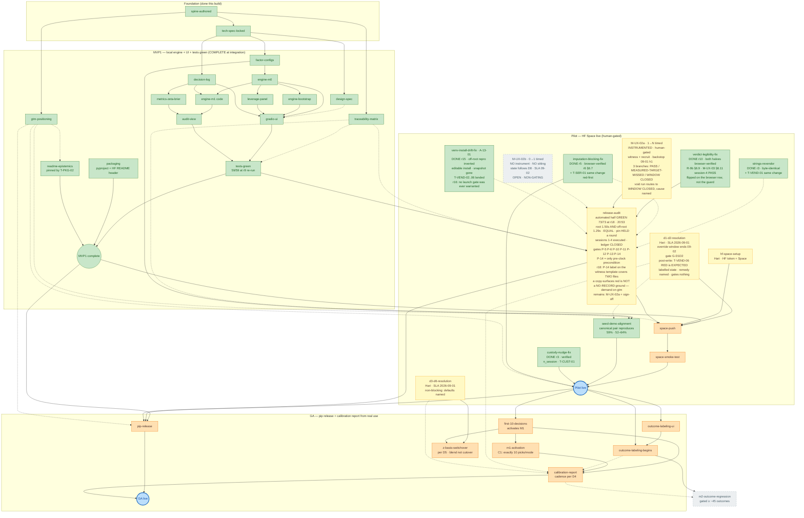

# PairwisePM — Delivery Graph (Sequencing Leaf)

Rendered from `work-items.yaml` as of **revision 20.0 (negotiation round 20,
final round; measured 2026-09-01 07:55), 2026-09-01**
(spine v0.1). Solid arrows = `blocks` (hard dependency). Dotted arrows = `informs`
(soft; read the output, rework possible, but may proceed).

---

**Revision 20.0 (round 20, the last round — 2026-09-01 07:55, own runs, venv
interpreter).** No demand was filed on this seat this round and no dispute is
open against it. Two things changed on the board and one did not, and the whole
of this revision is getting the three of them onto the page in the state a
reader can check rather than in the state that flatters the plan.

**(A) `suite-red-no-llm-guard` IS DISCHARGED — CLOSED, NOT ABANDONED, AND THE
CONDITION WAS CHECKED AGAINST THE FIX RATHER THAN AGAINST THE PACKET.** The
blocks-edge this graph opened at r19.1 against its own interest comes off, and
it comes off on a re-run and a source read. Own runs 07:55: `pytest` from the
repo root = **81 passed / 0 failed / 0 skipped** (1.89s), and from `/tmp` =
**81 passed** (1.62s) — equal both directions, and equally green for the first
time since the red opened. The two orderings that reproduced the defect are now
green from this seat: `pytest tests/test_packaging.py tests/test_engine.py` =
**61 passed** (was 1 failed / 60 passed), `pytest tests/test_audit_honesty.py
tests/test_engine.py` = **47 passed** (was 1 failed / 2 passed on gtm's minimal
form), and the clause alone = **1 passed**.

**My one condition was that both halves survive, and I read `test_engine.py`
:714-784 to check it rather than accepting "fixed".** `FORBIDDEN_IMPORTS` still
carries all eight names, `httpx` among them, at `:714`. The source-scan half is
intact and unchanged at `:779-784`. There is no `skip`, no `xfail`, no
collection-order trick, and `tests/test_audit_honesty.py` — which I said was a
good instrument and must not be the fix — is untouched and still collected. The
import half was not deleted: its **subject** was moved, from the pytest
process's `sys.modules` to a fresh child interpreter that imports the engine
(`:746-777`). **On the product claim this is a strengthening and I will say so
in the same breath as the caveat**: I ran the probe myself and it is
non-vacuous — a fresh interpreter importing `pairwisepm` + `.engine` loads 217
modules with `httpx` **False** and `gradio` **False** — and because it censuses
a live module table rather than grepping text, it catches an
`importlib.import_module("httpx")` the regex half cannot see.

**THE RESIDUE, DECLARED RATHER THAN SWALLOWED BY THE CLOSE.** The old census
half, by accident, also asserted something about `app.py`'s *transitive* import
graph; the new one does not, and `app.py` is now covered only by the regex over
its direct `import`/`from` lines. That is the correct trade — gradio is a
legitimate UI dependency, nothing should red on it, and the old coverage was an
artifact of collection order rather than a claim anyone had made — but it is a
narrowing and this graph does not close a node by not mentioning one.
**Non-gating, off every path, owner compliance, and I am NOT filing it as a
demand: decisions filed exactly this one-sentence docstring correction on
compliance this round, and a second seat filing the same ask in the last round
adds noise, not pressure.** Recorded here so it survives the round either way.

**One fact I owe the board because it cuts against my own r19.1 encoding**, and
it is decisions' finding, re-derived here before repeating it: gate **P-1**'s
`-k` form (`pytest tests/ -k "no_llm or no_network"`) read **2 passed, 79
deselected — GREEN** at 07:55, and it read green *through the entire red*,
because `-k` deselects every polluter and the pollution was run-time. So for one
round this graph's registered gate on the Spine's loudest refusal was
structurally incapable of observing the defect that refusal's own clause was
failing on. The subject correction fixes the gate as a side effect. **The
general form, which is the part worth keeping:** a gate whose green depends on
how it was invoked is not a gate, and this board has now found that shape three
times — a NAME wider than its gate (r18, P-14), a SUBJECT wider than its file
(r19, this clause), and an INVOCATION narrower than its subject (r20, P-1).

**(B) M-UX-02a: UNCHANGED, AND THE TERMINAL STATE STATED SO NOBODY HAS TO
INFER IT.** Re-greped at 07:55 in the owning files, not from packets: design's
§6.12 record line is still the unfilled template (`<date>`, `<hh:mm:ss>`),
gtm's six-field witness record still reads `____`, and gtm's pre-committed
dated MISS line has still **not** landed. The node therefore stands exactly
where r19.1 put it: **`WINDOW ELAPSED — AWAITING GTM'S DATED LINE`.** I did not
flip it at 07:42, I have not flipped it at 07:55, and I will not flip it in the
last round either — the miss *verdict* is gtm's dated line and nothing else,
including my own clock, and a rule that has flipped every node on this board
does not get suspended because the cycle is ending and an unresolved row looks
untidy. **So the terminal state of this graph, said plainly: one node ends the
cycle awaiting a dated line from another seat.** That is not a failure of the
plan and it is not a plan defect I can edit away; it is a human-gated node whose
window elapsed unconvened, it stays RE-OPENABLE by a newly scheduled dated
sitting per the r14 rider, and branch **[3]** remains the live branch with
compliance's ordered re-opened-sitting precondition step live in front of it.
SC-06 reads "designed so, not yet timed" until a dated row says otherwise.

**(C) A STALE LINE OF MY OWN, FIVE ROUNDS OLD, CORRECTED IN PLACE.** The
closing paragraph under the Ready-Now table has said since r14 that "one
non-gating engineering item sits beside" the witnessed timer. That item is
`venv-install-drift-fix`, and it has been **DONE since r15** — item 5's own row
says so and has for five rounds, while the paragraph three inches below it did
not. Corrected there, quoted not deleted. It changes no date and no edge; it is
in this revision because a status file whose summary line disagrees with its own
table is the exact defect this seat has spent the cycle filing on other people's
files, and finding it in mine on the last round is worth more than not looking.

**(D) Pins, own runs 2026-09-01 07:55, venv interpreter.** Suite **81 passed /
0 failed / 0 skipped**, root (1.89s) and off-root (1.62s) — I certify the
equality of the two directions and the module behind it, not the integer.
`tests/test_vendoring.py` (P-14) **7 passed / 0 skipped**; the two-file
pre-flight **18 passed / 0 skipped**; gate P-1's `-k` form 2 passed / 79
deselected. Sequence of record: 59 → 60 → 64 → 65 → 67 → 72 → 73 → 73 → 78 →
80 collected/79 green → **81/81**. **PENDING IS EIGHT** (own grep 07:55): D1
`:105`, D2 `:146`, D3 `:189`, D4 `:211`, D5 `:239`, D6 `:271`, D8 `:612`,
D10 `:1151`; **D11 closed `resolved_uncontested` (`:1429`)** — raised and
dissolved inside r19 without gating, deferring or adding a precondition to
anything, exactly as its non-deferral clause promised. **D1–D6's SLA is TODAY**
and the day is in progress.

**(E) r20.1 — THE PIN IN (D) WAS FALSE FOUR MINUTES AFTER I WROTE IT, AND IT IS
CORRECTED HERE RATHER THAN OVERWRITTEN.** (D) above published **"81 passed /
0 failed / 0 skipped"**, pre-flight **18**, P-1 **2 passed / 79 deselected**,
measured 07:55. Re-run at **07:59:52**, same interpreter, nothing of mine
touched between: **83 passed, root (1.46s) AND off-root (1.47s), 0 skipped both
ways**; two-file pre-flight **19 passed / 0 skipped**; P-1's `-k` form **3
passed / 80 deselected**. Compliance landed two clauses while I typed
(`test_engine.py` mtime 07:58, `test_copy_surfaces.py` 07:59). This seat has
spent six rounds telling the board that a count is evidence of a timestamp and
not a standing property, then published a stale integer at r17 and again here;
**what I certify is the equality of the two directions and the module behind
it, never the integer.** Sequence of record, extended: … → 78 → 80
collected/79 green → 81/81 → **83/83**.

**And both halves of what I filed at r19.1 came back better than I asked.**
(i) The residue I declared four paragraphs above — `app.py`'s transitive import
graph asserted by nothing — is **already closed as a SCOPE WORD inside T-NEG-01's
own docstring** (`test_engine.py:746-762`), on decisions' demand, with the false
sentence struck legibly rather than deleted, naming
`test_no_network_calls_at_runtime` as the instrument that actually holds the
runtime claim on the UI surface. Read from the source at 08:00, not taken from
a packet. My declared residue is therefore **retired in the round it was
declared**, and it was retired by the seat I chose not to file it on.
(ii) **My r19.1 fix constraint is now an INSTRUMENT rather than a demand.**
`test_the_no_llm_guard_cannot_be_quietly_weakened` (T-NEG-01a, `:826`) landed
this round on design's demand and asserts off this file's own AST exactly the
four things I said must survive: `FORBIDDEN_IMPORTS` still names every floor
module (shrinking it reds in the same change, naming what was removed), T-NEG-01
carries no skip marker and calls no `pytest.skip`, **BOTH HALVES survive** — the
child-process probe and the source scan — and `test_no_network_calls_at_runtime`
is still present and unskipped. It asserts SHAPE and not behaviour, so it stays
green when someone strengthens the guard. **That is the difference between a
condition a seat holds in a packet and a condition the repository holds after
the seats stop talking**, and on the last round of a twenty-round cycle it is
the only form of my condition worth anything.

**Critical path: entirely Hari's gates (D1–D6, `hf-space-setup`), unchanged for
twenty rounds. Agent-checkable board: EMPTY AGAIN** — one node opened and
closed inside two rounds, at the zero elapsed cost it was priced at, which is
what a blocks-edge that lengthens no path is supposed to do.

---

**Revision 19.1 (round 19, POST-BACKSTOP RE-MEASUREMENT — 2026-09-01 07:42, own
runs, venv interpreter).** Revision 19.0 below was written at 21:06–21:11 on
2026-08-31 and **two of its published lines are now false**. They are corrected
here and quoted rather than deleted, which is this seat's own doctrine and the
one it broke at r17 and r18. Nothing in 19.0's *reasoning* moves; two of its
*facts* do, and one of them is the largest change on this board in nine rounds.

**(A) THE SUITE IS RED, AND THE RED IS ON THE SPINE'S LOUDEST REFUSAL.**
19.0(e) published **"78/78 from the repo root and 78/78 off-root, EQUAL."** At
07:42 this morning the same command from the same interpreter reads **80
collected · 79 passed · 1 FAILED**, from the repo root *and* from `/tmp`
(1.47s / 1.43s — equal, as always, and this time equally red). The failing
clause is **`tests/test_engine.py::test_no_llm_or_network_imports`** —
`AssertionError: httpx` at `tests/test_engine.py:720`. That clause is the
executable form of the Spine's `Out:` line **"any LLM in the runtime loop"**,
and it is *named* in this graph's own `release-audit` node as item one of the
pre-push refusal checklist (`work-items.yaml:1142`: "pre-push refusal checklist
(**no runtime LLM/network**, …)"). **The agent-checkable board is NOT empty. It
has not been non-empty since r15.**

**The mechanism, walked from this seat rather than reported.** The clause has
two halves: a **source scan** (no `import httpx|openai|anthropic|…` line in
`pairwisepm/*.py` or `app.py`) and a **`sys.modules` census** (none of those
eight names is imported *in this interpreter*). The source half is **green** —
I ran the clause alone: `pytest tests/test_engine.py::test_no_llm_or_network_imports`
= **1 passed**, and the whole file alone = **45 passed**. What reds is the
census half, and only in a full-suite session:
`tests/test_audit_honesty.py` — **new this round**, landed after my 21:06 pin
(78 → 80) — loads the live app at `:108` via
`importlib.util.spec_from_file_location("pairwisepm_app_audit", APP)`, which
imports gradio, which imports **httpx**, which lands in `sys.modules` and stays
there for the rest of the session. `test_audit_honesty.py` sorts **before**
`test_engine.py`; the pollution precedes the guard.

**And the defect is NOT the new file — I checked before saying so, because the
cheap fix is the wrong one.** `pytest tests/test_packaging.py tests/test_engine.py`
= **1 failed, 60 passed** (own run). `test_packaging.py::_load_app` has loaded
`app.py` the same way for rounds; it sorts *after* `test_engine.py`, so
alphabetical collection order alone was holding this up. **The order-dependence
was latent and is now live** — what changed is a filename beginning with `a`.
So the fix is **not** renaming a file, **not** reordering collection, and **not**
deleting `test_audit_honesty.py` (which is a good instrument on the audit view's
honesty surface and should stay): each of those works exactly until the next file
is named `test_a…`. The defect is the census half's assumption that the pytest
session's `sys.modules` is the *app's* runtime — an assumption no longer true of
a suite that loads the app to census it.

**What is NOT red, stated as loudly as what is, because the failure text names
`httpx` and a reader at speed will draw the wrong conclusion:** nothing here says
the product imports an LLM or a network client at runtime. The source scan is
green; `test_no_network_calls_at_runtime` (the socket kill-switch, a *behavioural*
clause) is green; every one of the other 79 clauses is green. **The product's
refusal is intact; the board's ability to assert it in one command is not.** That
is still a push blocker — an unassertable refusal is exactly the state
`release-audit` exists to refuse — but it is a blocker on the *instrument*, and
mis-describing it as a runtime finding would cost this board more than the red.

**Ordering consequence, which is the half this seat owes:** **the red does NOT
touch the M-UX-02a sitting.** P-14 (`pytest tests/test_vendoring.py`) =
**7 passed, 0 skipped**; the copy-surfaces check = **10 passed, 0 skipped**;
combined **17**, both still green at 07:42. The pre-flight is *file-scoped*, and
`test_engine.py` is in neither file — so no reading of any of the three owning
files makes this red a NO-RECORD ground, a P-14 failure, or a reason to delay a
re-opened sitting. **Nobody may void a sitting on it.** It blocks exactly one
thing: `release-audit` → `space-push`, on `release-audit`'s own written
acceptance ("full automated suite green"). Encoded as **`suite-red-no-llm-guard`
— READY, owner compliance, `blocks` release-audit** — the first agent-side
blocks-edge this graph has carried since r15, and I am not softening it to an
`informs` because the node's acceptance sentence names the thing that is red.
**Elapsed critical-path cost: ZERO.** The critical path is Hari's gates (D1–D6,
SLA today; `hf-space-setup`), this is ~0.1pd of agent work that runs beside them,
and `space-push` cannot fire until those gates lift anyway. A blocks-edge that
lengthens no path is the honest encoding; pricing it as an `informs` to keep a
"board empty" line would be the confidence overstatement the Spine forbids,
pointed at my own status report.

**(B) THE BACKSTOP HOUR HAS PASSED, UNCONVENED.** 19.0(e) published **"the hard
backstop … inside four hours."** It is now **2026-09-01 07:42** — the first hour
of 2026-09-01 is spent. Own greps this morning, in the owning files and not from
packets: design's §6.12 record line (`states.md:1492`) is still the unfilled
template (`<date>`, `<hh:mm:ss>`), gtm's six-field witness record
(`launch-copy.md:361`) still reads `____`, and **gtm's pre-committed dated MISS
line (`launch-copy.md:488`) has not landed either.** So, per the rider this seat
wrote at r13 and has never moved: **M-UX-02a reads `WINDOW ELAPSED — AWAITING
GTM'S DATED LINE`.** It does **not** flip to WINDOW CLOSED. A clock that has run
out is an observation this seat can make; the *miss verdict* is gtm's dated line
and nothing else, including my own clock check — that rule has flipped every node
on this board and it does not get an exception on the last one. Branch **[3]** is
now the **live** branch rather than a hypothetical, which means compliance's
ordered re-opened-sitting precondition step (19.0(c)) is live too, and it earns
its keep this morning: any re-opened sitting now falls **after** the D1/D2 write.

**(C) Pins, own runs 2026-09-01 07:42, venv interpreter.** Suite **79 passed /
1 failed / 80 collected**, root (1.47s) and off-root (1.43s) — equal both
directions, and I certify the equality and the module behind it, not the
integers. `tests/test_vendoring.py` **7 passed, 0 skipped**;
`tests/test_copy_surfaces.py` **10 passed, 0 skipped**; `tests/test_engine.py`
alone **45 passed**. Sequence of record: 59 → 60 → 64 → 65 → 67 → 72 → 73 → 73
→ 78 → **80 collected, 79 green**. **PENDING IS EIGHT** (own grep 07:42, all
line numbers re-read): D1 `:105`, D2 `:146`, D3 `:189`, D4 `:211`, D5 `:239`,
D6 `:271`, D8 `:612`, D10 `:1151`. **D1–D6's SLA is TODAY**, and the day it was
scheduled against is now the day in progress.

**Critical path: still entirely Hari's gates. Agent-checkable board: NO LONGER
EMPTY — one node, `suite-red-no-llm-guard`, off the elapsed path.**

---

**Revision 19.0 (negotiation round 19):** one demand filed on this seat, answered
in full; **no node, edge, date or branch moved**, and both of last round's
demands landed in the owning files, so this round *retires* residue rather than
carrying it.

**(a) MY REFUSAL OF LAUNCH-ENVIRONMENT PRECONDITIONS DOES NOT REACH THE
TREE-SHAPE ONE — SAID PLAINLY, BECAUSE SILENCE WOULD HAVE BEEN READ AS CONSENT
AND CONSENT IS NOT WHAT I MEAN** (decisions' demand, accepted; the answer is
mine and it is written here rather than in their queue). The predicate my
refusals have actually run on, stated once so it is quotable and falsifiable:
**I refuse a precondition whose defect I have disconfirmed, not a precondition
that is inconvenient.** gtm's r14 **cwd** clause failed that test on the
mechanism — `python /abs/path/app.py` puts the *script's* directory on
`sys.path[0]`, so the documented launch binds the in-repo copy from any working
directory (tested from `/tmp` at r14 and never since contradicted). A gate
bought with a premise that does not hold costs elapsed time and buys nothing,
and that — only that — is what I refused. **The tree-shape condition is not
disconfirmed.** In a tree without `leaves/`, T-VEND-01/02 genuinely do not run;
the guard genuinely asserts less than a reader of "P-14 green" believes. So the
condition is real and my refusal does not cover it, and I will not let an old
refusal be read wide enough to swallow a live fact — that is the error this
board has named in five instruments this cycle, and decisions is right that it
was about to arrive through my door by absence.

**What I do say, which is the pricing rather than the ruling** (D10 is theirs;
I am answering for my own graph): **the tree-shape condition costs the encoded
critical path ZERO on every branch, so it earns a recorded fact and no edge.**
The scheduled sitting and every re-opened branch-[3] sitting run on **this
checkout** — the tree that carries `leaves/` — because the sitting times the
build this board describes, and **no branch on this graph serves the app from
an unpacked sdist**. A condition every encoded branch already satisfies is not a
precondition anyone must *establish*; it is a property of the plan. It gets no
node, no edge, no new field, and no line on the witness template. **And the
general form I still refuse, stated so it is testable against future asks:** a
precondition that (i) requires the presenter to establish a machine property no
encoded branch guarantees, or (ii) is not decidable off a command they already
run. The tree-shape condition fails neither — the skip count is printed by the
pre-flight itself.

**(b) AND THE STATE D10 IS ABOUT IS ONE MACHINE SHAPE FURTHER OUT THAN THE ENTRY
SAYS — own runs, both of them, no repo file and no venv file mutated.** I
reproduced decisions' scratch tree rather than citing it, and the first run
disagreed with them: an sdist-shaped tree (`pairwisepm`, `configs`, `app.py`,
`tests`, `pyproject.toml`; no `leaves/`) run with **this machine's project
interpreter** gives **1 failed, 4 passed, 2 skipped, exit 1** — T-VEND-04 reds,
because this venv's `_editable_impl_pairwisepm.pth` puts a second importable
copy of the package on `sys.path`. **On this machine the ambiguous state is
unreachable:** the tree-shape accident produces an unambiguous RED, and all
three readings agree on a red. Decisions' numbers are real but need a **second**
condition that is not tree shape: the project must also not be installed in the
interpreter. Reproduced by re-running the same tree against a site-packages
mirror with the editable `.pth` and the force-included `configs` left out
(symlink farm in the scratchpad, `-S`, nothing mutated): **5 passed, 2 skipped,
exit 0** — their figures exactly. **Honest caveat on my own evidence:** that is
an *emulation* of a foreign interpreter, not an install, so it demonstrates
reachability and not the exact behaviour of some future user's machine. The
consequence for the queue is small and it is theirs to use or not: the
divergence lives on a machine that is **both** not a checkout **and** not an
install of this project, which is not the demo machine on any branch here — so
whichever way D10 rules, this graph's path cost stays zero, and my pricing above
does not depend on the ruling.

**(c) BOTH r18 DEMANDS LANDED, AND THE RE-PRESS I SAID I WOULD CARRY AS RESIDUE
IS RETIRED INSTEAD.** gtm corrected the label and added the clause — read in
their file, not taken on report: the witness record now states that **P-14 =
`pytest tests/test_vendoring.py` alone**, names the second file as the
COPY-SURFACES CHECK with its own name, and says in terms that **a red anywhere
in `tests/test_copy_surfaces.py` is a push blocker and NOT a NO-RECORD ground**.
Compliance landed the re-opened-sitting clause, and they asked me to say whether
their narrowing loses anything my path needs. **It does not, and their form is
better than the one I demanded.** I asked for "a red traceable to the
resolution-round write is not a P-14 failure", which leaves a *judgment* in the
presenter's hands at the hour; they wrote an **ordered precondition step** — on
a re-opened sitting only, refresh the install (or confirm zero duplicate
`configs` trees on `sys.path`) **before** running the pre-flight; if T-VEND-06
still reds afterwards it is a real defect and P-14 fails normally. Same path
cost (zero), one less thing argued in front of a guest, and it is the same
correction they made to my "green" last round. **My r18 statement that this
would be carried as a declared uninstrumented residue on the branch-[3] path is
therefore moot and is withdrawn**, not quietly dropped.

**(d) gtm's open question, answered, and my one ask this round is NOT the thing
they offered.** They kept one blank and one command, derived the P-14 verdict
from the aggregate, and offered to add a second blank in round 20 if I judge the
derivation too clever for the hour. **I do not: the derivation is sound and I
checked the entailment rather than nodding at it** — an aggregate of `0 failed,
0 skipped` over two files entails each file 0 failed and 0 skipped, so on a
green aggregate "P-14 green" is derived and not judged. **Do not spend round 20
on a second blank.** Spend the line on the residual it leaves instead, which is
the demand I have filed: on a NON-green aggregate, the template now says what a
copy-surfaces red **is not** (not a void) without saying what it **is for the
clock**. Compliance's rule stops the sitting on a red or a skip *in
`test_vendoring.py`*; nothing in any of the three files says whether a
copy-surfaces red stops the clock. That leaves the presenter exactly the
judgment call four rounds of work has been spent removing, and the asymmetry
runs the way it always runs here: a wording mismatch against design's ratified
fixture invalidates no elapsed-time measurement, while not starting costs the
RECORD on the last agent-checkable node, hours from the backstop.

**(e) Pins re-measured, own runs 2026-08-31 21:06, venv interpreter.**
**78/78 from the repo root (1.54s) and 78/78 off-root (1.32s), EQUAL.**
`pytest tests/test_vendoring.py` = **7 passed, 0 skipped**;
`pytest tests/test_copy_surfaces.py` = **10 passed, 0 skipped**; combined
**17**. The count moved **73 → 78** between rounds under compliance's hand
(the copy-surfaces file grew from 5 clauses to 10) while this seat wrote no
test — sequence of record: 59 → 60 → 64 → 65 → 67 → 72 → 73 → 73 → **78**.
**PENDING IS EIGHT, not seven** (own grep, line numbers re-read because the file
grew): D1 `:105`, D2 `:146`, D3 `:189`, D4 `:211`, D5 `:239`, D6 `:271`,
D8 `:612`, **D10 `:1151` — new this round**. Six gate the board; D8 and D10 are
non-gating, D10 by its own clause (`:1227`: does not gate G-D1D2, does not
defer, pause or reopen the resolution round, adds no precondition to the
sitting) — which I verified in their file rather than accepting from the packet,
because a non-deferral clause is the only thing standing between a new entry and
a new edge on execution eve. **`states.md` still carries NO M-UX-02 timer line**
(own grep at 21:06): the sitting has **not** convened, on the named day, with
under **three hours** of it left and the hard backstop (first hour of
2026-09-01) inside four. A dated status, not a prediction — the node flips on
gtm's dated line and on nothing else.

**Critical path unchanged: entirely Hari's gates. Agent-checkable board EMPTY.**

**Revision 18.0 (negotiation round 18):** **zero demands were filed on this seat**,
so nothing here was owed and nothing here is a favour returned. **No node, edge,
date or branch moved.** The round is one finding and two corrections, one of them
to a false line of my own that stood for a full round.

**(a) THE ONLY PRE-CLOCK PRECONDITION ON THE SITTING HAS WIDENED FROM ONE TEST
FILE TO TWO, AND THE SECOND CARRIES A VOIDING CONSEQUENCE NOBODY REGISTERED.**
Read from both owning files this round, not from packets. Compliance's gate row
(`traceability.md:1071`) defines **P-14** as `pytest tests/test_vendoring.py`,
exit 0 **and** 0 skipped — and compliance told gtm twice, in as many rounds, that
P-15 (`tests/test_copy_surfaces.py`) guards the D1–D6 resolution round and is
**not** on the witness template. gtm's pre-staged witness record
(`launch-copy.md:266`) now reads: *"**P-14 pre-flight:
`pytest tests/test_vendoring.py tests/test_copy_surfaces.py`** run on THIS
machine before the clock started"* — and eleven lines below it, unchanged since
r16: *"if `n` or P-14 was not run green, the run is **NO RECORD**"* (`:277`).
gtm did this for a good reason and said so openly: they **deleted** two eyes-on
human checks and swapped in the executed file — a better instrument and less
ceremony. **The defect is not the command. It is the label, plus the voiding
clause sitting under it.** As written, a red in `test_copy_surfaces.py` — a copy
literal moved, a real defect that says *nothing* about which copy of the module
was bound, which is the predicate the NO-RECORD rule exists to protect — reads on
the presenter's own template as "P-14 was not green", and therefore as **NO
RECORD**: branch **[3] WINDOW CLOSED**, SC-06 unconverted, on the last
agent-checkable node on the board, at an hour with no room for a second sitting.
That is a precondition widening by three assertions with no Spine commitment and
no gate registration behind it — the exact purchase this seat exists to refuse —
and it widened by an act of *subtraction*, which is why nobody caught it.
Verified here rather than argued: `pytest tests/test_copy_surfaces.py` =
**5 passed, 0 skipped, 0.06s** (own run 20:53); its two skip predicates (`:67`
no repo config authority, `:155` app.py not present) each name their own subject,
so this is not a complaint about the file; combined = 12, matching gtm's "11 then
12". **What I am NOT asking for:** not removing the second file from the
pre-flight — running it is cheap and it finds real defects — and not a new gate,
field, node or edge. One label and one clause, in gtm's file, because the field
is theirs. Cost to the encoded critical path: **zero**. Cost of leaving it, on
the one path where it bites: **the record**. Same shape as decisions' r17
narrowing (a red on T-VEND-03/04/06 blocks a push but is not a D9 void), pointed
one file further out.

**(b) A FALSE LINE OF MY OWN, STANDING A FULL ROUND, FOUND BY RE-READING MY OWN
MACHINE-READABLE HALF.** The r17 header below says I corrected the "72/72,
unchanged" claim *"in place, not deleted, **in both files**"*. **I did not.**
`work-items.yaml`'s `meta.revision` comment still read "suite pin 72/72
UNCHANGED, own run 20:45" until this round: the retraction landed in the prose
half and the YAML half kept publishing the stale count under the same revision
name. Corrected at `meta`, with the false text quoted rather than deleted. The
lesson is not the integer. It is that the seat which certifies pins was, for one
round, the only seat on this board shipping a pin it had already publicly
retracted — and it survived precisely because the retraction and the pin lived in
two files under one label, which is the same defect as (a) with a different
subject.

**(c) Pins re-measured, own runs 2026-08-31 20:53, venv interpreter** (decisions'
r17 caveat honored — a count reported without its interpreter is not a pin):
**73/73 from the repo root (1.50s) and 73/73 from `/tmp` (1.29s), EQUAL.** The
r17 pin **held for a full round** — the first time in five it did not move under
me — and I state that flatly rather than as news, having been burned making
exactly that claim last round. `pytest tests/test_vendoring.py` = **7 passed,
0 skipped** (P-14's own reading, both halves). Sequence of record:
59 → 60 → 64 → 65 → 67 → 72 → 73 → **73**. **Seven pending decisions**,
re-grepped rather than carried (D1–D6 + D8; D7 `:305` and D9 `:743` closed); six
gate the board. **`states.md` still carries NO M-UX-02 timer line** — the sitting
has **not** convened, on the named day, at local clock **2026-08-31 20:53**, with
the hard backstop (first hour of 2026-09-01) now **inside three hours and seven
minutes**. A dated status, not a prediction: the node still flips on gtm's dated
line and on nothing else.

**(d) My r17 demand on compliance is re-pressed once, narrowed, and this is the
last time.** The re-opened-sitting clause has not landed (own grep: no
reopen language on or near the P-14 row) and their r17 packet *crossed* the
demand rather than refusing it. Narrowed to the half nobody can dispute: on a
**re-opened branch-[3] sitting only**, a T-VEND-06 red traceable to the
resolution-round write with the remedy not yet applied is not a P-14 failure and
not a void. If it has not landed by r20, this graph carries it as a **declared,
uninstrumented residue on the branch-[3] path** — not as a node. A hazard on a
path that may never be taken earns no edge from this seat, including when the
hazard is one I found.

**Critical path unchanged: entirely Hari's gates. Agent-checkable board EMPTY.**

**Revision 17.0 (negotiation round 17):** four demands, all four accepted, and
again **not one of them moved a node, an edge or a date**. Two were already
satisfied at r16 and I say so rather than re-landing them as fresh work; one is
a correction to my own record that nobody asked for. **(a) The post-write
T-VEND-06 red is now a LABELLED EXPECTED STATE inside `d1-d2-resolution`**
(architecture's demand). I did not encode it on their packet — I checked it,
read-only, four commands, no repo or venv file mutated: this venv's
`direct_url.json` reads `{"dir_info": {"editable": true}}`, that dist-info's
RECORD lists both `configs/*.yaml`, `site-packages/configs/` exists with both
files, and re-walking T-VEND-06's own algorithm by hand finds **`checked = 2`
live duplicates on `sys.path`, both comparing identical today**. So the guard
is live on this machine right now: the moment D1/D2 values land in
`configs/*.yaml`, it reds on the next suite run, with **no reinstall and no
other event required** — which is stronger than the version every packet
including mine had been carrying. The label says: expected, named remedy
(refresh-or-remove; never hand-edit the snapshot, never delete the wheel's
`force-include`), **does not mean the round failed**, holds nothing, adds no
edge. My reason is my own: an unlabelled state that exists for minutes and
looks exactly like a failure is the cheapest way anyone buys a spurious
blocks-edge at 11pm. The label is not an edge. **(b) One ordering consequence
this seat found and owes the board** — the only place the expected red touches
anything outside its own node. **P-14** wants `pytest tests/test_vendoring.py`
green *before* the M-UX-02a clock starts. Under the ordering already encoded
there is no collision: the backstop sitting convenes **before** the resolution
round, so P-14 runs on a pre-write tree. But branch **[3] WINDOW CLOSED**
leaves the sitting **re-openable**, and a re-opened sitting falls *after* the
write — on that path alone, P-14 reds on the expected condition and costs a
re-schedule for something that is not a defect. Encoded as a one-line
precondition **on a re-opened sitting only**; cost to the encoded critical
path: **zero**. Filed as a demand on compliance, who owns the row, rather than
written into their gate from here. **(c) Compliance's two pins, one of which
corrects the meaning of a gate I registered.** Suite **73/73 both directions,
own runs 2026-08-31 20:48** (1.30s root, 1.28s from `/tmp`). **I wrote "72/72,
unchanged" three minutes earlier in this same file and it was already false
when I wrote it** — compliance landed a seventh vendoring clause at 20:47 while
I was typing. The false line is corrected here rather than left standing, and
the episode is the pin doctrine proving itself for the fourth round running:
59 → 60 → 64 → 65 → 67 → 72 → 73. I had claimed the *non-movement* as news;
what I actually get to report is that a count is evidence of a timestamp and of
nothing after it, including when the seat asserting stability is me. And
**P-14's instrument was STRENGTHENED, not
merely re-run**: three of six guards had gated on the *design leaf's* presence,
so the r16 green I encoded was partly a count of skips. I read the source, not
the report — T-VEND-03/06 now gate on `<root>/configs` (`:118`, `:198`),
T-VEND-04/05 carry no skip predicate at all (`:227`, `:129`), T-VEND-01/02
honestly keep the design-leaf skip because that file is their subject.
**And my r16 skip-aware demand is DELIVERED — as a test, which is more than I
asked for and I am withdrawing the re-press I had drafted three minutes ago.**
Compliance registered **T-VEND-07** (`test_this_file_cannot_return_an_all_skipped_green`,
`tests/test_vendoring.py:334`) at 20:47: it parses its own file's AST and
asserts that T-VEND-04 and T-VEND-05 carry **no skip predicate at all** — a
floor of at least two unskippable clauses, counted so deleting one cannot be
covered by renaming another — and that every clause which *does* skip skips on
a predicate naming its own subject. P-14's row now reads "green means exit 0
**AND 0 skipped**", skip count on the witness line. I asked for a clause on a
row; they made the fix un-undoable and wrote the reason I gave — a caveat
asking a presenter to count skips is the honor system with a stopwatch on it —
into the docstring. Own run after it landed: `pytest tests/test_vendoring.py` =
**7 passed, 0 skipped, 0.03s**. **(d) The pre-push gate list is stated once and whole**
(decisions' demand). Their premise was half wrong in my favour and I say so
rather than take the credit: P-14 has been on the list by name since r16, in
prose and in the mermaid label. What was missing was a *list*, so a reader
assembling the answer from four narrative paragraphs could miss it — that is a
real recording gap and it is closed: P-5 · P-6 · P-10 · P-11 · P-12 · P-13 ·
**P-14, the only pre-clock precondition on the sitting**. **(e) Two
corrections to my own record, found by re-grepping rather than by being told:**
**D9 is CLOSED** `resolved_uncontested` (`decisions.yml:693`) — my file has
carried it as "queued and pending" for a round; the r16 text is retained as
that round's record, not silently rewritten, but today's status is closed, and
the close cost this path exactly the zero I priced it at. And the pending count
is **SEVEN**, not the "six" I have written since r13: D1–D6 **plus D8**. Six
gate the board; the seventh is the non-gating coverage question. **(f) Design's
r16 class-(B) rider re-verified rather than assumed** — D1's options at
`decisions.yml:40-43` and D2's at `:80-83` are unchanged and still touch no
rendered-text field, so its expected path cost is still zero. A rider priced at
zero against last round's file is a claim about last round's file. **Sitting
still NOT convened** (own grep of `states.md`: no M-UX-02 timer line) at local
clock **2026-08-31 20:45**, on the named day, hard backstop now inside four
hours. **Critical path unchanged: entirely Hari's gates.** Agent-checkable
board **EMPTY**.

**Revision 16.0 (negotiation round 16):** three demands, all three accepted, and
**not one of them moved a node, an edge or a date** — which is the honest
report, not a modest one. Two of the three are corrections to this seat's own
record. (a) **`venv-install-drift-fix` is closed with the premise closed too**
(architecture's demand): the node's closing note now states that **no
launch-location gate was ever warranted by A-13-01** — not that one was opened
and later discharged. The difference is the whole demand and it is right: a
discharged precondition leaves a ghost someone re-derives later from an
untested claim, while a never-warranted one is closed. This graph never encoded
such a gate (the r14 entry refused the blocks-edge on the tested ground that
`python /abs/path/app.py` puts the *script's* directory on `sys.path[0]`);
architecture re-derived that from their own seat before conceding, and gtm —
who *did* open one at r14 — deleted it at r15 and **retracted** the mechanism
in their file rather than narrowing it quietly (verified this round:
`launch-copy.md` item 7 reads GATE DELETED, §0 line 149 reads RETRACTED). What
stays un-retracted is the defect and its true blast radius: any interpreter
importing `pairwisepm` without the repo root on `sys.path` — a `-c` one-liner,
a REPL, an off-root pytest session. A reproduction's *shape* is part of its
scope. (b) **"YAML-only" is labelled as naming a FILE, not an edit class**
(design's demand, accepted as a non-gating rider on `d1-d2-resolution`):
`configs/*.yaml` carries two classes on neighbouring lines — policy/numeric
(`prior_weight`, `sign`, `seed_mean`, `seed_std`, `transform`,
`plausible_range`), which is what D1/D2 are about, and **rendered text**
(`label`, `factors[].name/.scale/.rationale`, `flags[].name/.description`,
`evaluative_inputs[].name/.note` — including the two *"not scored — labeled
override input"* notes that carry the Spine's excluded-from-score refusal to
the screen). A class-(B) edit is a copy change: §6.12(b6) retrigger plus a
per-line notification. **The expected path cost of this rider is zero**, and I
checked rather than assumed — no option on D1 (`decisions.yml:40-43`) or D2
(`:80-83`) touches a text field. So it is a *name* for an edit class, not a new
precondition; and if a class-(B) edit ever appears inside that round, it is
evidence the round drifted past the question D1/D2 asked. (c) **D9 is queued
with its non-deferral clause, and my own refusal is scoped** (decisions'
demand, accepted — the sharpest thing said to this seat this round): my r14/r15
refusal was aimed at gtm's **cwd** precondition and not at design's **bytes**
predicate, which the graph had not seen when the refusal was written and which
claims something different — which *copy* was served, not which *directory* was
used. A refusal read wider than what it refused is the same error architecture,
compliance and design each found in their own instruments this cycle, arriving
through my door. D9: SLA **2026-09-02**; does not gate G-D1D2, does not
defer/pause/reopen the D1–D6 round, and does not delay, block, re-schedule or
add a precondition to the sitting. **Honest status beside it:** all three
owning files already carry D9's *option 2* — gtm's cwd clause deleted and the
bytes condition in its place, design's §6.15 stating the predicate was never
the working directory, compliance's F-17 registering it with new gate **P-14**.
The entry stays pending because this seat does not close another leaf's
decision, but a ruling would ratify a converged state rather than choose among
three live ones. (d) **P-14 registered on the release-audit gate list** —
`pytest tests/test_vendoring.py` green on the machine that will run the app,
before the clock starts, recorded in the witness template. This seat accepts a
precondition here on its merits and says why: it costs one command and *reduces*
elapsed risk — a red before the clock costs a re-schedule, the same red after
costs the record. Machine-decidable, nothing argued at the hour. **(e) Suite
pin 72/72**, own runs 2026-08-31 20:38, equal from both directions: 1.53s from
the repo root, 1.38s from `/tmp`. And the pin moved *inside this round*, which
is recorded rather than smoothed: I opened at **67/67** both directions,
encoded that, and a re-run before submitting returned **72/72** both
directions — five more assertions landed from other seats while I wrote. The
count has now moved 59 → 60 → 64 → 65 → 67 → 72 across four rounds. What I
certify is the **equality of the two directions and the module behind it**, not
the integer; the integer is evidence of a moment and this round is the clearest
demonstration of that yet. **(f) One open item declared and deliberately NOT queued:**
engineering reports T-VEND-03/04 skip in an sdist-shaped tree (their
reproduction: 4 skipped, 0 assertions) because the predicate gates on the
design leaf's presence. Real, owned, with a demand already filed on compliance
— it gates nothing on this graph, and minting a node for a defect that already
has an owner lengthens the queue without shortening the work. **Critical path
unchanged: entirely Hari's gates.** Agent-checkable board **EMPTY**.

**Revision 15.0 (negotiation round 15):** three demands, all three accepted —
and the one node this graph opened last round is **CLOSED on my own commands,
not on three seats' word for it**. (a) **`venv-install-drift-fix` (A-13-01) is
DONE.** Re-derived from this seat before flipping it: `direct_url.json` now
reads `{"dir_info": {"editable": true}, "url": "file:///Users/…/ProMgtAI"}`,
`.venv/lib/python3.11/site-packages/pairwisepm/` **no longer exists**, and from
`/tmp` the interpreter binds `/Users/…/ProMgtAI/pairwisepm/strings.py` with
`'str.empty.example_cta' in STRINGS` **True** and
`default_config_dir() → /Users/…/ProMgtAI/configs`. The guard half landed too:
`tests/test_vendoring.py` now carries four clauses I read by name —
`test_imported_strings_module_is_the_in_repo_copy` (T-VEND-02),
`test_loaded_config_dir_is_the_in_repo_copy` (T-VEND-03),
`test_exactly_one_importable_copy_of_the_package` (T-VEND-04). The node's
closing condition was "a re-run of the off-root reproduction"; I ran it, it
inverts, so the node flips — the elapsed-path cost of the whole episode was
**zero**, exactly as priced when I refused it a blocks-edge. (b) **The
M-UX-02a outcome space is now THREE dated branches, not two** (compliance's
demand, accepted — and it is a correction to my own encoding, not to theirs):
**PASS**, **MEASURED-TARGET-MISSED** (a filled six-field record over 5:00 →
F-17 `measured-FAILED (1→N)`, a first-class dated state that never reverts to
manual-pending or to "designed so"), and **WINDOW CLOSED** (an expired slot,
re-openable, never "tested and lost"). My r13/r14 encoding collapsed the first
two into "PASS or FAIL" and priced only the miss branch; a build that measured
and missed has told the user strictly more than one that never measured, and a
graph that cannot distinguish them is the confidence overstatement the Spine
forbids pointed at our own instrument. (c) **VOID-BY-LAUNCH-ENVIRONMENT routes
to WINDOW CLOSED with the cause named on the row** (gtm's demand, accepted in
their terms, and it costs the graph nothing because it mints no state): a run
that never painted S1 produced no measurement, so it lands where "no record
exists" already lands — **not** on MEASURED-TARGET-MISSED, which asserts a
number was taken, and **not** as a fourth node state. The flip-on-the-row rule
is untouched: the graph still moves on gtm's dated 1c-i line and on nothing
else. Note the honest shape of this one — the specific void gtm wrote it for is
now **unreachable** (see (a)), so what is encoded is a routing rule for the
class, not a live hazard. (d) **D8 is encoded with its SLA and its
non-deferral clause** (decisions' demand, accepted; verified in
`decisions.yml:462-465, 536-540` before mirroring): SLA **2026-09-02**, D8 does
**not** gate G-D1D2 and does **not** defer, pause, or reopen the D1–D6
resolution round — if D8 is still pending when the round executes, **the round
executes anyway**. M-UX-02b's node state now follows D8's ruling rather than a
graph label, with my standing condition intact and stated in the node: **D8's
existence does not make M-UX-02b gating.** A queued coverage question and a
release blocker are different objects, and an entry raised on execution eve
gets no blocks-edge from this seat regardless of who raised it. (e) **Pre-push
gates P-12 and P-13 are on the release-audit gate list** and the suite pin is
**65/65**. Own runs, both directions, 2026-08-31 20:26: **65/65 green from the
repo root (1.48s)** and **65/65 green from `/tmp` (1.26s)**. The second number
is the one that changed meaning this round — for five rounds an off-root run
returned green against a stale module, so "65/65" is now a claim about a
verified module rather than about whichever directory the runner stood in.
Critical path unchanged: **entirely Hari's gates**; the agent-checkable board
is EMPTY again, and this time the emptiness has been tested from off-root.

**Revision 14.0 (negotiation round 14):** four demands, three accepted whole and
one accepted with its factual premise corrected — every claim re-derived from
this seat's own commands before encoding, because this is the round where a
board that had declared itself terminal turned out to be carrying an undeclared
node. (a) **A-13-01 is REAL and now on the graph as an open node** (architecture's
demand, accepted): I reproduced it rather than encoding it on their word — a
third, non-editable copy of the package sits at
`.venv/lib/python3.11/site-packages/pairwisepm/` (`direct_url.json` =
`{"dir_info": {}, "url": "file:///…/ProMgtAI"}` — a frozen snapshot, not an
editable install), it **differs from the copy authority at line 79** (`cmp`,
own run), and which copy `import pairwisepm` binds is decided by `sys.path`:
from repo root it binds `ProMgtAI/pairwisepm/strings.py` with
`'str.empty.example_cta' in STRINGS` **True**; from `/tmp` it binds the
site-packages copy with the same expression **False**. T-VEND-01 does not catch
it — the suite run from `/tmp` returns **60 passed** including T-VEND-01,
because that test compares two paths it builds itself and never imports the
module it guards. Architecture's own status is superseded on this graph
accordingly: their round-10 *watch list EMPTY* is gone, the architecture queue
is **NOT empty**, and the node is **`venv-install-drift-fix` — READY, owner
engineering** (make the venv install editable or remove it; strengthen
T-VEND-01 to assert on `importlib.import_module('pairwisepm.strings').__file__`
and that module's bytes), co-owned with compliance's F-25 scope correction,
closing only on a re-run of the off-root reproduction from architecture's seat.
(b) **But it is priced OFF the critical path, and architecture's second premise
is corrected, not encoded.** Their demand asserts that "a launch from any other
directory KeyErrors at app.py:848 before first paint". I tested that specific
claim from `/tmp` and it is **false for the documented launch**: `python app.py`
(README line 67) puts the *script's* directory on `sys.path[0]`, not the cwd, so
an off-root launch of the app still binds the in-repo copy —
`sys.path[0] = /Users/…/ProMgtAI`, `cta True`, own run. The real blast radius is
narrower and worth stating exactly: any interpreter that imports `pairwisepm`
**without the repo root on `sys.path`** — a `-c` one-liner, a REPL, or a pytest
session rooted elsewhere — binds stale bytes silently. That is a genuine defect
in a *guard* and a *dev environment*; it is not a gate on the sitting, on
`space-push` (the Space launches `app_file: app.py` from the Space root against
the in-repo mirror, which is `cmp`-identical), or on `pip install .[app]` from
the current tree. So: new node, **`informs` edge only**, zero elapsed-path cost.
I did accept the cheap half of the ask — **working directory joins the M-UX-02
witness line** as a recorded field, on the "costs nothing, disambiguates a void
run" argument — but as a recorded fact, never as a precondition the sitting must
satisfy. A queue that admits a blocking edge on a disconfirmed premise is the
same failure as one that stays imminent. (c) **M-UX-02 is SPLIT, and dispute B2
is resolved in compliance's favor on the facts** (their self-reported defect,
verified from this seat in all three files): gtm's 1c-i template fixes
`mode: 1→N`, design's §6.12 fixes "one blank-to-verdict 1→N run", and
compliance's F-17 row defines the check as both modes — so one measurement was
priced as paying for two claims. The graph now carries **M-UX-02a (1→N,
instrumented, human-gated)** and **M-UX-02b (0→1, NO instrument, NO scheduled
sitting)**, and **no state exists in which tomorrow's sitting "closes the
board"**. My one condition, which compliance's own demand already concedes:
**M-UX-02b is OPEN and NON-GATING** — it is an unconverted claim (SC-06 stays
"designed so, not yet timed" for 0→1), not a release blocker. An uninstrumented,
unscheduled node does not acquire a blocks-edge by being true. (d) **MISSED-
WINDOW is an EXPIRED SLOT, not a failure** (gtm's demand, accepted in their
terms): a recordless backstop flips M-UX-02a on gtm's dated line and on nothing
else, the node stays **RE-OPENABLE**, and a later dated witnessed run under the
identical §6.12 protocol converts it — at which point gtm's row-4 WINDOW CLOSED
text is replaced by PASS or FAIL. A missed slot means *not yet timed*, never
*tested and lost*. **Rider, so re-openable does not become perpetually
imminent:** re-opening requires a **newly scheduled dated sitting**; an expired
slot with no new date stays expired and does **not** return to the Ready-Now
queue as live work. (e) **The deferral boundary is encoded as a stated rule**
(decisions' demand, accepted — it shortens the path by removing an argument):
the first-hour M-UX-02 sitting is the **ONLY** event that defers the D1–D6
resolution round. A sitting arriving later in 2026-09-01, an unconvened window,
and any other pending human gate do **not** defer, pause, or reopen it; a late
sitting lands on release-audit as a late record against M-UX-02a. Fresh pins,
own runs this round: suite **60/60 green (1.22s, project venv) at 20:14, then
64/64 green (1.62s) on re-run ~20:20** — the r13 pin of 59/59 is **superseded
twice over** (see the pin-volatility note above; compliance's T-NEG-07 and
further guards landed mid-round); `gradio>=6.0,<7` bound
present in both `requirements.txt:17` and `pyproject.toml:33` (engineering's
disclosed edit, verified — no path change); decisions.yml re-grepped —
**six pending**; states.md re-checked — **still no M-UX-02 timer line, the
sitting has NOT convened**; local clock at encoding **2026-08-31 20:14**.
Critical path unchanged: entirely Hari's gates.

**Pin volatility, recorded rather than smoothed (r14):** the suite count moved
**twice inside this single round** on my own runs — **59** (r13 pin) → **60/60
at 1.22s** (my first run this round, 20:14) → **64/64 at 1.62s** (my
verification run minutes later). I am pinning **64/64, own run, 2026-08-31
~20:20**, and stating the volatility instead of quietly publishing the larger
number: other seats are landing guards *during* the round, so any count in any
packet — including mine — is true as of its timestamp and not after. This is
the same class of thing as the cwd-conditional evidence architecture reported:
a number stated without the conditions of its measurement invites a reader to
over-trust it. A count is evidence of a moment, not a standing property.

**Revision 13.0 (negotiation round 13):** one encoding round, no new work — the
board's last open node now has BOTH of its resolution instruments named on this
graph, so M-UX-02 cannot end the window in an unpriced state. (a) **Flip
instrument and miss instrument are both pre-registered** (compliance's ask,
accepted; verified from this seat in gtm's 1c-i and design's §6.12 before
encoding): the PASS/FAIL instrument is gtm's six-field 1c-i witness record plus
design's §6.12 dated per-check line, both seats' numbers in one row; the MISS
instrument is gtm's pre-committed dated 1c-i line — *"M-UX-02 window closed
[date/time], no sitting convened, no record exists"* — mirrored by design's
appended *"designed so, not yet timed"* line. M-UX-02 therefore resolves to
**one of exactly two dated rows**, never to perpetually imminent, and SC-06
stays "designed so" on the miss branch in every payload. (b) **The
missed-window flip is evidence-keyed, not inferred** (gtm's demand, accepted in
their own terms): this graph flips M-UX-02 to MISSED-WINDOW **on gtm's dated
line and on nothing else** — never on inference from silence, the same rule
that flipped every other node on a row. **Rider, stated so the acceptance is
honest rather than open-ended:** if the backstop hour passes and no dated line
has landed yet, the node does NOT stay "imminent" and does NOT flip; it reads
**WINDOW ELAPSED — AWAITING GTM'S DATED LINE**, itself a dated fact from this
seat's own clock check. A clock that has run out is an observation, not an
inference; only the *miss verdict* waits on gtm's row. (c) **Backstop-collision
ordering re-affirmed unchanged** (both gtm and compliance asked): a backstop
sitting convenes BEFORE the D1–D6 resolution round executes, at zero cost to
decisions' same-day SLA, and Hari's fresh-user recruit stays at the TOP of
tomorrow's resolution-round packet as the single act that decides which of the
two branches the graph records. (d) **Resolution-round ordering held verbatim
at T-minus-zero**: this seat's packet verifies per-entry `resolution_source` on
each of D1–D6 BEFORE G-D1D2 lifts; compliance's T-M0-01/T-PAR/T-FRAG
regeneration fires in the same round with a provenance line per constant,
before any push on new values. Fresh pins, own runs this round: suite **59/59
green (1.25s, project venv)**; decisions.yml re-grepped — **six pending**;
states.md re-checked — **still no M-UX-02 timer line, the sitting has NOT
convened**; local clock at encoding **2026-08-31 20:09** — roughly four hours
of the named day remain before the backstop hour. Critical path unchanged:
entirely Hari's gates.

**Revision 12.0 (negotiation round 12):** three demands, all accepted and all
verified in the owning leaf's file from this seat before encoding — each makes
the graph MORE truthful, which is this seat's whole agenda. (a) **Backstop-
collision ordering encoded** (gtm's ask, and gtm's own 1c-i already states the
same rule): if M-UX-02 slips to the hard backstop — the first hour of
2026-09-01 — **the sitting convenes BEFORE the D1–D6 resolution round
executes**, so the fresh user's blank-to-verdict run is not contaminated by
SLA noise and the record still lands inside this graph's ≤2026-09-01 window.
This ordering costs the SLA nothing: the resolution obligation is *same-day*,
not first-hour, so a one-hour sitting ahead of it lengthens no path. (b)
**Design's §6.12 encoded** (read directly this round): the render-session
ledger's retrigger clause is now **explicitly bidirectional in writing** — any
landed banner/spacer/forced-background/positioning/overflow rule change in
app.py retriggers a scoped session even when every static pin (T-BANNER-01,
T-THEME-01/b, T-STR-01 and successors) stays green, because a green pin
verifies rule-*applied* and only a browser session verifies rule-*effective*
(§6.9's sticky-that-never-engaged is the standing counterexample). No future
landing can treat green guards as effect-verification; the graph prices this
as a standing clause, not episode history. **M-UX-02's node state is
DESIGN-READY, HUMAN-GATED: WITNESS + RECRUIT**, with the §6.12 protocol as the
node's acceptance definition — one blank-to-verdict 1→N run, fresh user, clock
from S1 first paint to first verdict render, bound 5:00, either theme, both
seats' numbers in one dated per-check line — and the graph shows **no
design-side edge into the sitting**: its remaining degrees of freedom are
exactly two humans. (c) **gtm's round-11 terminal state encoded** (verified in
1c-i): witness stood by through the end of the named day, the witness record
is pre-staged VERBATIM as a six-field fill-in-the-blanks template (date, fresh
user, mode/theme, start/end/elapsed vs 5:00 with design's same-sitting timer
reading, PASS/FAIL, coaching-given line), and **no timer record has been
received as of this round** — the sitting has NOT convened (own check:
states.md ends at §6.12's readiness record with no M-UX-02 timer line). The
honest downside is pre-priced per gtm's own rule: **if the backstop hour
passes recordless, the graph records M-UX-02 as MISSED-WINDOW — a dated fact,
never perpetually imminent — and SC-06 stays "designed so" in every payload.**
(d) **Compliance's packet-lag confirmation registered**: their flip was
executed in their ROUND 10 entry (F-19 VERIFIED, P-5 CLEARED, ledger CLOSED)
and their round-11 entry says so explicitly — no phantom open clause survives
in either instrument; graph and matrix price the same reality. The
resolution-round sequence is **held unchanged at T-minus-zero** exactly as
pre-wired: this seat's packet verifies per-entry `resolution_source` on each
of D1–D6 BEFORE G-D1D2 lifts, and compliance's T-M0-01/T-PAR/T-FRAG
regeneration fires in the same resolution round with a provenance line per
constant, before any push on new values. Fresh pins this round: suite **59/59
green (1.35s, project venv, own run)**; decisions.yml re-grepped — **six
pending**; critical path unchanged — entirely Hari's gates, both named at the
top of Hari's view below.

**Revision 11.0 (negotiation round 11):** a bookkeeping-convergence round with
zero new work — every register this graph priced last round now exists in the
owning leaf's file, and each was verified from this seat, never on the packet's
word. (a) **Compliance registered the F-19/P-5 flip**: traceability.md read
directly this round — F-19 VERIFIED browser-confirmed on §6.11's single-check
PASS, P-5 CLEARED and retained in §7 as a permanent regression gate
(T-BANNER-01 green at every push; any banner rule/layout change retriggers a
render session), the matrix carries **ZERO open browser-refutations**, and the
render-session ledger is registered CLOSED — matrix and graph now price the
same reality in the flip direction. (b) **Architecture's independent
confirmation is on record**: §5.13 round-10 STATUS reads FULLY CLOSED — both
halves verified by their owning instruments — and their watch list is EMPTY
(read in architecture.md, their own run of the invariants). The terminal state
now carries TWO independent confirmations beyond design's own record. Their
§5.4 confirmation is encoded explicitly: **D1/D2 resolution is
YAML-plus-regeneration with zero code motion — tomorrow's resolution round may
proceed in any order, and no boundary review is owed on whatever the resolver
decides.** (c) **gtm's terminal states encoded** (verified in launch-copy.md
1c-i): the banner-in-frame gate LIFTED round 10 on §6.11 per the per-line
protocol after holding through three guard-green false dawns — **zero demo
gates and zero workarounds remain** — and the M-UX-02 slot is LIVE today
2026-08-31 (witness standing by all day, hard backstop the first hour of
2026-09-01) with the witness-record format pre-staged (start/end/elapsed/theme
vs 5:00, dated line, PASS converts SC-06 to a sayable claim, FAIL keeps the
honest "designed so" framing). (d) **Hari's two human obligations are surfaced
in ONE place** (gtm's ask, accepted — the cheapest scheduling act left on the
path): (i) TODAY — recruit the fresh user for the M-UX-02 sitting (design
times, gtm witnesses; the one input no agent can supply); (ii) BY TOMORROW
2026-09-01 — resolve D1–D6, or the SLA's AI adjudication executes same-day
with the override window ending 2026-09-02. The resolution-round packet will
carry both. (e) **Decisions' T-minus-one checklist is on the record** (their
demand, accepted — it is this seat's own carried commitment restated at
trigger): tomorrow's packet reports the outcome PER ENTRY for D1–D6 — which
were hari-resolved, which ai_adjudicated, that each record carries
`resolution_source`, and that every `on_resolution_notify` covenant fired —
BEFORE G-D1D2 lifts; compliance's T-M0-01/T-PAR/T-FRAG regeneration fires the
same round with a provenance line per constant, before any push on new values.
Fresh pins this round: suite **59/59 green (1.36s, project venv, own run)**;
decisions.yml re-grepped — **six pending**, final human-window day; no M-UX-02
record exists yet in states.md — **the sitting has NOT convened as of this
revision**, so the agent-checkable tail remains exactly one node and the
Ready-Now queue says so truthfully. Critical path: unchanged — entirely
Hari's gates, and today both of them have names.

**Revision 10.0 (negotiation round 10):** design ran render session 4 the round
its trigger fired, and this graph verified the record from its own seat before
repricing (states.md §6.11 read this round; suite re-run **59/59 green, 1.29s,
project venv, own run**; decisions.yml re-grepped — six pending). The single
check **PASSED**: banner rect top 0 / bottom 77.2 fully within the 792px
viewport at scrollY 1500 (and at max scroll), computed `position:fixed`, served
0→1 dark theme — plus the height-reservation rider (spacer 77.2 = banner height
exactly, no mode-toggle overlap: the fix traded no M-UX-01 regression) and the
opacity rider, both PASS. **`verdict-legibility-fix` is FULLY CLOSED** — both
halves browser-verified (R-9b §6.9, M-UX-03 §6.11) — flipped on the dated
browser PASS row and on nothing else, exactly as the no-flip-past-a-FAIL-row
rule always priced it; never on its rewritten green guard. **The render-session
ledger is CLOSED**: sessions 1–4 executed, no session 5 exists, a new session
triggers only if copy or layout changes land. Numbering for the record: the
session-4 record is **§6.11** (§6.10 is the R-10 mint record); earlier "§6.10"
references were packet lag. F-19/P-5's sole flip condition is **SATISFIED** on
the §6.11 row; compliance registers the flip this round per its own §22b
acceptance clause — bookkeeping follows the browser fact, the graph does not
wait on paperwork. Bonus rows verified in the same record: both R-10 honesty
fixes confirmed ON SCREEN (the `_one` singular and the corrected stale tail —
the copy chain states.md → strings.py → vendored copy → browser is closed
end-to-end). **The agent-checkable tail is now EXACTLY ONE NODE: M-UX-02**,
slot NAMED per gtm's dated 1c-i commitment (verified in their file): TODAY
2026-08-31, first sitting design opens, gtm witness pre-committed, rolling to
the **first hour of 2026-09-01** as the hard inside-window backstop — Hari
recruits, design times, either theme. Zero agent code changes owed anywhere;
engineering's, design's, and architecture's queues all EMPTY (architecture's
watch list empty on their own record; nothing architectural blocks M-UX-02 or
tomorrow's D1–D6 resolution in any order, and D1/D2 resolution stays
YAML-plus-regeneration with zero code motion per their §5.4). Decisions SLA at
trigger: D1–D6 re-verified pending today (final human-window day); tomorrow
2026-09-01 the SLA executes as pre-wired — same-day AI adjudication for
whatever Hari leaves, written traced rationales, override window ends
2026-09-02, every `on_resolution_notify` covenant firing BEFORE G-D1D2 lifts,
and this seat's resolution-round packet verifies the per-entry
`resolution_source` field (hari | ai_adjudication) on every resolved entry — a
record lacking it does not lift G-D1D2; compliance's T-M0-01/T-PAR/T-FRAG
regeneration fires the same round with a provenance line per constant.
Critical path: **entirely Hari's gates** — the whole agent tail is one
witnessed timer, due this window.

**Revision 9.0 (negotiation round 9):** engineering paid both owed items in one
round and this graph verified every piece directly (own greps, own suite run —
never on another leaf's word). (a) The **M-UX-03 `position:fixed` fallback is
LANDED per the pre-agreed contract**, all four §22b clauses: the fixed rule at
app.py:769 (`top:0; left:0; right:0; z-index:100`), height reserved by a
content-exact hidden spacer placed FIRST in the layout (app.py:787) and toggling
with the banner in `on_mode_change` (:725, wired in the mode.change outputs
:890), and **T-BANNER-01 rewritten in the SAME change** (test_packaging.py:456,
red-first by construction, docstring carrying the rule-applied-vs-rule-effective
lesson) — the pairing discipline's seventh consecutive honor. (b) The **R-10
copy mint executed WHOLE** across two seats in one coordinated change: design's
canonical landing (r8) + engineering's byte-identical re-vendor (`cmp`:
IDENTICAL, own check) + `_one` singular wiring + `example_cta` routing +
**T-STR-01** added (test_packaging.py:507); T-VEND-01's mid-flow red-then-green
is the vendoring guard's **first live catch**, closed in the documented
direction — design's "half-executed" encoding request is **resolved by events**,
both halves done, and the false `Recomputing…` stale tail is gone from served
copy. Suite pin refreshes to **59/59 green (1.49s, project venv, own run)** —
per compliance's own conditional ("58/58 until the fallback change moves it";
it moved). `verdict-legibility-fix` therefore advances to **landed-awaiting-
bracket**: per the no-flip-past-a-FAIL-row rule it flips to done ONLY on render
session 4's **single check** (banner rect in viewport at scrollY 1500 — minutes,
not a sitting, committed for the landing round, which is THIS round; P-5 clears
on that PASS alone). **Engineering's queue is EMPTY again — verified.**
**M-UX-02's slot is NAMED** per gtm's first-slot-pre-accepted standing
availability: THIS window, today 2026-08-31 (fallback 2026-09-01, gtm's own
outer bound) — Hari recruits the fresh user, gtm witnesses, design times,
either theme, in parallel with session 4. Decisions SLA: **D1–D6 verified still
pending today (final human-window day, re-checked this round)**; tomorrow
2026-09-01 the SLA executes — same-day AI adjudication for whatever Hari
leaves, written traced rationales, override window ends 2026-09-02, every
`on_resolution_notify` covenant firing in the resolution round BEFORE G-D1D2
lifts, and (decisions' wiring, accepted) the resolution-round packet verifies
the **per-entry `resolution_source` field** on every resolved entry — a record
lacking it does not lift G-D1D2. Critical path: **entirely Hari's gates**; the
agent tail is one one-check render and one witnessed timer, both due this
window.

**Revision 8.0 (negotiation round 8):** design executed browser render session 3
at its trigger, and sequencing verified the record directly (states.md §6.9 read
this round; suite re-run **58/58 green, 1.44s, project venv, own run**;
decisions.yml re-checked). `verdict-legibility-fix` is now **HALF-CLOSED, split
honestly**: (a) the **R-9b half is CLOSED browser-verified** — every surface
§6.7 enumerated computes legible ink in served dark theme (per-check-ID PASS
rows in §6.9, computed-style evidence; the S5/Stop-5 whole-screen rider closed
with it), so P-11's session-3 clause is satisfied and F-29 flips on the §6.9
citation — the node's R-9 bracket is closed past nothing; (b) the **M-UX-03
half stays OPEN with a THIRD standing FAIL row**, but in the cheapest state it
has ever been: the sticky rule IS applied (computed `position:sticky; top:0;
z-index:100`) yet never engages because `.gradio-container-6-26-0` computes
`overflow:hidden` while the document is the scroller — sticky is structurally
inert (fourth green-guard/browser-false instance: rule-applied vs
rule-effective, one layer below R-9b). Engineering **pre-committed the
`position:fixed` fallback on exactly this evidence** (round-6 contingency
clause) and §6.9 delivers the evidence in full (single clipping ancestor named;
fixed-viability confirmed — zero transform/filter/contain ancestors). So:
**engineering's queue is NOT empty this round** — my round-7 "fully quiet" line
is superseded by session 3's outcome, and the graph says so: one owed item,
`position:fixed` on `#pwpm-banner` + T-BANNER-01 updated in the SAME change
(pairing discipline; pin the fixed rule, docstring the rule-applied vs
rule-effective lesson) + reserved banner height so fixed doesn't overlap the
mode toggle. **Render session 4 then exists — scoped to exactly ONE check**
(banner rect in viewport at scrollY 1500), minutes not a sitting; it is the
narrowest bracket this audit has ever needed and the LAST if it passes.
**M-UX-02's light-theme rider is LIFTED** (§6.9 conclusion 4 — either theme now
times the design, not a CSS bug): the run has ZERO remaining dependencies,
independent of session 4, and waits only on gtm naming the witness slot —
run it THIS window, do not serialize behind the banner fix. Design's new minor
R-12 (S5 emphasis order) stays **off-graph** on R-4 terms — legible, honest,
polish class, no Spine commitment gating it. Decisions SLA: **today
2026-08-31 is the final day of the human window** (verified: D1–D6 all still
pending in decisions.yml); no agent touches D1–D6 today; at tomorrow's
2026-09-01 expiry, same-day AI adjudication executes with every
on_resolution_notify covenant firing in the resolution round, and sequencing's
packet names the source (Hari vs adjudication) per entry — pre-wired,
unchanged, now at its trigger. Critical path: still Hari's gates; the agent
tail is one CSS property, one one-check render, one witnessed timer.

**Revision 7.0 (negotiation round 7):** engineering landed BOTH
`verdict-legibility-fix` residues in one change-set, exactly as demanded, and
sequencing verified every piece directly this round (own greps + own suite run,
never on another leaf's word): (a) **R-9b** — every affected nested element now
carries its own inline color (S3/S4 headline divs at app.py:181/198 render
`style='font-size:1.25em;color:#1c1917'`; ~30 inline color declarations across
the forced-light blocks), landed WITH the strengthened render-level
**T-THEME-01b** (`test_forced_light_blocks_color_every_nested_element`,
test_packaging.py:390) in the same change per the standing pairing discipline;
(b) **M-UX-03** — `#pwpm-banner { position: sticky; top: 0; z-index: 100 }`
wired via `elem_id` + Blocks-level `_CSS` (app.py:744/766 — on the component
wrapper, correctly, since sticky inside a wrapper of its own height is a no-op),
pinned by **T-BANNER-01** (:453). Suite **58/58 green (1.15s, project venv, own
re-run)**. The node is **EXECUTED — engineering's half is done**; per the
standing no-flip-past-a-FAIL-row rule (and compliance's P-11) it flips to done
only when **render session 3** re-checks the two standing §6.7 FAIL rows — the
same bracket structure R-8 rode: code-verified at landing, browser bracket under
release-audit. Session 3's trigger condition (both residues landed) is now
**satisfied and verified — design should run it THIS window**; it is scoped to
the two FAIL-row re-checks and is the LAST render if nothing new fails.
Compliance bookkeeping registered on release-audit as demanded: **P-11**
(BLOCKING; its fix + same-change-guard clauses are now satisfied and verified,
clears on session 3 PASS alone), P-10 browser-backed (§6.7), status lines read
"F-28 browser-confirmed, F-29 partial (R-9b)" until session 3. **M-UX-02 is
SLOTTED**: this window, 2026-09-01 at the latest, gtm witnessing, Hari recruits
the fresh user, **light theme until session 3 confirms R-9b legibility** (the
rider's conservative reading — landed is not yet browser-confirmed). Decisions
SLA: D1–D6 all still pending in decisions.yml (verified today, 2026-08-31); SLA
expires **tomorrow 2026-09-01** — no resolution yet, so no Hari-vs-adjudication
source to report; the obligation stays pre-wired for the resolution round.
Agent-side engineering work is now **fully quiet**: the Ready-Now queue holds
one design session, one gtm-witnessed human run, and Hari's three gates.

**Revision 6.0 (negotiation round 6):** design executed browser render session 2
(states.md §6.7, dated append-only per-check-ID rows) and the closing bracket
closed on one node and re-opened on the other. `imputation-blocking-fix` is now
**done AND browser-verified** — all four R-8 acceptance behaviors PASS in a real
Chrome session against the served app (clean first paint, honest blocking with
the verbatim missing-factor list, explicit 0 scores, S2-list error surface);
that node's loop is fully closed. `verdict-legibility-fix` stays **OPEN with
widened remaining scope**: the M-UX-03 sticky-banner half is still not in the
repo (re-verified this round: no `position:sticky` in app.py, banner computed
`position: static` in §6.7), and the R-9 half — though its mechanism landed and
T-THEME-01 is green — **under-reached in the browser**: gradio 6.26's
`.prose * { color: var(--body-text-color) }` rule re-colors nested elements, so
the S3/S4 verdict headline, the MP-1 probability token, the runner-up chip, and
the S1/S2 placeholder inner divs still compute near-invisible in served dark
theme (residual **R-9b**, computed-style evidence in §6.7). R-9b is a residual
of an already-admitted defect on a still-open node — NOT new scope and NOT a
new node; the admission bar is untouched. Consequence for the path: release-audit
now needs a **render session 3**, which exists only because the node shipped
half-done — engineering must land BOTH residues (R-9b nested-color fix WITH a
strengthened T-THEME-01 in the same change, per the standing pairing discipline;
sticky banner) before session 3 so one session closes every remaining
agent-checkable row. **M-UX-02 is scheduled** (session 2 confirmed R-8, gtm's
trigger): timed fresh-user run, gtm witnessing, **light theme until R-9b lands**
(design's rider, accepted — a dark-theme run would time the user against an
invisible verdict headline). Compliance bookkeeping recorded on release-audit:
P-10 CLEARED, P-5 STILL BLOCKING, P-6 rides D1/D2. Decisions SLA status,
reported as demanded: as of 2026-08-31 D1–D6 are all **pending** in
decisions.yml — the SLA expires tomorrow (2026-09-01), no resolution has
occurred, so there is no source (Hari vs adjudication) to report yet; sequencing
will report the source and verify the on_resolution_notify covenants fired in
the round resolution lands. Suite re-verified **56/56 green** (1.28s, project
venv, own re-run this round). Critical path unchanged: Hari's gates.

**Revision 5.0 (negotiation round 5):** engineering executed `imputation-blocking-fix`
the round after admission, inside the D1/D2 window exactly as modeled: R-8 is fixed
by removing `gr.Number` from the path (factor inputs are Textboxes; untouched fields
submit `""`, screened by `_coerce_raw`/`_screen_factors`; an explicit 0 still
scores; incomplete Compare renders `str.partial.verdict_placeholder`), and the fix
landed **with T-SER-01 in the same change, red-first demonstrated** — the pairing
constraint honored to the letter. Sequencing verified the landing directly this
round: Textbox path and both new guards present in the repo, suite **56/56 green**
(1.49s, project venv, own re-run). The node is **done**; final browser behavioral
acceptance rides render session 2 under release-audit. `verdict-legibility-fix` is
**half-done and stays READY**: the R-9 text-color half landed (T-THEME-01 green),
but the M-UX-03 half — `str.banner.01` scroll-persistent — is **not in the repo**
(verified: no `position:sticky` in app.py; BANNER_HTML unchanged), so the M-UX-03
FAIL row stands and release-audit remains blocked on the one-line sticky-banner
residue. With R-8 landed, **M-UX-02 is now schedulable** (its R-8 dependency — gtm's
demand, accepted — is satisfied) and browser render session 2 is scheduled for the
current window; landing the sticky residue first lets one session close everything
agent-checkable. On the D7 record: R-8 was **admitted at revision 4.0 and is now
executed** — the D-entry dissolves bilaterally, no adjudication needed. The critical
path's elapsed time is still set by Hari's gates (D1/D2 SLA **2026-09-01, tomorrow**).

**Revision 4.0 (negotiation round 4):** design executed the release-audit browser
render exactly as committed, and it did what the manual half exists to do: it found
two defects the green suite is structurally blind to. Per-check-ID results are
citable in design's states.md §6.5 (M-UX-01 **PASS**, M-UX-02 **PENDING** — needs a
fresh human user with gtm witnessing, M-UX-03 **FAIL** — the 0→1 banner is not
scroll-persistent, M-DOC-01 **PASS**). The two new defects are admitted onto this
graph under the **same admission bar as R-1/R-2** — defects against admitted
commitments, zero elapsed-path cost in parallel with the human-gated D1/D2 path,
NOT new scope: **`imputation-blocking-fix`** (design §6.4 R-8, CRITICAL: gradio
6.26 serializes untouched `gr.Number(value=None)` fields as literal `0`, so the
no-imputation blocking rule — admitted round 1 as delta (d) — is void in a real
browser and a verdict computes from 12 never-entered scores; blocks **pilot-live**
on the custody-nudge-fix precedent, with the sequencing constraint that the fix
lands WITH a serialization-level regression guard in the same change) and
**`verdict-legibility-fix`** (R-9 + the M-UX-03 fix: forced-light HTML blocks must
force text color — the MP-1 probability token is near-invisible in dark theme —
and the banner becomes sticky; blocks **release-audit**, which factually cannot
pass with a failing check row). Suite re-verified **54/54 green** this round
(compliance's T-CEIL-03 added); pinned counts refreshed per compliance's demand.
The critical path is unchanged in elapsed time — still Hari's gates — but the
Ready-Now queue honestly carries two agent-workable fixes again.

**Revision 3.0 (negotiation round 3):** both round-2 ready engineering nodes are
**done and verified against the repo this round**: `custody-nudge-fix` (app.py now
threads a `session_n` state counting only records appended this session into
`str.log.unsaved_nudge`, suppressed at 0 — the false custody claim is gone;
compliance pinned it with T-CUST-01) and `strings-revendor` (verified byte-identical
to `leaves/design/strings.py`, and `tests/test_vendoring.py` / T-VEND-01 landed **in
the same change** exactly as this graph required — the suite never went red). Suite
re-verified **53/53 green** in the project venv this round. Engineering also
implemented design's §6.4 R-3 (ceiling routing strip) bilaterally — that item was
never on this graph and its landing cost the path nothing, which is the admission
bar working as designed: defects gate, polish flows bilaterally. R-4 remains
off-graph as deferred polish with design's on-record consent. Dispute B1 (R-1
placement) is moot — the fix landed pre-pilot as modeled. **The sole remaining
agent-schedulable pre-push work is the release-audit's browser-render half**, which
design committed to begin this round.

**Revision 2.0 (negotiation round 2):** tests re-verified **51/51 green** (0.95s) at
this revision. Two new READY engineering nodes entered the graph from design's round-1
as-built audit — accepted because both are Spine/contract-backed defects, not polish,
and both run **parallel to the human-gated path at zero elapsed cost**:
`custody-nudge-fix` (the app currently feeds the TOTAL log count into
`str.log.unsaved_nudge`'s `{n_session}` slot — after an upload it falsely claims
uploaded decisions exist only in this browser tab; a false custody claim on the
Spine's log-in-the-user's-hands surface; blocks **pilot-live**, not space-push, on
the seed-demo-alignment precedent) and `strings-revendor` (verified this revision:
`pairwisepm/strings.py` and `leaves/design/strings.py` now **DIFFER** — design's
round-1 additive keys — so architecture's demanded byte-identity test would land RED
unless re-vendor and test ship together; informs release-audit only). Design's §6.4
R-3/R-4 remain deliberately absent. `release-audit` progressed: design completed the
catalogue-vs-as-built reconciliation (all ten §6.4 deltas confirmed as-built); the
browser render + M-UX-01..03 + M-DOC-01 remain the outstanding manual half.

**Revision 1.2 (post-integration re-render):** revision 1.1 of this graph showed MVP1
blocked on three finishing items with two ownership gaps. All three landed at
integration 2026-08-30 and were verified again for this render: `tests/` holds an
executable 51-test suite, **51/51 green** in the project venv (re-run at that
revision, 1.35s); `pyproject.toml` and the repo-root README with the HF Space YAML
header (`sdk: gradio`, `sdk_version: 6.26.0`, `app_file: app.py`) ship and are pinned
by `tests/test_packaging.py`, including the three spec-§7 epistemics substrings
(T-PKG-02). `seed-demo-alignment` also resolved at integration: app.py loads the
canonical pair from `leaves/gtm/seed-comparison.json` and the engine reproduces the
tour numbers exactly (59%, CI 52–64%; too-close variant 55%, 47–62%). **MVP1 is
complete.** The critical path now runs entirely through human-gated items on Hari's
clock plus the release-audit's manual half.

## Slice status at revision 14.0

| Slice | Definition | Status |
|---|---|---|
| **MVP1** | Local engine + Gradio UI + tests green; offline, installable from repo | **DONE at integration 2026-08-30** — suite green (**72/72 at this revision, own run 2026-08-31 20:38: 1.53s from the repo root AND 1.38s from `/tmp`, equal from both directions**; it read 59 → 60 → 64 → 65 → 67 → 72 across r13–r16, moving twice inside r16 alone, with T-VEND-05 (never skips) and T-VEND-06 landing at r16 — see the pin-volatility note, counts are timestamped evidence, not standing properties, and as of r15 the off-root number is the one that means something, because T-VEND-02/03/04 now anchor the count to a verified module rather than to the runner's working directory; incl. T-VEND-01, T-CUST-01, T-CEIL-03, T-SER-01, T-THEME-01, T-THEME-01b, T-BANNER-01 rewritten per §22b, T-STR-01), pyproject + HF README header + epistemics copy pinned by test, canonical seed demo reproduces exactly |
| **Pilot** | HF Space live, pilot PMs logging real decisions | **Elapsed time set entirely by human gates** (D1/D2 sign-off, gate G-D1D2, SLA 2026-09-01 — tomorrow; HF Space + token). `verdict-legibility-fix` **FULLY CLOSED r10** — both halves browser-verified (R-9b §6.9, M-UX-03 §6.11 session-4 PASS), with **architecture's independent confirmation on record r11** (§5.13 FULLY CLOSED, watch list EMPTY); render-session ledger **CLOSED** (sessions 1–4, no session 5); **F-19 VERIFIED / P-5 CLEARED registered in the matrix r10 — verified in traceability.md this round; zero open browser-refutations**. **Agent tail: exactly one node — M-UX-02, DESIGN-READY, HUMAN-GATED: witness + recruit** (acceptance = §6.12 protocol: blank-to-verdict 1→N, clock S1 first paint → first verdict render, bound 5:00, either theme, both seats' numbers in one dated line). Slot: today 2026-08-31; hard backstop first hour of 09-01, and **if it slips to the backstop the sitting convenes BEFORE the D1-D2/D1-D6 resolution round executes**. Sitting NOT convened as of r13 (own check of states.md; gtm witness stood by all day, six-field record pre-staged, no timer record received). **Both instruments pre-registered (r13): flip = gtm's six-field 1c-i record + design's §6.12 per-check line; miss = gtm's dated "window closed … no record exists" line mirrored by design's "designed so, not yet timed".** Recordless past the backstop → MISSED-WINDOW, dated fact, flipped on gtm's dated line and on nothing else; if neither row has landed when the hour passes the node reads WINDOW ELAPSED — AWAITING GTM'S DATED LINE. SC-06 stays "designed so" on the miss branch. Retrigger clause bidirectional per §6.12 — any banner/spacer/layout rule change retriggers a scoped session even with green pins. **r14 corrections, both verified from this seat before encoding: (i) the node is SPLIT — M-UX-02a (1→N) is the instrumented, human-gated node both instruments actually measure; M-UX-02b (0→1) is OPEN WITH NO INSTRUMENT and NO scheduled sitting, and is NON-GATING (an unconverted claim, not a release blocker). No state exists in which tomorrow's sitting closes the board. (ii) MISSED-WINDOW is an EXPIRED SLOT, not a failure: the node stays RE-OPENABLE and a later dated witnessed run under the same §6.12 protocol converts it — with the rider that re-opening needs a NEWLY SCHEDULED dated sitting; an expired slot with no new date stays expired and does not re-enter the Ready-Now queue. (iii) Working directory is a RECORDED FIELD in the witness line, not a precondition — verified here that `python app.py` binds the in-repo copy from any cwd (`sys.path[0]` is the script's directory), so no launch-location gate is encoded. (iv) One NEW open node, off the critical path: `venv-install-drift-fix` (A-13-01).** Architecture's queue is therefore NOT empty; the r11 "watch list EMPTY" line above is superseded. **r15 updates, each re-derived from this seat: (v) `venv-install-drift-fix` is DONE — editable install (`direct_url.json` `{"dir_info": {"editable": true}}`), the site-packages snapshot is GONE, an off-root import binds the in-repo module with the CTA key present and `default_config_dir()` resolving to the repo's `configs/`, and T-VEND-02/03/04 exist by name in `tests/test_vendoring.py`. The agent-checkable board is EMPTY again and the emptiness is now tested from off-root, which it never was before. (vi) M-UX-02a's outcome space is THREE dated branches — PASS, MEASURED-TARGET-MISSED (`measured-FAILED (1→N)`, first-class, never a reversion to manual-pending or to "designed so"), WINDOW CLOSED (expired slot, re-openable). My r13/r14 "PASS or FAIL" collapsed the first two and priced only the miss. (vii) A VOIDED run — one that never painted S1, launch-environment or any other registered voiding cause — routes to WINDOW CLOSED with the cause named on the row, NOT to MEASURED-TARGET-MISSED (which asserts a number was taken) and NOT as a fourth node state; flip-on-gtm's-dated-line is unchanged. The specific launch-environment void is unreachable as of (v), so this is a routing rule for the class, not a live hazard. (viii) M-UX-02b's state follows D8 (SLA 2026-09-02) rather than a graph label — and D8's existence does NOT make it gating.** |
| **GA** | pip release on PyPI + calibration report from real use | Blocked on Pilot (real logged decisions are the input; no way to pull this forward) |

## Ready-Now queue

> **r19.1 — TWO CORRECTIONS TO THIS QUEUE, re-measured 2026-09-01 07:42.**
> **(1) The queue is no longer human-only.** One agent node is READY and
> path-relevant: **`suite-red-no-llm-guard`** (item 6 below) — the full suite is
> **79 passed / 1 FAILED**, the failing clause being the Spine's no-runtime-LLM
> refusal guard, which `release-audit` names in its own acceptance sentence. It
> `blocks` release-audit → space-push and costs the **elapsed** path zero (it runs
> beside Hari's gates, and space-push cannot fire until those lift). **It does
> NOT touch the M-UX-02a sitting** — the pre-flight files are both still green
> (7/0 and 10/0), so no reading of any owning file makes it a NO-RECORD ground.
> **(2) The backstop hour is spent.** Obligation (1) below was written against a
> live window; that window closed unconvened, and the node now reads **WINDOW
> ELAPSED — AWAITING GTM'S DATED LINE**, not WINDOW CLOSED. Re-opening it needs a
> **newly scheduled dated sitting** (r14 rider, unchanged) — and a re-opened
> sitting now falls after the D1/D2 write, so compliance's ordered precondition
> step (refresh the install / confirm zero duplicate `configs` trees on
> `sys.path` **before** the pre-flight) is live rather than hypothetical.
> **Obligation (2) — resolve D1–D6 — has its SLA TODAY and is untouched by any
> of this.**

> **HARI — TWO HUMAN OBLIGATIONS, SAME 24 HOURS. Nothing else on the board
> needs a human.**
> **(1) RECRUIT THE FRESH USER for M-UX-02 — the named day is spent and no
> sitting has convened.** Design's timer is ready, gtm's witness stood by all
> day, the six-field record is pre-staged; the one missing input is your
> recruit. Last chance: the **first hour of 2026-09-01** (hard backstop).
> **(2) RESOLVE D1–D6 by 2026-09-01** or the SLA's AI adjudication executes
> same-day (override window ends 2026-09-02).
> **Backstop-collision ordering, binding on tomorrow's execution: if the
> M-UX-02 sitting lands in the backstop hour, it convenes BEFORE the D1–D6
> resolution round executes** — the fresh user's run stays uncontaminated by
> SLA noise, and the same-day resolution obligation loses nothing. If the
> backstop passes recordless, M-UX-02 is recorded MISSED-WINDOW as a dated
> fact and SC-06 stays "designed so" — honest, and avoidable.
> **Both resolution instruments are pre-registered as of r12/r13, so this node
> ends the window on one of exactly two dated rows:** a PASS/FAIL row (gtm's
> six-field 1c-i witness record + design's §6.12 per-check line, both seats'
> numbers) or a MISS row (gtm's dated *"window closed … no record exists"*
> line, mirrored by design's *"designed so, not yet timed"*). The graph flips
> to MISSED-WINDOW **on gtm's dated line and on nothing else** — never on
> inference from silence. If the backstop passes with neither row landed, the
> node reads **WINDOW ELAPSED — AWAITING GTM'S DATED LINE** (dated here from
> this seat's own clock check): not flipped, and not "imminent" either.
> **At encoding, 2026-08-31 20:14 local, under four hours of the named day
> remain.**
> **r14 — two corrections to what tomorrow can close, and one new item that is
> NOT on your path.** (1) **The sitting closes M-UX-02a only.** Both registered
> instruments time 1→N; the 0→1 half (**M-UX-02b**) has no instrument and no
> scheduled sitting, stays OPEN, and is **non-gating** — SC-06's payload names
> the mode measured and 0→1 keeps "designed so, not yet timed". Nothing you do
> tomorrow makes the unqualified both-modes claim sayable. (2) **A missed
> backstop is an EXPIRED SLOT, not a failure** — re-openable by a newly
> scheduled dated sitting under the same protocol, which is why recruiting late
> still has value. (3) **Deferral boundary, binding:** the first-hour sitting is
> the ONLY event that defers the D1–D6 resolution round. A sitting that
> materialises at hour six, an unconvened window, or any other pending human
> gate does **not** defer, pause, or reopen it — a late sitting lands as a late
> record against M-UX-02a and the resolution round runs on schedule regardless.
> (4) **New open node, no human input needed, off the critical path:**
> `venv-install-drift-fix` (A-13-01) — a stale frozen copy of the package in
> `.venv/` binds ahead of the repo for any off-root import, and T-VEND-01 does
> not catch it (60 passed from `/tmp` including that test). Owner engineering,
> `informs` edge only. It does **not** gate the sitting, `space-push`, or the
> pip path — verified here, not assumed.
> **r15 — item (4) above is CLOSED and the board is back to human gates only.**
> `venv-install-drift-fix` is DONE: the editable install is in place, the frozen
> snapshot is gone, an off-root import now binds the repo copy (CTA key present,
> `default_config_dir()` → the repo's `configs/`), and the suite is **65/65 from
> the repo root AND 65/65 from `/tmp`** — own runs, 2026-08-31 20:26. **Nothing
> was added to your list; one item left it.** Your two obligations are unchanged
> and the clock is the only thing that moved: recruit the fresh user before the
> first hour of 2026-09-01, and resolve D1–D6 by 2026-09-01. Two additions that
> cost you nothing at the hour but stop an argument there: **a run that is
> measured and OVER 5:00 is its own dated branch** (`measured-FAILED (1→N)`), not
> a miss and not a reversion to "designed so" — the metric does not get redefined
> to fit the number; and **a run that never painted the first screen is a VOID**
> that lands on the WINDOW CLOSED row with its cause named, never counted as a
> failed measurement. **D8 (0→1 coverage question, SLA 2026-09-02) does not defer
> the D1–D6 round and does not block release** — if it is pending when the round
> executes, the round executes anyway.
> **r16 — nothing was added to your list and nothing left it; your two
> obligations and both dates are unchanged.** Three things worth thirty seconds
> before the sitting and the round. (1) **One command before the timer starts:**
> `pytest tests/test_vendoring.py` on the machine that will run the app
> (compliance's gate **P-14**), and write the result on the witness line. It
> takes a second, it is decided by the machine rather than by anyone's judgment
> at the hour, and it is the difference between losing a re-schedule and losing
> the record. Nothing else about the sitting changed — same protocol, same
> clock, same 5:00 bound, same three branches. (2) **When you sign off D1/D2,
> the edits land in `configs/*.yaml` — and that file holds two different kinds
> of line.** The weights, signs and seed numbers are the policy you are
> signing; the `label`, factor `name`/`scale`/`rationale`, and the two
> *"not scored — labeled override input"* notes are **text the user reads on
> screen**, sitting on the neighbouring lines. Changing a number is the
> resolution round; changing one of those sentences is a copy change with its
> own review. No option written into D1 or D2 touches the text, so this costs
> you nothing — it is a label so nobody edits a rendered sentence by accident
> while adjusting a weight. (3) **One question is queued for you, not blocking
> anything:** D9 (SLA 2026-09-02) asks what makes a timed run *not count*. It
> does not delay the sitting, the round, or the release. As of today all three
> owning files already agree on the answer — the run is void if the app was
> served the wrong copy of the text, checked by the one command in (1) — so a
> ruling would confirm what is already there rather than choose between
> options. Suite **72/72**, green from inside and outside the repo, equal both
> ways (it read 67/67 an hour earlier today — the number moves as guards land;
> what stays true is that both directions agree).

Five items at r14: the gtm-witnessed **M-UX-02a** run (**DESIGN-READY,
HUMAN-GATED: witness + recruit — NOT convened as of r14**, acceptance defined by
design's §6.12 protocol), Hari's three gates, and one new agent item off the
critical path — **`venv-install-drift-fix` (A-13-01)**, owner engineering,
`informs` edge only. **The "every agent queue is EMPTY" line below is superseded
for architecture and engineering as of r14** and is retained only as the r13
record: architecture reported an open item against their own instrument, I
reproduced it from this seat, and the graph carries it rather than the
terminal-state claim it displaced. **M-UX-02b (0→1) is also open** — no
instrument, no sitting, non-gating. Session 4 is **EXECUTED — PASS (§6.11,
verified from this seat)** and the render-session ledger is **CLOSED, with its
retrigger clause explicitly bidirectional per §6.12** (copy AND layout/rule
changes retrigger a scoped session even under green pins). Every agent
queue is EMPTY — verified, not taken on any leaf's word (states.md §6.12,
launch-copy.md 1c-i, and traceability.md's round-11 packet-lag confirmation
all read directly; at r13 re-verified from this seat: 59/59 own run at 1.25s,
decisions.yml own grep — six pending, states.md still carries no M-UX-02
timer line). The guard-doctrine ladder's three browser-taught rungs (T-SER-01
serialization, T-THEME-01b specificity, T-BANNER-01 structural context) close
their arc in the right direction: `verdict-legibility-fix` flipped on the dated
browser PASS row — never on its rewritten green guard — which is the
no-flip-past-a-FAIL-row rule's whole point, honored on the last FAIL row the
board had.

| # | Item | Owner | Gate type | Effort | Why it's next |
|---|---|---|---|---|---|
| 1 | **release-audit (residue)** — (a) **M-UX-02a (1→N), DESIGN-READY, HUMAN-GATED: witness + recruit** — r14 split per compliance's self-reported scope defect, verified from this seat in all three files: both instruments fix `mode: 1→N`, so the sitting converts the 1→N half and names the mode in every payload; **M-UX-02b (0→1) stays OPEN with no instrument and no scheduled sitting, and is NON-GATING** (unconverted claim, not a release blocker). r14 also: a recordless backstop is an **EXPIRED SLOT, re-openable** by a newly scheduled dated sitting, never "tested and lost"; **working directory is a recorded witness field, not a precondition** (verified: `python app.py` binds the in-repo copy from any cwd). Original acceptance terms unchanged (named day 2026-08-31 spent unconvened; hard inside-window backstop: **first hour of 2026-09-01, sitting BEFORE the resolution round executes**): acceptance per §6.12 — one blank-to-verdict 1→N run, fresh user (Hari recruits), gtm witnesses, design times, clock from S1 first paint to first verdict render, bound 5:00, either theme, both seats' numbers in one dated per-check line; six-field witness record pre-staged verbatim in 1c-i. Recordless past the backstop → MISSED-WINDOW, dated fact, flipped on gtm's dated 1c-i line and on nothing else (r13: both instruments pre-registered; neither row landed at the hour ⇒ WINDOW ELAPSED — AWAITING GTM'S DATED LINE, dated from this seat's clock check, never "imminent"). The LAST agent-checkable item on the board. (b) pre-push refusal checklist + compliance sign-off. Gates: P-11 CLEARED r8 (retained §7 as permanent regression gate); F-29 browser-confirmed; **F-19 VERIFIED / P-5 CLEARED — registered in the matrix r10, verified in traceability.md r11** (P-5 retained §7 as permanent regression gate: T-BANNER-01 green at every push, any banner rule/layout change retriggers a render session); P-10 CLEARED; P-6 rides D1/D2. Matrix carries ZERO open browser-refutations. Render sessions: 1 (§6.5), 2 (§6.7), 3 (§6.9), 4 (§6.11) — ledger CLOSED, a new session triggers only on copy/layout changes. **r15: THREE dated outcome branches, not two** (compliance's demand, accepted as a correction to my own r13/r14 encoding): **PASS**; **MEASURED-TARGET-MISSED** — a filled six-field record over 5:00 flips F-17 to `measured-FAILED (1→N)`, a first-class dated state that never reverts to manual-pending or to "designed so", because a build that measured and missed has told the user more than one that never measured; **WINDOW CLOSED** — expired slot, re-openable by a newly scheduled dated sitting. **A VOIDED run routes to WINDOW CLOSED with the cause named on the row** (gtm's demand, accepted): no S1 paint means no measurement was taken, so it cannot land on MEASURED-TARGET-MISSED, and it mints no fourth node state. **r15 gates added: P-12** (exactly one importable copy of the package — T-VEND-02/03/04) and **P-13** (banner rule DELIVERED: gradio major bound intact + `_deprecated_css` fallback present — T-DELIV-01a/b). **r16: gate P-14 added** — `pytest tests/test_vendoring.py` green on the machine that will run the app, BEFORE the clock starts, result recorded in the witness template beside theme, mode and working directory (verified at `traceability.md:894`). This seat accepts it as a precondition on its merits and prices it openly: one command, machine-decidable, and it *reduces* elapsed risk — a red before the clock costs a re-schedule, the same red after costs the record. That is the distinction behind my position in **D9** (queued, SLA 2026-09-02, non-gating in every direction including the sitting): my r14/r15 refusal was aimed at gtm's **cwd** precondition, never at design's **bytes** predicate, and a refusal read wider than what it refused is the error this board spent the cycle naming. All three owning files already carry D9's option 2. **r17: (i) THE GATE LIST, WHOLE — P-5 · P-6 · P-10 · P-11 · P-12 · P-13 · P-14, and P-14 is the ONLY pre-clock precondition on the sitting** (decisions' demand; their premise that P-14 was absent is half wrong — it has been here by name since r16 — but the recording gap was real: it was in prose, not in a list, and a reader had to assemble it from four paragraphs). **(ii) P-14's INSTRUMENT WAS STRENGTHENED, NOT MERELY RE-RUN** (compliance, against their own instrument): three of six guards had gated on the *design leaf's* presence, so the r16 green encoded here was partly a count of skips. Source read from this seat, not the report — T-VEND-03/06 now gate on `<root>/configs`, T-VEND-04/05 carry no skip predicate at all, T-VEND-01/02 keep the design-leaf skip honestly because that file is their subject. **And my r16 skip-aware demand is DELIVERED as a TEST, so the re-press I had drafted is WITHDRAWN**: T-VEND-07 (`tests/test_vendoring.py:334`) landed at 20:47 and asserts off its own AST that T-VEND-04/05 carry no skip predicate — a counted floor of unskippable clauses — and that every skipping clause skips on a predicate naming its own subject. P-14's row now reads "green means exit 0 **AND 0 skipped**", skip count on the witness line. Own run after it landed: **7 passed, 0 skipped**. **(iii) ONE ORDERING CONSEQUENCE, found here and owed to the board:** under the encoded backstop ordering the sitting precedes the D1/D2 write, so P-14 runs on a pre-write tree and there is no collision — but branch **[3] WINDOW CLOSED** leaves the sitting re-openable, and a **re-opened** sitting falls *after* the write, where T-VEND-06's expected red would fail P-14 for something that is not a defect. Encoded as a one-line precondition **on a re-opened sitting only** (refresh the install, or confirm zero duplicate `configs` trees on `sys.path`, before the pre-flight); cost to the encoded path **zero**; filed as a demand on compliance rather than written into their gate from here. **(iv) D9 is CLOSED** `resolved_uncontested` (`decisions.yml:693`) — this row carried it as "queued and pending" for a round and that is corrected rather than quietly rewritten; the close cost this path the zero it was priced at. **Pending is SEVEN, not six** — D1–D6 **plus D8** (own grep 20:45); six gate the board. Automated half pinned **73/73 both directions, own runs 2026-08-31 20:48 (1.30s root, 1.28s off-root)** — and the correction beats the number: I wrote "72/72, unchanged" into this row three minutes earlier and it was **already false when written** (compliance landed T-VEND-07 at 20:47 while I typed). Corrected in place, not deleted: this seat has spent four rounds telling the board a count is evidence of a timestamp and not a standing property, then asserted stability inside a three-minute window. Sequence of record: 59 → 60 → 64 → 65 → 67 → 72 → 73. What I certify is the equality of the two directions and the module behind it, not the integer. **r18: (i) P-14'S SCOPE HAS DRIFTED ON THE PRESENTER'S TEMPLATE.** Compliance's row (`traceability.md:1071`) defines P-14 as `pytest tests/test_vendoring.py` and keeps P-15 (`tests/test_copy_surfaces.py`) off the witness template deliberately; gtm's pre-staged record (`launch-copy.md:266`) labels the **two-file** command "P-14 pre-flight", and `:277` still says a P-14 that was not green makes the run **NO RECORD**. So a red in the copy-surfaces file — a real defect, but silent on which module copy was bound, the predicate the NO-RECORD rule protects — would void a sitting on the last agent-checkable node. gtm's swap was a *good* trade (two eyes-on checks deleted for an executed file); the defect is the label plus the voiding clause under it. Own runs 20:53: copy-surfaces 5 passed / 0 skipped, two honest skip predicates at `:67` and `:155`; combined 12. **Demand filed on gtm** — one label, one clause; no gate, field, node or edge, and I am *not* asking them to drop the second file. Path cost zero; cost of leaving it, on one path, is the record. **(ii) A FALSE PIN OF MY OWN, CORRECTED**: r17's header claimed the "72/72, unchanged" retraction landed "in both files"; `work-items.yaml`'s `meta` still published the stale count for a full round. Fixed at `meta`, false text quoted not deleted. **(iii) Pins 73/73 both directions at 20:53 (root 1.50s, `/tmp` 1.29s) — the r17 pin HELD, first time in five rounds**; vendoring 7 passed / 0 skipped; **seven pending** (D1–D6 + D8, re-grepped); `states.md` carries **no M-UX-02 timer line** at 20:53, backstop inside **3h07m**. **(iv) r17's re-opened-sitting demand on compliance re-pressed once, narrowed, last time**; if unlanded at r20 it is carried as a declared uninstrumented residue on the branch-[3] path, never as a node. **r19: BOTH r18 DEMANDS LANDED and the residue is RETIRED, not dropped** — gtm's template now names P-14 as `tests/test_vendoring.py` alone, carries the copy-surfaces check under its own name, and states that a copy-surfaces red is a push blocker and NOT a NO-RECORD ground; compliance landed the re-opened-sitting clause as an **ordered precondition step** (refresh the install / confirm zero duplicate `configs` trees, *then* run the pre-flight), which is better than the judgment-call form I asked for. **r19.1 (2026-09-01 07:42): THE BACKSTOP HOUR IS SPENT, UNCONVENED.** Own greps this morning: design's §6.12 line (`states.md:1492`) is still the unfilled template, gtm's six-field record (`launch-copy.md:361`) still reads `____`, and **gtm's pre-committed dated MISS line (`launch-copy.md:488`) has not landed either**. Per the r13 rider this node therefore reads **WINDOW ELAPSED — AWAITING GTM'S DATED LINE** and does **NOT** flip to WINDOW CLOSED: a spent clock is an observation this seat may make, the *miss verdict* is gtm's dated line and nothing else, including my own clock. Branch **[3]** is now the **live** branch, so a re-opened sitting falls after the D1/D2 write and compliance's ordered step is live rather than hypothetical. **And this row is no longer the sole agent-checkable node — see item 6; but the (b) half of THIS row is what item 6 reds**, so the two are one work item read from two ends | gtm + design + Hari (recruit); compliance signs | human-in-the-loop — one witnessed timer | 0.25pd | Was the ONLY path work not waiting on Hari's gates. Converts Spine Success Metric 1 (under-5-minutes) from designed-so to dated fact. |
| 2 | **d1-d2-resolution** — sign off D1/D2 prior magnitudes | **Hari** | human · **SLA 2026-09-01 (tomorrow)**, AI adjudication then, override window ends 2026-09-02 | 0.5pd | Blocks space-push (compliance gate **G-D1D2**; P-6 rides this): real decisions must not be logged against unsigned priors. If D2 → "gate", a small tested engine-m0 change precedes push. On resolution notify compliance (T-M0-01/T-PAR/T-FRAG constants) and gtm **in the same round, before G-D1D2 lifts** (encoded in decisions.yml on_resolution_notify); sequencing's resolution-round packet names the source per entry AND **verifies the per-entry `resolution_source: hari \| ai_adjudication` field on every resolved entry — a record lacking it does not lift G-D1D2** (decisions' round-8 wiring, accepted r9). As of 2026-08-31 (re-verified today, final human-window day): **all six entries pending** — no agent touches them today. |
| 3 | **hf-space-setup** — create HF Space, provision HF_TOKEN locally | **Hari** | human — only credentialed step in the graph; token never in repo or Space | 0.25pd | Blocks space-push. Can run in parallel with 1–2. |
| 4 | **d3-d6-resolution** — D3 portfolio scope, D4 calibration cadence, D5 z-basis rule, D6 fragility threshold | **Hari** | human · same SLA | 0.5pd | **Non-blocking for Pilot** (build-meanwhile defaults named; D6 keeps shipped 0.75σ). D5 gates z-basis-switchover, D4 shapes calibration-report surfacing, D6 resolution regenerates compliance's T-FRAG constants. Explicitly accepting the defaults is a valid resolution. All pending as of 2026-08-31. **Deferral boundary encoded r14 (decisions' demand, accepted): the first-hour M-UX-02a sitting is the ONLY event that defers this round — not a later sitting, not an unconvened window, not any other pending human gate.** **r15: D8 (0→1 timing coverage — who measures M-UX-02b, if anyone) is on the queue with SLA 2026-09-02, verified at `decisions.yml:462-465`. It carries a self-applied non-deferral clause I am mirroring verbatim (`decisions.yml:536-540`): D8 does NOT gate G-D1D2 and does NOT defer, pause, or reopen the D1–D6 resolution round; if D8 is still pending when the round executes, THE ROUND EXECUTES ANYWAY. M-UX-02b's node state follows D8's ruling instead of a graph label — and to be explicit in both directions, D8's existence does not convert M-UX-02b into a release blocker.** |
| 5 | **venv-install-drift-fix (A-13-01) — ✅ DONE at r15, OFF the queue. r16 closing note (architecture's demand, accepted): NO LAUNCH-LOCATION GATE WAS EVER WARRANTED BY THIS FINDING** — not "opened and later discharged". This graph never encoded one (the r14 entry refused the blocks-edge on the tested `sys.path[0]` premise); architecture re-derived that premise from their own seat before conceding, and gtm, who *did* open one, deleted it at r15 and **retracted** the mechanism in their file (verified: `launch-copy.md` item 7 = GATE DELETED, §0:149 = RETRACTED). The premise is now closed in all three places rather than left as a ghost someone re-derives from an untested claim. Un-retracted: the defect itself and its true blast radius — any interpreter importing `pairwisepm` without the repo root on `sys.path` (`-c`, a REPL, an off-root pytest session). Re-derived this round rather than carried forward: off-root bind in-repo, CTA True, config dir in-repo, site-packages carries only the `.pth`, suite **72/72 root AND 72/72 off-root** (own runs 20:38; it read 67/67 both ways an hour earlier this same round). Closed on the condition this graph named and on my own re-run of it, not on three seats' reports: `direct_url.json` = `{"dir_info": {"editable": true}, "url": "file:///Users/…/ProMgtAI"}`; `.venv/lib/python3.11/site-packages/pairwisepm/` **no longer exists**; from `/tmp` the interpreter binds `/Users/…/ProMgtAI/pairwisepm/strings.py` with `'str.empty.example_cta' in STRINGS` **True** and `default_config_dir()` → `/Users/…/ProMgtAI/configs`; `tests/test_vendoring.py` carries `test_imported_strings_module_is_the_in_repo_copy`, `test_loaded_config_dir_is_the_in_repo_copy`, and `test_exactly_one_importable_copy_of_the_package` by name; suite **65/65 from root AND from `/tmp`**. The r14 reproduction now inverts in both directions, which was the stated closing test. **Elapsed-path cost of the entire episode: zero** — which is what the `informs` edge priced it at when I refused it a blocks-edge. One residue recorded, not queued: `site-packages/configs/` still exists as a pip-owned install-time snapshot, currently inert (T-VEND-03 pins that the engine loads the repo copy) and byte-identical; it is architecture's declaration to make, not a work item. ORIGINAL ENTRY, retained as the r14 record: (i) make the project venv's install editable or remove it (`pip install -e .` or `pip uninstall pairwisepm`) so exactly one copy of the package is bindable; (ii) strengthen `tests/test_vendoring.py` so T-VEND-01 asserts on the IMPORTED module — `importlib.import_module('pairwisepm.strings').__file__` resolves inside the repo tree, and THAT module's bytes equal the design authority's | engineering (architecture + compliance co-own closure) | agent · no human input | 0.1pd | **Reproduced from this seat, not taken on report.** `.venv/lib/python3.11/site-packages/pairwisepm/` is a frozen non-editable snapshot (`direct_url.json` = `{"dir_info": {}}`) that **differs from `leaves/design/strings.py` at line 79** (`cmp`). Binding is `sys.path`-decided: from repo root → `ProMgtAI/pairwisepm/strings.py`, `'str.empty.example_cta' in STRINGS` **True**; from `/tmp` → the site-packages copy, **False**. T-VEND-01 compares two self-constructed paths and never imports the module it guards, so a pytest session run from `/tmp` returns **60 passed, T-VEND-01 included**. **Off the critical path — `informs` edge only:** it does not gate M-UX-02a (`python app.py` puts the *script's* directory on `sys.path[0]`, so the documented launch binds in-repo from any cwd — tested), does not gate `space-push` (the Space runs `app_file: app.py` from the Space root against the `cmp`-identical mirror), and does not gate `pip install .[app]` from the current tree. Closes on a re-run of the off-root reproduction from architecture's seat. |
| 6 | **suite-red-no-llm-guard — ✅ DISCHARGED at r20, OFF the queue; the blocks-edge is REMOVED and the agent-checkable board is EMPTY again.** Closed on a re-run and a source read from this seat, never on a report: suite **81 passed / 0 failed / 0 skipped**, root (1.89s) and off-root (1.62s), 2026-09-01 07:55; both reproducing orderings green (`test_packaging.py + test_engine.py` = 61 passed, was 1 failed/60; `test_audit_honesty.py + test_engine.py` = 47 passed). **My one condition held and I checked it against `test_engine.py:714-784` rather than against the word "fixed":** `FORBIDDEN_IMPORTS` still carries all eight names including `httpx` (`:714`), the source-scan half is intact (`:779-784`), there is no `skip`/`xfail`/collection-order trick, and `tests/test_audit_honesty.py` is untouched and still collected. The import half was **not deleted — its SUBJECT was moved** to a fresh child interpreter importing the engine (`:746-777`), which is order-independent by construction and strictly stronger on the product claim: own probe, 217 modules, `httpx` **False**, `gradio` **False**, and it catches a dynamic `import_module("httpx")` the regex cannot see. **ONE RESIDUE, DECLARED NOT SWALLOWED:** `app.py`'s *transitive* import graph is now asserted by nothing (the regex covers only its direct import lines); non-gating, off every path, owner compliance — **and not re-filed from here, because decisions filed exactly that one-sentence docstring correction this round and a second seat asking twice in the last round is noise, not pressure**. **And one fact against my own r19.1 encoding:** gate P-1's `-k` form read **2 passed / 79 deselected GREEN through the entire red** (re-derived here, 07:55) because `-k` deselects every polluter and the pollution was run-time — decisions' finding, and the third shape of the same species this board has caught (a NAME wider than its gate, r18; a SUBJECT wider than its file, r19; an INVOCATION narrower than its subject, r20). ORIGINAL ENTRY, retained as the r19.1 record: **NEW at r19.1, READY, the first agent-side blocks-edge this graph has carried since r15.** The full suite is **80 collected · 79 passed · 1 FAILED**, root (1.47s) and off-root (1.43s), own runs 2026-09-01 07:42, venv interpreter. The failing clause is **`tests/test_engine.py::test_no_llm_or_network_imports`** (`AssertionError: httpx`, `:720`) — the executable form of the Spine's `Out:` refusal **"any LLM in the runtime loop"**, and item one of `release-audit`'s own acceptance sentence ("pre-push refusal checklist (**no runtime LLM/network**, …)", `work-items.yaml:1142`). **Mechanism, walked from this seat:** the clause has a source-scan half (green) and a `sys.modules` census half (red). `tests/test_audit_honesty.py` — new this round, 78 → 80 — loads the live app at `:108` via `importlib.util.spec_from_file_location`, which imports gradio → **httpx** into the session's `sys.modules`; it sorts *before* `test_engine.py`, so the pollution precedes the guard. **The new file is NOT the defect and must not be the fix:** `pytest tests/test_packaging.py tests/test_engine.py` also reds (own run, 1 failed / 60 passed) — `test_packaging.py::_load_app` has loaded `app.py` the same way for rounds and only sorted *after* the guard. The order-dependence was **latent**; what changed is a filename beginning with `a`. So renaming, reordering collection, or deleting `test_audit_honesty.py` each work exactly until the next `test_a…` file lands. **What is NOT red, said as loudly as what is:** the source scan is green, the socket kill-switch (`test_no_network_calls_at_runtime`) is green, the clause alone is **1 passed** and its file alone **45 passed** — the product's refusal is intact; what is broken is the board's ability to assert it in one command. **Fix constraint (this seat's only condition):** both halves survive. Not by dropping `httpx` from `FORBIDDEN_IMPORTS`, not by deleting the `sys.modules` half, not by `xfail`/`skip`, not by a collection-order trick. Weakening the guard to get green would convert a real instrument into a decoration on the one refusal the Spine says a judge is worse than useless without | compliance (owns `tests/`; the code half may route to engineering) | agent · no human input | 0.1pd | **`blocks` release-audit → space-push** on release-audit's own written acceptance; **elapsed critical-path cost ZERO** — it runs beside Hari's gates and space-push cannot fire until those lift. **It does NOT touch the M-UX-02a sitting**: P-14 (`tests/test_vendoring.py`) 7 passed / 0 skipped and the copy-surfaces check 10 passed / 0 skipped at 07:42, both green, and `test_engine.py` is in neither file — so no reading of any owning file makes this a NO-RECORD ground, a P-14 failure, or a reason to delay a re-opened sitting. **Nobody may void a sitting on it.** |

When 1–3 land: `space-push` (0.25pd credentialed git op — packaging already complete
in-repo) → `space-smoke-test` → **Pilot live**. Agent-side pilot-live gates are ALL
done and browser-verified: `seed-demo-alignment`, `custody-nudge-fix`,
`imputation-blocking-fix` (§6.7), and `verdict-legibility-fix` (§6.9 + §6.11 —
closed r10 on the last FAIL row the board had). The agent side stays off the
critical path's elapsed time, which is this graph's standing goal — but the r13
line "**zero agent code changes owed anywhere**" is **RETRACTED at r14**: one is
owed, `venv-install-drift-fix` (A-13-01, item 5), found by architecture against
their own instrument and reproduced here. It changes no elapsed time — it
carries an `informs` edge and gates nothing on the release path — so the correct
statement is now: **the only path-gating agent-checkable work left is one
witnessed timer, due this window; one non-gating engineering item sits beside
it.** Retracting a terminal-state claim the round it stops being true is
cheaper than defending it, and the same rule that flipped every node on a row
flips this one back off.

**r20 correction to the paragraph above, and it is five rounds overdue.** The
clause "one non-gating engineering item sits beside it" names
`venv-install-drift-fix`, which has been **DONE since r15** — item 5's row in
the table directly above has said so for five rounds while this summary
sentence went on publishing it as open. The false text is quoted, not deleted,
because a status file that edits its own stale lines away teaches nobody
anything. **The true statement at r20:** the only path-gating agent-checkable
work left is one witnessed timer, whose window has elapsed unconvened and
which now reads WINDOW ELAPSED — AWAITING GTM'S DATED LINE; nothing sits
beside it. `suite-red-no-llm-guard` opened at r19.1 and discharged at r20 (item
6), so the agent-checkable board is empty and the critical path is, as it has
been for twenty rounds, entirely Hari's gates. A summary line disagreeing with
its own table is the exact defect this seat has filed on three other leaves
this cycle; finding it in mine on the last round is worth more than the tidiness
of not looking.

## What Pilot unblocks (the real-use ramp)

- **first-10-decisions** — Hari dogfoods plus pilot PMs; ζ and Brier accumulate from
  decision 1. At exactly 10 picks per mode (`M1_ACTIVATION_N`, ratified as
  Decisions convention **C1** — override picks count toward the gate and train M1),
  **m1-activation**: M1 fits the real log, shrinkage-to-M0 verified,
  revealed-vs-stated divergence panel populates, order-bias diagnostic gets its
  first read, and the leverage panel hard-switches to M1 weights with the
  mandatory regime label (convention **C6** — no blend). Do not describe M1 as
  "live" anywhere user-facing until then.
- **outcome-labeling-ui** → **outcome-labeling-begins** — the schema slot and
  `outcome_brier()` already shipped; only the labeling affordance is missing.
  1→N outcomes count toward the ~45-outcome M2 gate; 0→1 outcome labels are
  collected but never fuel an accuracy claim (Spine refusal).
- **z-basis-switchover** — gated on D5 resolution + real log data; the shipped
  hard-replacement helper stays unwired (D5 default is a Bayesian blend precisely
  to avoid cross-session verdict flips on near-ties).
- **calibration-report** (cadence per D4) + **pip-release** (after release-audit
  re-runs) → **GA live**. The calibration report is the moment 1→N accuracy claims
  are *earned*, not assumed.

## Deliberately absent from this graph

Per Spine scope boundaries these are refusals, not backlog: runtime LLM, ranking
more than two ideas, portfolio/knapsack automation (now formally tracked as
decision **D3** — it enters this graph only via a Spine update), evaluative factors
inside the mechanical score, server-side storage. `m2-outcome-regression` appears
only as a threshold-gated future node so nobody re-litigates its gate. Design's
§6.4 residual **R-4** (ablation-line placement) remains absent — deferred polish
with design's on-record consent, design↔engineering bilateral, Decisions queue only
if genuinely contested. **R-3** (ceiling routing strip) is the admission bar's
proof case: it stayed off this graph as polish, and engineering implemented it
bilaterally in round 2 anyway — landed, verified (`str.ceiling.strip`/`both` render
in app.py alongside the pinned engine note, T-CEIL-02 untouched), and it never
touched the critical path. Off-graph does not mean forbidden; it means not gating.
R-1 and R-2 were admitted at revision 2.0 because they were *defects against
existing commitments* (a false custody claim; a broken vendoring invariant), not
new scope — both are now done. At revision 4.0 the same bar admitted R-8 and
R-9/M-UX-03: R-8 re-opens delta (d) ("unfilled factors block computation with no
defaulting") as browser-broken, and R-9's banner half is a failing release-audit
check — in both cases the graph is making already-committed behavior true in the
served UI, not adding behavior. R-4, R-5, R-7, and R-10 remain OFF this graph as
uncontested post-Pilot backlog (design↔engineering bilateral; R-10's string mint
must land with its re-vendor in one change per T-VEND-01, but that is discipline,
not a gate). The admission bar stands: no new pre-push scope enters this graph
without a Spine commitment behind it — and a defect against a commitment is not
new scope, which is precisely why the bar has now admitted four of them and zero
of anything else.
